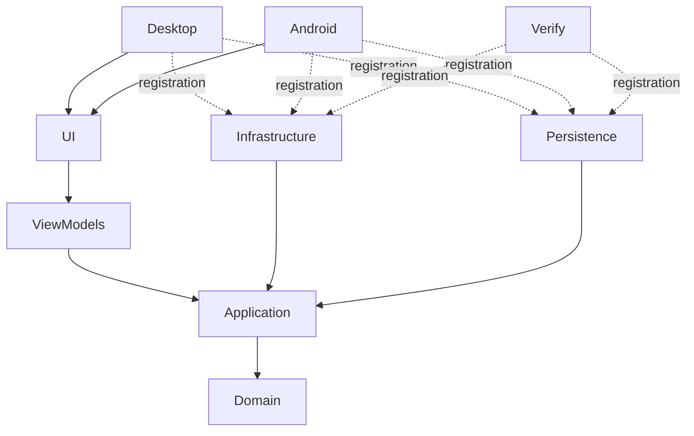

# Архитектура

Domain использует только BCL и содержит географические инварианты, правила проходимости, стоимостные профили, расчёт стоимости участков и сравнение альтернатив. Application определяет контракты геоданных, маршрутизации, настроек и сессии; управляет точками и ревизией ввода. Параметры выполнения поиска находятся в Application request options, не в Domain. Persistence отвечает за SQLite/R-tree, чтение исходных геометрий, настройки и проверку офлайн-пакетов. Infrastructure реализует NTS-операции, пространственные индексы, A* и генерацию сетки, вызывая предметные правила Domain. ViewModels содержат состояние и команды, включая контракт clipboard; прямой ссылки на UI-технологии нет. UI содержит XAML, карты и `AvaloniaClipboardService`.

Desktop, Android и Verify являются Composition Root. Они вызывают модульные `AddInfrastructure()`, `AddPersistence(dataDirectory, settingsPath)` и `AddPresentation(prepareData)`, затем регистрируют `IPlanningSession`. Проектов Bootstrap и Composition больше нет; Infrastructure и Persistence друг от друга не зависят.

`NavigationHost` реализует IScreen. Map/Settings — singleton ViewModels с IRoutableViewModel, Shell получает их через DI. RoutingState сохраняет не более двух записей; back работает, количество экранов и подписок не растёт от повторных переходов. View создаются зарегистрированными типизированными фабриками, без поиска по строкам и reflection.

`MapView` использует ReactiveUserControl и WhenActivated. Подписки, события адаптера и токен загрузки освобождаются при деактивации. `MapsuiMapAdapter` реализует IMapAdapter, сообщает географические координаты и принимает снимки состояния. Собственное состояние перетаскивания — только временный preview; фиксацию выполняет ViewModel через Application. При потере захвата preview сбрасывается. Точки во ViewModel — основной источник состояния. Рассчитанные значимые вершины образуют отдельный слой с отдельной нумерацией и двусторонним выбором со списком; коллинеарные узлы и дубли не показываются. Infrastructure сохраняет геометрические точки перехода через мост в метаданных маршрута, а ViewModels добавляют их только в презентационный список.

Поворот камеры остаётся в UI: Desktop вращает карту перетаскиванием правой кнопкой, Android — жестом двумя пальцами. Плавающая кнопка компаса показывает фактическое направление севера и сразу устанавливает 0°, сохраняя центр и масштаб; сброс детерминирован и не зависит от UI animation loop. `OfflineViewportLimiter` рассчитывает видимую мировую область с учётом угла; если соотношение экрана и пакета оставляет поля, пакет центрируется предсказуемо. Для пользовательских точек действует Application validator: Infrastructure проверяет исходные геометрии зданий, озёр, болот и рек и границы набора до фиксации в PlanningSession.

Ввод меняет ревизию сессии, отменяет вычисление и очищает результаты. Application сравнивает ревизию после await; ViewModel проверяет cancellation token перед публикацией. Алгоритм не блокирует UI. Запас кабеля фиксируется с настройками расчёта и не пересчитывается задним числом при переходе в настройки.

Карты читаются по текущей области просмотра; события viewport объединяются с задержкой 200 мс. Поздний ответ старого запроса не заменяет новый слой. Первый экран подгоняется под границы пакета после завершения адаптивной разметки и читает соответствующий уровень детализации. Ручное масштабирование не сбрасывается при изменении размеров. SQLite ограничивает выборку 50 000 объектов с понятным сообщением. Для пакетов schema_version=2 подготовлены три уровня детализации карты; расчёт использует исходную геометрию. Подготовка и проверка большой базы выполняются в фоне через StartupViewModel.

Обязательный стек зафиксирован централизованно: Avalonia 11.3.0, Avalonia.ReactiveUI 11.3.0, ReactiveUI 20.4.1, ReactiveUI.Fody 19.5.41, Fody 6.9.2. Это совместимая проверенная компиляцией комбинация из референсов, не выбор всех последних версий. `PropertyChanged` проверяется на собранном production ViewModel. NuGet lock-файлы фиксируют транзитивные зависимости.

Compiled bindings включены глобально; Views и DataTemplate имеют x:DataType. Единственное подавленное предупреждение — AVLN3001 для View с DI-конструкторами: runtime parameterless loader не используется, фабрики вызывают скомпилированный InitializeComponent. Отключения compiled bindings нет.

## Изученные референсы перед реализацией

- [AvaloniaRoutingExampleMenuAndSettings](https://github.com/Volodya1000/AvaloniaRoutingExampleMenuAndSettings), SHA `197a4763a46e3bc9a7dd69e33d8e2d780d209cf5`: IScreen, IRoutableViewModel, RoutingState, RoutedViewHost, выбранный раздел, Fody. Исправлены new зависимых VM и строковый locator.
- [AvaloniaRoutingExample](https://github.com/Volodya1000/AvaloniaRoutingExample), SHA `1487137f30f5c9b12da5d8752ce543c32a920c91`: navigate/back, сопоставление View, отдельная библиотека VM. Фабрики View регистрируются в UI-модуле представления.
- [AvaloniaUserControlTest](https://github.com/Volodya1000/AvaloniaUserControlTest), SHA `274b041925a1ef345ff96c5baab64a52296a4cfe`: ReactiveUserControl, ReactiveCommand, [Reactive], коллекции и компоненты. UI-события не выполняют прикладные операции непосредственно.
- [ReactiveUI PR 1503](https://github.com/reactiveui/ReactiveUI/pull/1503): историческое включение Fody в проект; не доказательство совместимости текущих пакетов, поэтому добавлен тест реального weaving.
