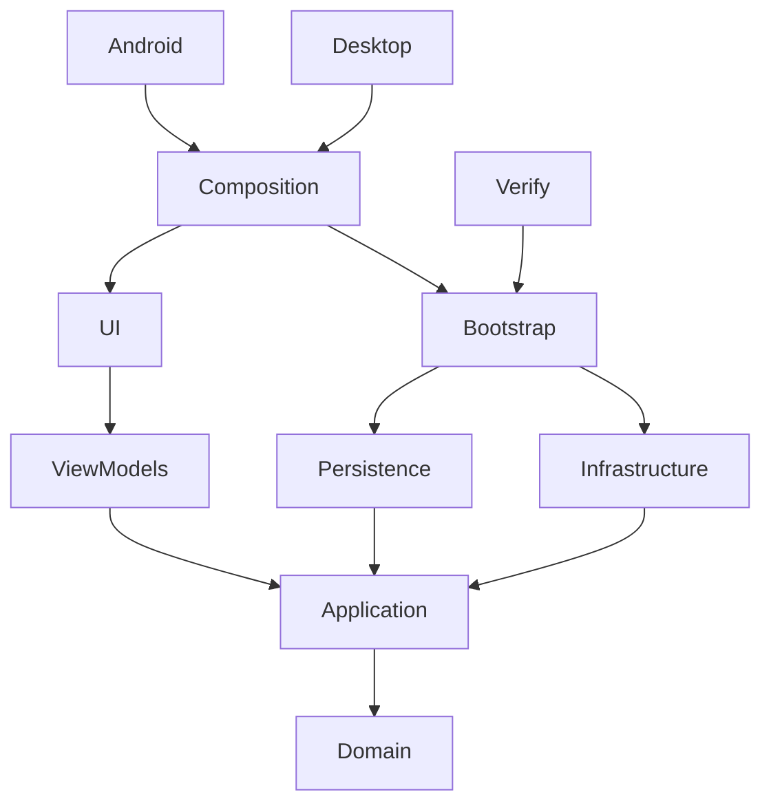

# Архитектура

Domain использует только BCL: проверенные координаты, геодезические длины, профили стоимости и результаты. Application определяет контракты геоданных, маршрутизации, настроек, clipboard и сессии; управляет точками и ревизией ввода. Persistence реализует контракты геоданных и настроек, SQLite/R-tree и JSON. Infrastructure реализует NTS и A*. ViewModels содержат ReactiveObject, Fody-свойства и команды; прямой ссылки на Infrastructure или Mapsui нет. UI отвечает за XAML, типизированные View, технологический ввод и отображение ошибок запуска. Bootstrap регистрирует только прикладные сервисы и используется консольным Verify без Avalonia. Composition дополняет эти регистрации ViewModels, Avalonia views, clipboard и адаптером карты для Desktop и Android.

`NavigationHost` реализует IScreen. Map/Settings — singleton ViewModels с IRoutableViewModel, Shell получает их через DI. RoutingState сохраняет не более двух записей; back работает, количество экранов и подписок не растёт от повторных переходов. View создаются зарегистрированными типизированными фабриками, без поиска по строкам и reflection.

`MapView` использует ReactiveUserControl и WhenActivated. Подписки, события адаптера и токен загрузки освобождаются при деактивации. `MapsuiMapAdapter` реализует IMapAdapter, сообщает географические координаты и принимает снимки состояния. Собственное состояние перетаскивания — только временный preview; фиксацию выполняет ViewModel через Application. При потере захвата preview сбрасывается. Точки во ViewModel — основной источник состояния.

Ввод меняет ревизию сессии, отменяет вычисление и очищает результаты. Application сравнивает ревизию после await; ViewModel проверяет cancellation token перед публикацией. Алгоритм не блокирует UI. Запас кабеля фиксируется с настройками расчёта и не пересчитывается задним числом при переходе в настройки.

Карты читаются по текущей области просмотра; события viewport объединяются с задержкой 200 мс. Поздний ответ старого запроса не заменяет новый слой. Первый экран подгоняется под границы пакета после завершения адаптивной разметки и читает соответствующий уровень детализации. Ручное масштабирование не сбрасывается при изменении размеров. SQLite ограничивает выборку 50 000 объектов с понятным сообщением. Для пакетов schema_version=2 подготовлены три уровня детализации карты; расчёт использует исходную геометрию. Подготовка и проверка большой базы выполняются в фоне через StartupViewModel.

Обязательный стек зафиксирован централизованно: Avalonia 11.3.0, Avalonia.ReactiveUI 11.3.0, ReactiveUI 20.4.1, ReactiveUI.Fody 19.5.41, Fody 6.9.2. Это совместимая проверенная компиляцией комбинация из референсов, не выбор всех последних версий. `PropertyChanged` проверяется на собранном production ViewModel. NuGet lock-файлы фиксируют транзитивные зависимости.

Compiled bindings включены глобально; Views и DataTemplate имеют x:DataType. Единственное подавленное предупреждение — AVLN3001 для View с DI-конструкторами: runtime parameterless loader не используется, фабрики вызывают скомпилированный InitializeComponent. Отключения compiled bindings нет.

## Изученные референсы перед реализацией

- [AvaloniaRoutingExampleMenuAndSettings](https://github.com/Volodya1000/AvaloniaRoutingExampleMenuAndSettings), SHA `197a4763a46e3bc9a7dd69e33d8e2d780d209cf5`: IScreen, IRoutableViewModel, RoutingState, RoutedViewHost, выбранный раздел, Fody. Исправлены new зависимых VM и строковый locator.
- [AvaloniaRoutingExample](https://github.com/Volodya1000/AvaloniaRoutingExample), SHA `1487137f30f5c9b12da5d8752ce543c32a920c91`: navigate/back, сопоставление View, отдельная библиотека VM. Фабрики View перенесены в Bootstrap.
- [AvaloniaUserControlTest](https://github.com/Volodya1000/AvaloniaUserControlTest), SHA `274b041925a1ef345ff96c5baab64a52296a4cfe`: ReactiveUserControl, ReactiveCommand, [Reactive], коллекции и компоненты. UI-события не выполняют прикладные операции непосредственно.
- [ReactiveUI PR 1503](https://github.com/reactiveui/ReactiveUI/pull/1503): историческое включение Fody в проект; не доказательство совместимости текущих пакетов, поэтому добавлен тест реального weaving.
