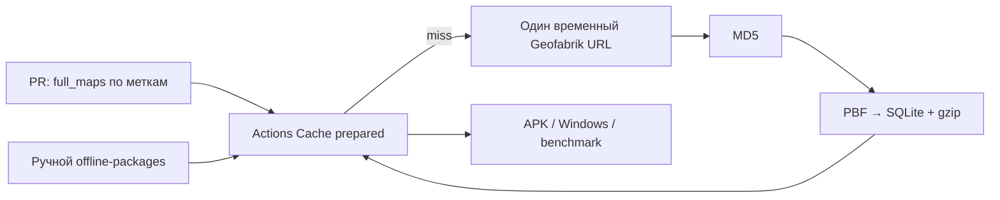
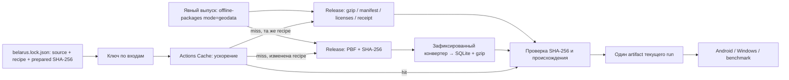

# Геоданные в CI: источник, хранение и восстановление

Версия страны задаётся одним файлом [`belarus.lock.json`](../tools/GeodataPreparation/belarus.lock.json).
Полные PBF и SQLite не входят в Git. Снимок Geofabrik и готовый пакет хранятся как
публичные GitHub Release assets этого репозитория. В приложении нет загрузки карт:
оно по-прежнему получает SQLite v2 и Android assets существующего формата.

## Почему падала сборка

Исследование выполнено 31 октября 2026 года:

- Коммит [`a178c79`](https://github.com/Volodya1000/maps/commit/a178c79bdad9992a94be47717413cd08905a503f)
  из [PR #2](https://github.com/Volodya1000/maps/pull/2) впервые добавил
  `belarus-261022.osm.pbf` и MD5 `a2327228173b7fe8e74e2097e3dae0d4`
  в `offline-packages.yml` 23 октября. Коммит
  [`9c74a44`](https://github.com/Volodya1000/maps/commit/9c74a44cc3d7aadcbe81ceb5118ce9b2414aacd5)
  из [PR #13](https://github.com/Volodya1000/maps/pull/13) перенёс механизм в PR APK.
- [Job 123390041104](https://github.com/Volodya1000/maps/actions/runs/40855705578/job/123390041104)
  29 октября: промах кеша, успешный curl этого URL, успешная конвертация с проверкой
  MD5. Манифест записал SHA-256
  `f3e13c679d63a8de8deb74c1fdaac84a1aa82c21f36dad99f426d196ba141e68`
  и timestamp `2026-10-22T20:21:33Z`. Это прямое подтверждение прежней доступности.
- [Job 124447900411](https://github.com/Volodya1000/maps/actions/runs/41170244278/job/124447900411)
  из PR #39 31 октября: тот же ключ `belarus-a232...-ee7695...`, промах кеша,
  HTTP 404. Независимый HEAD-запрос 31 октября также вернул 404.
- [Официальная техническая документация Geofabrik](https://download.geofabrik.de/technical.html)
  прямо говорит: «We delete these older files after a while». Она **не обещает
  определённое число дней хранения ежедневных PBF**. Указанные там 100 дней
  относятся к `.osc.gz` diff, а не к снимкам. [Статья Geofabrik об истории](https://blog.geofabrik.de/index.php/2024/11/13/historic-openstreetmap-data/)
  описывает доступные ежегодные снимки на 1 января и получение других дат из
  history; байты такого восстановления не обязаны совпадать с прежним PBF.
- [Страница Беларуси](https://download.geofabrik.de/europe/belarus.html) предлагает
  стабильное имя `belarus-latest.osm.pbf` и `.md5`, но содержимое latest меняется.
  В raw index есть датированные PBF и их MD5. Публичного SHA-256 для выбранного
  файла там не обнаружено. MD5 от Geofabrik служит дополнительной проверкой при
  приёме; доверенный SHA-256 фиксируется после загрузки по HTTPS и ревью.

Нельзя доказать конкретную операцию удаления, её время или внутреннюю причину
по доступным материалам. Наблюдаемая недоступность согласуется с опубликованной
политикой, но не доказывает конкретное событие очистки.

Авторское объяснение выбора **именно 22 октября** в доступных коммите и обсуждении
PR не найдено. Зафиксированные URL+MD5 технически закрепляли один набор данных;
`latest` с фиксированным MD5 впоследствии перестал бы проходить проверку.
Воспроизводимая подготовка также явно предусмотрена существующим
`rebuild_sample.py`. Не следует приписывать автору недокументированный мотив.

## Аудит прежней схемы

В `ci.yml` quality/tooling, desktop tests, data и основной Android job не требуют
полной Беларуси. Data rebuild использует включённый в Git Minsk `source.osm.gz`;
.NET unit tests создают маленькие SQLite, Android smoke использует Minsk. Полная
карта нужна country APK/установщику, проверке шести областных центров и выбранным
меткой измерениям маршрутов. Формат/классификацию конвертера можно проверить на
маленьком локальном PBF; полнота покрытия страны требует настоящего набора.

Были **два места сетевого получения полного PBF**: reusable PR workflow и ручной
offline-packages. Каждое скачивало его один раз на промах prepared cache, затем
повторяло всю конвертацию; сам PBF не сохранялся. Основной CI не скачивает полный
PBF. Инструменты `prepare.py`/`download_snapshot.py` отдельно поддерживают
подготовку малых наборов через официальный OSM API, но CI rebuild сети не требует.

Ключ prepared cache учитывал MD5 и пять Python-файлов. Он не учитывал lock-файл
зависимостей конвертера, Python, лицензии и NOTICE. При удалении кеша отсутствовал
постоянный источник для восстановления. MD5 проверялся до osmium, но это устаревший
некриптографический для защиты от подмены алгоритм; готовый кеш перед повторным
использованием не проверялся.

[GitHub Cache ограничивает доступ областью веток](https://docs.github.com/en/actions/using-workflows/caching-dependencies-to-speed-up-workflows#restrictions-for-accessing-a-cache):
кеш `refs/pull/N/merge` доступен повторным запускам этого PR, но не соседним PR.
31 октября API показывал одинаковые prepared keys у PR #32–36 (около 1,208 ГБ
каждый), но ни одного country cache на `main`. Поэтому даже неизменный ключ не
означал попадание нового PR. [Кеш может быть вытеснен или удалён](https://docs.github.com/en/actions/using-workflows/caching-dependencies-to-speed-up-workflows#usage-limits-and-eviction-policy),
и не является постоянным хранилищем.

Изменение setup-uv не входило в ключ карты. Оно создало обычное событие PR;
существующая политика `full_maps` включает полную карту по умолчанию.
В PR #39 кеш setup-uv успешно восстановился, а кеш карты — нет. Это разные кеши.

## Сравнение решений

| Вариант | Надёжность и воспроизводимость | Время / объём при холодном старте | Хранение и сопровождение | Безопасность / обновления |
| --- | --- | --- | --- | --- |
| A: фиксированный Geofabrik + Actions Cache | Не переживает исчезновение URL; SHA закрепляет байты, но не сохраняет их | PBF + вся конвертация | Минимум настройки; дорогое восстановление, невозможное после удаления файла | SHA-256 обязателен; дату надо менять вручную |
| B: постоянный PBF в Release + prepared cache | Исходник переживает очистку Geofabrik; воспроизводимые входы | PBF + вся конвертация после потери кеша | Один release, около 351 МБ исходника; просто | HTTPS + закреплённый SHA-256, обновление через PR |
| C: версионированный prepared package | Кеш вообще не нужен для восстановления; точные байты пакета закреплены | Готовый gzip около 1,2 ГБ, конвертации нет | Около 1,2 ГБ на версию; нужен явный выпуск после изменения конвертера | Закреплённые SHA-256 всех файлов; без исходника трудно пересобрать |
| Выбрано: C + постоянный исходник B | Переживает потерю кеша и исходного URL; сохраняет возможность новой конвертации | Готовый пакет; PBF только при изменении входов | GitHub Releases, без серверов/S3; примерно 1,6 ГБ на версию | SHA-256, фиксированные зависимости, явный выпуск и PR |

Release assets не имеют срока хранения Actions artifacts/cache; это не гарантия
вечной доступности GitHub. Хранилище и трафик подчинены условиям GitHub; денежная
стоимость здесь не измерялась. Лимит отдельного release asset — 2 GiB; текущие PBF
и gzip укладываются. Данные публикуются с ODbL и attribution. Нельзя удалять
используемые версии при обычной очистке кеша/CI artifacts.

## Новая схема

[`country_data.py`](../tools/GeodataPreparation/country_data.py) — общий механизм;
[composite action](../.github/actions/country-data/action.yml) восстанавливает
только точный ключ и проверяет пакет. Для получения/проверки готовых данных
используется только стандартная библиотека системного Python 3.10+; `setup-uv`
включается только при реальной конвертации. Путь готового пакета не создаёт и не
пытается сохранять пустой кеш Python-зависимостей. Неизменный опубликованный пакет не сохраняется
повторно в PR-scoped cache каждого PR: постоянная копия уже есть в Release.
Кеш сохраняется для изменённой recipe в PR и для запусков вне PR (например, ручного
installer workflow на `main`, чей кеш доступен PR). Нет `restore-keys`,
подстановки latest или допуска повреждённых файлов. Каждый источник PBF должен
дать **один и тот же SHA-256**: сначала постоянная копия, затем официальный
Geofabrik. Временный файл публикуется атомарно только после полной проверки.
Сетевые ошибки повторяются до трёх раз, 404 и неверные байты переключают источник.

Ключ включает версию и SHA-256 OSM, runtime Python/uv, код подготовки,
`pyproject.toml` и `uv.lock` конвертера, NOTICE и лицензии. Изменение общего
`uv.lock`, setup-uv action, C#, документации, маршрутизации или workflow не требует
новой конвертации. Изменение расположения идентичного зеркала также не меняет ключ.
Изменение геометрии, классификации, LOD, схемы SQLite или зависимостей конвертера
меняет ключ. Разбиение готового gzip на Android chunks выполняется после получения
пакета; изменение `split_android_map.py` не требует заново читать PBF.

Совпадение ключа с `prepared.key` означает: при промахе кеша загрузить закреплённый
пакет из Release. Другая recipe означает: в уже разрешённом тяжёлом job подготовить
новый пакет из постоянного PBF. Изменение recipe в PR не публикует ничего в Release:
PR работает с `contents: read`. После ревью новый пакет можно опубликовать вручную.
`package.json` фиксирует происхождение и хеши файлов; при совпадении с опубликованной
версией они дополнительно сверяются с хешами в Git. При подготовке gzip проверяется
полной распаковкой на SHA-256 SQLite из manifest, включая gzip CRC.

Geodata job всегда передаёт один проверенный artifact текущего запуска всем
потребителям. Они больше не пытаются независимо восстановить кеш: удаление кеша
между jobs не влияет на передачу. Actions artifact здесь служит транспортом внутри
run; постоянная копия находится в Releases. Внутренний PR artifact карты хранится
один день, чтобы не держать ещё одну многогигабайтную копию 90 дней. Это не меняет
срок хранения опубликованных APK. После истечения этого artifact перезапускайте
весь родительский workflow, чтобы он снова передал пакет из Release потребителям;
повторная конвертация неизменных входов не требуется. Artifact ручной сборки
установщиков сохраняет прежнюю политику хранения для существующей публикации.

## Быстрый PR и тяжёлые проверки

Политика **сохранена**: по умолчанию PR получает Minsk и Belarus APK;
`ci:skip-full-maps` исключает тяжёлую ветку; `ci:full-maps` и
`ci:routing-benchmark` имеют приоритет. Подробнее: [метки PR](pull-request-labels.md).
Документация или обновление setup-uv всё ещё проходят существующие обязательные
jobs и по прежней политике могут упаковывать Belarus APK, но **не преобразуют PBF**
при неизменных входах даже с пустым Actions Cache. Автоматически менять политику
«два APK по умолчанию» на opt-in этот PR не должен.

## Обновление снимка или конвертера

1. Создайте ветку; не меняйте `main` напрямую. Выберите датированный PBF на
   официальной странице Geofabrik, скачайте по HTTPS, проверьте опубликованный
   `.md5`, вычислите `sha256sum`. Не используйте `latest` как fallback старой версии.
2. В `belarus.lock.json` измените `source.version`, SHA-256 и официальный URL.
   Постоянный URL будет заменён издателем при публикации. При изменении только
   конвертера сохраните исходный SHA-256. Python/uv и зависимости обновляются явно.
3. Выполните `tools/check.py lint` и `tools/check.py data`: тесты используют локальные
   фикстуры, не скачивают Беларусь. Для локального полного rebuild:
   `python tools/GeodataPreparation/country_data.py prepare --output artifacts/country-new`.
4. Отправьте ветку и запустите **Full Belarus offline installers** вручную на этой
   ветке, выбрав `mode=geodata`. Режим `installers` остаётся обычной сборкой
   установщиков. Только явный издатель получает `contents: write`.
5. Издатель проверит полный gzip, запустит штатный Verify `--inspect` для страны и
   шести областных центров, опубликует PBF и prepared files в новой версии Release.
   Существующие assets не перезаписываются. Код публикации фиксирует SHA-256 каждого
   файла и recipe key; права на dispatch/push должны быть только у доверенных людей.
6. Скачайте artifact `geodata-publication`, возьмите оттуда `belarus.lock.json`,
   добавьте его в **тот же PR** и проверьте review: версия, URLs, SHA-256, отчёт
   областных центров, conversion_errors. Не считайте изменения карты незаметным
   обновлением зависимостей. Сохраните старые Releases для старых коммитов.

Если нужно только получить текущую карту локально:
`python tools/GeodataPreparation/country_data.py ensure --output artifacts/belarus`.
Используйте отдельный каталог для этого механизма; старый `install_belarus.py`
продолжает устанавливать ранее выпущенный пакет для разработки по своей инструкции.

## Восстановление и диагностика

- **Кеш удалён/вытеснен:** перезапустите job. Не меняйте lock: будет скачан тот же
  готовый Release package без конвертации. `key` печатает требуемую recipe.
- **Повреждённый кеш:** проверка падает с `Geodata error`, SHA-256 mismatch или
  incomplete package. Удалите только кеш с указанным ключом и повторите запуск.
  Для локальной копии удалите повреждённый каталог перед `ensure`.
- **Основной PBF URL недоступен:** будет использован официальный fallback только
  с тем же SHA-256. Если оба источника недоступны, ошибка перечисляет URL и причины;
  восстановите идентичный файл в Release. `source --output <file>` отдельно
  диагностирует получение PBF. Не подставляйте другой снимок под прежний checksum.
- **Готовый Release недоступен:** job падает с диагностикой; дорогой rebuild
  неизменного пакета не запускается скрытно. Восстановите файлы с теми же хешами
  или явно опубликуйте и закрепите новую версию.
- **SHA-256 не совпал:** не меняйте ожидаемый хеш ради зелёной сборки. Сверьте
  версию, источник, неполную загрузку и целостность Release; повреждённые bytes
  никогда не передаются в osmium или Android.
- **Изменён конвертер:** новый ключ закономерен. Локальные fixture tests остаются
  быстрыми; полная конвертация выполняется только в выбранной тяжёлой ветке.

Release могут удалить администраторы; SHA-256 обнаруживает подмену, но не лечит
недоступность. Native SQLite/GEOS и ОС могут влиять на layout повторно построенной
базы: точные байты опубликованной версии закреплены, а независимый rebuild требует
сравнения результатов и отдельного выпуска. Известные ошибки геометрии остаются
в manifest, а не скрываются этим механизмом. Windows/Android и эмулятор проверяются
существующими платформенными jobs, не заменяются тестом загрузчика.

## Измерения первоначального выпуска

[Выпуск 31 октября](https://github.com/Volodya1000/maps/actions/runs/41201086419)
успешно подготовил и проверил снимок `belarus-261030` с timestamp
`2026-10-30T21:24:51Z`. `conversion_errors` пуст; штатный Verify подтвердил обзор
страны и данные шести областных центров. [Манифест](evidence/belarus-ci-20261030-manifest.json),
[проверка областных центров](evidence/belarus-ci-20261030-check.json) и
[условия измерений](evidence/ci-geodata-recovery.json) сохранены в репозитории.

| Операция | Фактический результат |
| --- | --- |
| Приём PBF с официального Geofabrik локально | 351 288 844 байта; 25,156 с |
| От verified PBF до manifest конвертера, включая locked uv sync | 24 мин 18 с |
| Полная подготовка после verified PBF, включая проверку gzip/receipt | 24 мин 33 с |
| Готовый gzip | 1 211 600 958 байт |
| Полный prepared package с лицензиями и receipt | 1 211 683 375 байт |
| Получение в пустой локальный каталог из Release, включая SHA-256 | 56,672 с; конвертер не запускался |
| Повторная локальная проверка того же пакета | 2,445 с; без сети |

Все SHA-256 опубликованных assets также сверены с независимыми digest из GitHub
API. Это реальные наблюдения разных runners/сетей, а не гарантированное время CI:
время загрузки зависит от сети. Тёплое измерение проверяет локальный prepared
cache, не задержку сервиса Actions Cache. Старый успешный CI 29 октября тратил
около 59 с на 334 MiB PBF и 19 мин 18 с на конвертацию. Новый обычный PR получает
готовый пакет; вычисление карты остаётся только для изменения recipe/OSM.

Холодный payload готовой карты больше PBF примерно в 3,45 раза. При этом больше
нет записи отдельного prepared cache каждого неизменного PR. В прежнем холодном
PR были PBF download, cache upload, artifact upload и загрузка карты потребителем;
теперь это Release download, artifact upload и загрузка потребителем. Денежный
биллинг и суммарный сетевой overhead GitHub не измерялись.
