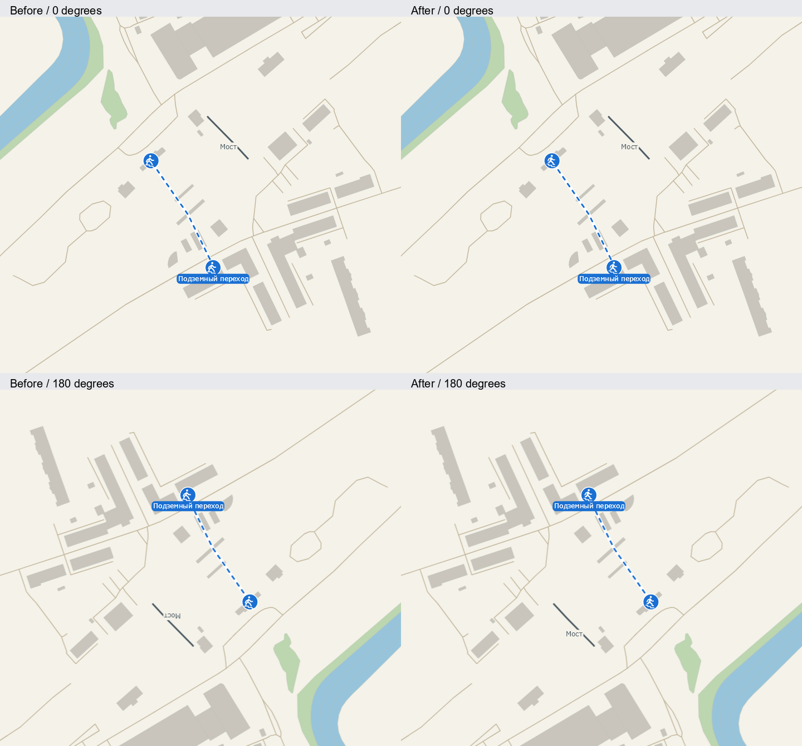
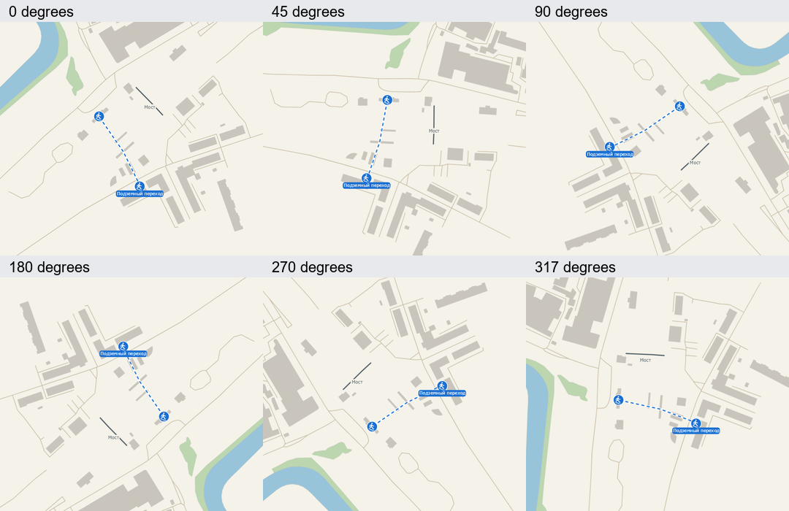
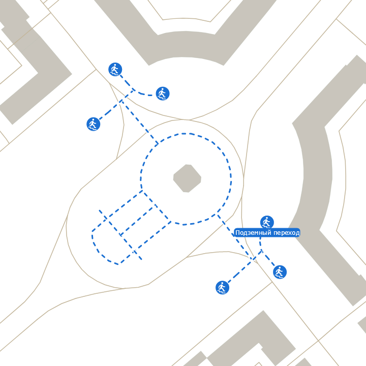

# PR #55: горизонтальные подписи и знак подземного перехода

19 ноября 2026 года, Windows. Визуальный baseline — `69c0e81`, завершающий
сохранённую работу после `0d8a70a`. Этот дополнительный визуальный коммит
не меняет Domain, Infrastructure, Persistence, топологию или маршрутизатор.

## Причина и общее решение

`MapsuiStyleFactory.ForTerrain` добавлял «Мост» к геометрии, которую
`GeodataFeatureProvider` передавал в `OfflineRasterLayer`. Надпись попадала
в готовый PNG тайла. При вращении Mapsui поворачивал весь тайл вместе с
текстом. При 180° текст оказывался перевёрнутым. Подземные знаки уже
использовали отдельный векторный provider.

Теперь оба типа использует общий путь:

1. `MapAnnotationFeatureProvider` получает данные для векторного слоя.
2. `PrepareAnnotations` создаёт точки привязки: середину линии моста и
   подтверждённые входы подземной сети. Исходные WKB не изменяются.
3. `MapsuiStyleFactory.MapLabel` задаёт текст, цвет, фон, экранное смещение
   и видимость. Одна реализация служит обоим типам.
4. `MapAnnotationLayer` выводит точечные подписи непосредственно через
   Mapsui/Skia. Мировые координаты преобразуются при каждом рендере;
   текст и смещение остаются в координатах экрана. Компенсации угла нет.

Растровый provider явно исключает все эти аннотации. Линии мостов и тоннелей
продолжают вращаться вместе с картой. В адаптере без repository используется
тот же слой, получающий подготовленный снимок напрямую.

Пороги собраны в `MapsuiStyleFactory`: «Мост» и значки входов — до 5,
«Подземный переход» — до 2, линии тоннелей — до 10 метров проекции на пиксель.
Существующие цвета и смещения 16/20 px сохранены.

Mapsui 4.1.9 не применяет `CollisionDetection` в своём
[Skia label renderer](https://github.com/Mapsui/Mapsui/blob/4.1.9/Mapsui.Rendering.Skia/SkiaStyles/LabelStyleRenderer.cs).
Поэтому общий слой проверяет коллизии при каждом рендере. Измерение текста
учитывает шрифт, фон, halo и экранное смещение. Описанные вокруг подписей
круги дают консервативную защиту от пересечений при любом угле; очень близкие
подписи могут скрываться раньше, чем при проверке прямоугольников.
Порядок устойчив, невидимый текст не занимает место, скрытие подписи не
удаляет значки входов. Изменение масштаба восстанавливает текст без запроса
данных. Флаг коллизий сохраняется в общей фабрике стилей.

Входные ID и network/node IDs устраняют дубли. Для частичных repository-fetch
подземная подпись сохраняет исходную точку привязки на время жизни карты,
даже если первой в следующем ответе пришла другая часть сети. Механизм
использует общий ключ аннотации и настройку сохранения привязки, без знания
типов объектов. Полная замена снимка очищает сохранённые привязки;
обычный мост всегда использует актуальную геометрию.

Компенсация растрового текста углом и две независимые реализации подписей
отклонены: первая не исправляет тайлы, вторая дублирует поведение.
Новых интерфейсов, пакетов и проектных зависимостей нет.

Архитектурная проверка: UI → Mapsui/NTS/Skia — PASS, отображение находится
в UI; изменения правил Domain или геометрии маршрутизации отсутствуют.
Официальный Avalonia Docs MCP был запрошен по headless/Skia rendering;
он вернул общие материалы по custom controls, без Mapsui API. Поведение
проверено по исходникам Mapsui 4.1.9 и фактическому рендеру.

## Новый SVG

Фигура нарисована заново замкнутыми формами: отдельная голова, связный корпус
с согнутыми ногами, две руки и отдельная лестница. Между ступенями и ногами
оставлены синие промежутки; нижняя ступень не сливается с обводкой круга.
Формат 40×40, синий круг, белый силуэт и прозрачный внешний фон сохранены.
Визуальный ориентир — [дорожный знак 6.6](https://commons.wikimedia.org/wiki/File:RU_road_sign_6.6.svg);
его SVG не копировался.

Осмотрены оригинальные Mapsui PNG [24](underpass-24.png),
[32](underpass-32.png), [40](underpass-40.png) px и
[лист размеров с увеличением](underpass-preview.png). Эти PNG также служат
эталонами силуэта в тестах, включая промежутки между фигурой и лестницей.

## Изображения настоящего рендера Mapsui

Использована исходная WKB-выборка `Fixtures/Underpasses/proletarskaya.json`,
включающая мост `way/25381163`, подземный переход, два подтверждённых входа,
дороги, здания и реку. Фон получен через настоящий
`OfflineRasterLayer.TileSource.GetTileAsync` / `RasterizingTileProvider`;
подписи — из рабочего векторного слоя. Это составные PNG Mapsui/Skia,
а не макеты и не скриншоты свойств объектов.

| Поворот | До | После |
| --- | --- | --- |
| 0° | [PNG](before-0.png) | [PNG](after-0.png) |
| 45° | [PNG](before-45.png) | [PNG](after-45.png) |
| 90° | [PNG](before-90.png) | [PNG](after-90.png) |
| 180° | [PNG](before-180.png) | [PNG](after-180.png) |
| 270° | [PNG](before-270.png) | [PNG](after-270.png) |
| 317° | [PNG](before-317.png) | [PNG](after-317.png) |







На листе поворотов обе подписи горизонтальны, знаки вертикальны, линии
занимают соответствующее карте географическое положение. На площади
Победы сохранены кольцо, внутренние участки и все шесть выходов.

## Регрессионные доказательства

| Требование | Тест и наблюдаемый результат |
| --- | --- |
| Оба текста при 0/45/90/180/270/317°, привязка к объектам | `BothAnnotationTypesRenderHorizontallyAndFollowTheirWorldAnchor`: одинаковые пиксели горизонтальных надписей, положение чернил относительно мировой точки, отсутствие этих текстов в raster source |
| Настоящий составной рендер | `RealOfflineTilesKeepBothLabelsReadableOnProletarskayaMap`: геометрия присутствует в растровом фоне, каждый текст добавляет видимые пиксели поверх него |
| Пороги до/на/после 2 и 5 | `CachedAnnotationsRespectBothVisibilityBoundariesInActualPixels` |
| Коллизии, отсутствие дублей, сохранение входов, восстановление после zoom | `CollisionSelectionRestoresTextOnZoomAndKeepsEveryEntrance`, все шесть углов |
| Вариант без repository, zoom без замены данных, новая геометрия с тем же ID | `DirectAdapterRetainsAnnotationsAcrossZoomWithoutReplacingSourceData` |
| Частичный/переставленный ответ без смены привязки сети | `ShuffledAndPartialNetworkFetchKeepsOneOriginalWorldAnchor` |
| Силуэт, прозрачность, вертикальность в трёх размерах | `SignMatchesReviewedSilhouetteAtSmallSizesAndAllRotations`: сравнение с осмотренными PNG при шести углах, допуск до 2% пикселей для платформенной растеризации |
| Подземная схема и число выходов | Существующие `RectangularNetworkRendersFourEntrancesWithoutDiagonalShortcuts`, `VictorySquareRendersSixConfirmedSurfaceEntrancesAndOneLabel`, `ConfirmedEntrancesRenderOnBothSidesOfSingleOrDividedRoad` |

До исправления новые 12 сценариев рендера падали: мост оставался в raster
source, в векторном слое отсутствовал второй тип подписей. Сохранённые PNG
подтверждают перевёрнутую надпись при 180°. После исправления целевые
проверки рендера/поведения проходят; результаты полного gate ниже.

Повторный Verify на прежнем подготовленном пакете сохранил маршрут площади
Победы: [192,8394101385862 м, одно подземное прохождение](victory-route.json).
Шесть дорожных событий с пятью различными дорогами учитываются отдельно
от одного непрерывного визита. Повторный контакт с той же дорогой в другой
точке сохраняется; совпадение RoadId не превращает два контакта в один.

При полном прогоне воспроизведён ранее описанный сбой Avalonia headless:
`PlatformNotSupportedException` в `Dispatcher.PushFrame` до тела теста
`BridgeTransitionAtCableBendIsVisibleAndSelectableWithItsListNumber`.
В тестах освобождался `Map`, но не сам `MapControl`: его таймер 16 мс
продолжал отправлять задания через Dispatcher между приложениями тестов.
Исправлены 44 явных создания контролов и 22 владения через MapView/DI
в 11 тестовых файлах. Проверки и сценарии сохранены, пакеты и настройки
изоляции не менялись. Целевые UI-тесты после очистки — 129/129 PASS.
Это устраняет доказанную утечку таймеров; уже поставленные в очередь
сторонние задачи не имеют публичного API ожидания, поэтому отсутствие
любого возможного сбоя Avalonia не утверждается.

## Проверки и воспроизведение

| Проверка | Результат |
| --- | --- |
| `uv run --locked pre-commit run --all-files` после освобождения контролов | PASS: все hooks |
| `tools/check.py lint` и форматирование whitespace/style/analyzers | PASS через тот же hook/CI dispatcher |
| Полный Release build и .NET-тесты | PASS, 674/674, без предупреждений |
| Coverage | PASS, line 95,7%, branch 87,4% при gate 85%/80% |
| win-x64 self-contained publish | PASS |
| `tools/check.py data` | PASS, 72/72 и воспроизводимая сборка sample |
| `tools/check.py terrain` | PASS, браузерный сценарий и CSS lint |
| `tools/check.py android` | PASS, Android Release, подпись APK, проверка отсутствия INTERNET и наличия офлайн-данных |
| `build-win7-x86.ps1` | PASS, net6.0 self-contained win-x86; PE machine `0x14c`, офлайн-база присутствует |
| `uv run --locked pre-commit run --all-files --hook-stage pre-push` | PASS, Android Release/permissions |
| Повторный Verify и GEOS-аудит | PASS, 192,839 м, один визит, шесть контактов с пятью дорогами |
| Исходные PNG и новые PNG после финальных изменений | Совпадение SHA-256 для всех шести ракурсов и трёх размеров знака |

Физический Android и запуск на самой Windows 7 — NOT VERIFIED; результат
сборки не выдаётся за проверку на устройстве. Статус CI для отправленного
коммита доступен в Checks PR; окончательный результат также публикуется
в комментарии к PR. Merge не выполняется.

```powershell
$env:PYTHONUTF8='1'
$env:ANDROID_HOME='C:/Program Files (x86)/Android/android-sdk'
$env:JAVA_HOME='C:/Program Files (x86)/Android/openjdk/jdk-17.0.14'
$env:UNDERPASS_EVIDENCE_DIR=(Join-Path $PWD 'artifacts/pr55-map-after')
dotnet test tests/CableRoutePlanner.Tests -c Release --no-restore --filter 'FullyQualifiedName~MapAnnotation|FullyQualifiedName~UnderpassRenderingTests|FullyQualifiedName~BridgeRenderingTests'
uv run --locked pre-commit run --all-files
uv run --locked pre-commit run --all-files --hook-stage pre-push
./tools/Windows7Compatibility/build-win7-x86.ps1 -OutputDirectory artifacts/pr55-map-polish-win7
dotnet tools/CableRoutePlanner.Verify/bin/Release/net8.0/CableRoutePlanner.Verify.dll --crossing artifacts/pr55-evidence/after docs/evidence/pr55-network-fix/victory.json artifacts/pr55-map-after/victory-route.json
```

Для снимков «до» используйте baseline `69c0e81` и новые render-тесты без
изменений production: они сохраняют PNG перед ожидаемыми ошибками assertions.
Актуальный статус CI доступен во вкладке [Checks PR #55](https://github.com/Volodya1000/maps/pull/55/checks).
