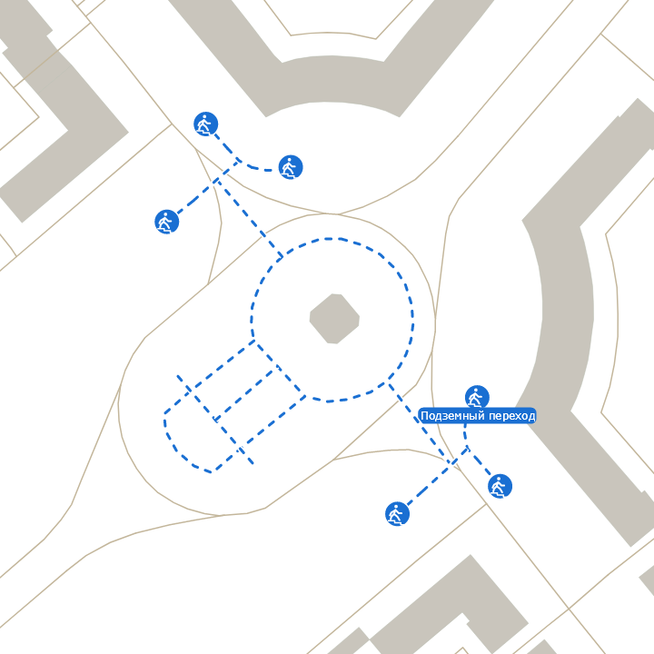

# PR #55: связные подземные сети, проходы и выходы

Финальная полировка подписей и пиктограммы с новыми снимками и проверками:
[дополнительный технический отчёт](../pr55-map-polish/report.md).

Проверка 19 ноября 2026 года, Windows. Базовый HEAD:
`7fbad6bf084455d7e056b83e627bdbdaed99c10e`.
В исходном Verify заменена только эквивалентная сортировка Order → OrderBy
для совместимости с .NET 6; поведение базового поиска не менялось.

## Изменение модели

Подготовка сохраняет исходные node IDs и компоненту связности в необязательной
таблице `underpass_topology` SQLite v3. Компоненты объединяются по общему OSM
узлу на одном layer, без поиска по расстоянию. В компоненте с подтверждённым
дорожным пересечением сохраняются и внутренние участки без собственного
пересечения дороги. Старые SQLite v1/v2/v3 без новой таблицы читаются прежним
консервативным способом. Для восстановления отсутствующих внутренних линий
нужен заново подготовленный офлайн-пакет: обновление одного приложения не
восстановит информацию, отсутствующую в старой SQLite.

Порталы сохраняют исходные вершины. Внутренние соединения графа создаются по
одинаковым network/node IDs и одинаковым координатам; наружные подключения —
только в подтверждённых выходах. Обычные рёбра сетки, прямые соединения и
наружные коннекторы не могут использовать новые сети для пересечения дороги:
это разрешено только рёбрам подземного графа. Сокращение маршрута сохраняет вершины сети.
Проверка дорожного контакта может использовать продолжение коридора через стык
ways одной компоненты; конкретная дорога всё равно требует исходной связи, а
сам контакт должен лежать на соответствующем way. Здания, вода и прочие
запрещённые препятствия проверяются для каждого полного сегмента.
Если стык ways лежит на оси дороги, подготовка проверяет двухрёберный путь
через общий OSM node ID на одном layer. Это сохраняет Т-образные переходы,
даже когда отдельные ways только касаются дороги своими концами. Совпадение
координат без общего node ID не даёт разрешения. Повтор одного дорожного
контакта в общей вершине удаляется по расстоянию вдоль маршрута с допуском
1 мм; повторное пересечение после выхода и возврата сохраняется.

`RoadCrossingEvent` описывает контакт с дорогой, `UnderpassPassage` — непрерывный
визит в сооружение. Интервалы измеряются вдоль маршрута, поэтому выход и
повторный вход дают два визита даже при повторении тех же координат.
Близкие разные компоненты не объединяются. Число дорожных контактов сохранено
отдельно; повторные контакты в той же точке также не теряются.

Domain остаётся BCL-only; новые данные связности находятся в Application,
NTS/граф — в Infrastructure, чтение SQLite — в Persistence, отображение — в UI.
Новые проектные зависимости и пакеты не добавлялись.

## Площадь Победы: реальные данные и результат

PBF SHA-256:
`4463a38a3b68819c46fd9f89fc286a8f98afec480aff48d5240222254e45ec01`.
Исходная SQLite v3 SHA-256:
`f584e0c9963692b31b0f2b6322dc810641729bbabcc410626faf8ea70b703493`.
Оригинальные препятствия и дороги выборки не упрощались и не удалялись.
Подземные данные повторно извлечены из PBF текущим классификатором.
Геометрическое сопоставление допускает несколько отдельных внутренних
точечных контактов одной замкнутой линии с дорогой. Общие линейные участки
и контакты только на концах линий по-прежнему не разрешают переход.

Компонента содержит 16 ways: `25463811`, `39537165`, `39537168`, `39537169`,
`39537170`, `39538562`, `39538563`, `39576458`, `39576459`, `39576460`,
`39576461`, `39576462`, `39576463`, `71756658`, `151013720`, `636039205`.
Кольцо — `way/25463811`. В [исходной топологии](victory-osm.json) сохранены
все теги, координаты и node IDs; соединения определены последовательными
парами узлов каждого way, включая замыкание кольца и ответвления.

Из восьми терминальных узлов шесть соединены с наземными пешеходными ways:

| OSM node | Широта | Долгота |
| --- | --- | --- |
| 473698193 | 53.9089564 | 27.5742584 |
| 473698206 | 53.9081054 | 27.5753984 |
| 473698197 | 53.9091155 | 27.5748707 |
| 473698211 | 53.9081863 | 27.5759061 |
| 473698196 | 53.9092412 | 27.5744514 |
| 473698209 | 53.9084447 | 27.5757929 |

Все шесть теперь передаются карте и графу. Узлы `473722182` и `473722186`
имеют подземные продолжения, но не подтверждённый выход на поверхность:
наружными порталами и значками они не становятся.

Сценарий содержит только две пользовательские точки — первую и четвёртую
строки таблицы. Ячейка 25 м, MaxNodes 100000, три стандартных профиля.

| Запуск | Результат |
| --- | --- |
| До, максимальная длина 1000000 м | Обход 656,15 м; кольцо не используется |
| После, те же параметры | 192,84 м по подтверждённой сети, одно прохождение, шесть дорожных контактов с пятью различными дорогами |
| До, максимум 300 м | `no_route`, `RouteLengthLimitExceeded` во всех профилях |
| После, максимум 300 м | 192,84 м, одно прохождение |
| После, underpasses=false, максимум 300 м | `NoRouteInSearchArea` во всех профилях |

Это восстановление функционального маршрута через комплекс, а не только
визуализация. При этом исходный NoRoute на устройстве без заданного максимума
длины не воспроизведён: базовый HEAD нашёл длинный обход. Не следует заменять
это наблюдение утверждением, что до исправления вообще не существовало пути.

Независимый [GEOS-аудит](audit.json) проверяет исходные WKB, дорожные связи и
запрещённые препятствия. Для итогового маршрута дополнительно доказано, что
вся линия находится в метровом коридоре реальной сети. Все контакты разрешены
подтверждённой компонентой; новых диагоналей между входами нет.

## Карта и пиктограмма

В подробном масштабе показываются полные исходные участки и знаки только у
узлов с подтверждённой связью с поверхностью. Одна подпись на компоненту,
collision detection и `RotateWithMap=false` сохранены. Для старых пакетов без
топологии новые выходы не угадываются по геометрии.



[Одна дорога](single-road.png), [две проезжие части](divided-road.png),
[прямоугольная сеть с четырьмя входами](four-entrance-network.png).

SVG исправлен вручную, внешний фон прозрачен. Реальные PNG, отрисованные
производственным Mapsui/Skia renderer: [24 px](underpass-24.png),
[32 px](underpass-32.png), [40 px](underpass-40.png). Изображения просмотрены.
Пользовательские скриншоты карты получены; отдельное исходное изображение
дорожного знака не предоставлено, точное совпадение с ним не подтверждается. Это рендеры карты,
а не снимки с физического Android-устройства.

## Пешеходный мост

Найден `way/25381163`, кандидат SQLite `59328`: `bridge=yes`,
`highway=footway`, `layer=1`, `surface=asphalt`. Геометрия:
`27.585844,53.8913863 → 27.5858614,53.8913736 → 27.5863783,53.8910639 → 27.5866182,53.8909108`.
Проблема относится к отображению без построения маршрута. Кандидат существует
и попадает в выборку подробной карты, но прежняя линия шириной около одного
пикселя и близкого к дорогам коричневого цвета плохо различима. На подробных
масштабах мост теперь имеет контрастную серо-синюю линию 3 px со светлой
обводкой 6 px и подпись «Мост» с проверкой столкновений. Изменены только стили отображения; разрешения маршрутизатора
и модель надземных переходов не расширялись.

Рендер-тест `ProletarskayaFootbridgeIsReadableWithoutBuildingARoute` падал на
прежнем стиле при 1 и 7 м/пиксель и проходит после исправления. Проверяется
геометрия реального `way/25381163`, отдельно от линий рассчитанного маршрута.
Снимки: [прежний стиль, 7 м/px](bridge-before-7.png),
[исправленный, 7 м/px](bridge-7.png), [на карте, 1 м/px](bridge-map-1.png).

Дополнительный Verify для ранее указанных координат сохранён как регрессионная
диагностика: базовый HEAD на полной исходной SQLite строит 136,94 м
([результат](bridge-full-before.json)); пользователь не сообщал NoRoute в
уточнённом сценарии и маршрут на устройстве не строил.

Проверены значения по умолчанию: ячейка 25 м, MaxNodes 100000, запас 10%,
максимальная длина 1000000 м. `JsonSettingsStore.Load()` автоматически включает
газовые и подземные переходы; отдельного переключателя видимости мостов нет.
Начальный масштаб адаптера — 7 м/пиксель. Тесты не требуют изменения настроек.
Железнодорожные пути не входят в существующие отображаемые типы подложки;
новый слой железных дорог в эту доработку не добавлен.

## Регрессии и проверки

Полный проход PBF: 1293 исходных подземных ways; [все семь](classification.json)
ранее исключённых ложных кандидатов по-прежнему исключены.
`way/24422904`: true — 87,99 м; false — `NoRouteInSearchArea`.
На заново подготовленной выборке PBF тот же сценарий даёт 54,23 м,
два дорожных контакта и одно прохождение; GEOS-аудит — valid, false снова
даёт `NoRouteInSearchArea`. [Результат новой подготовки](way24422904-prepared-true.json).
Старые настройки, GPS, газовые переходы и мостовые правила не менялись;
пользовательское предупреждение об инженерной проверке не возвращено.

| Requirement | Evidence |
| --- | --- |
| Два дорожных контакта и повторный вход | `ContinuousUnderpassCountsOnceAcrossTwoRoadsAndCountsReentry` |
| Разные сооружения не объединяются по близости | `SharedOsmNodeUnitesPassageButNearbyUnconnectedWaysRemainSeparate` |
| Связный стык и отрицательная пара | `OnlyConfirmedNetworkContinuationCoversRoadReviewWindow` |
| Т-образный стык на оси дороги | `SharedUnderpassJunctionOnRoadAxisConnectsThreeConfirmedBranches`, `test_shared_source_junction_on_road_axis_proves_crossing_without_proximity_join` |
| Нет входа у произвольного дорожного контакта | `NetworkWithoutConfirmedSurfaceEntrancesCannotBeEnteredAtRoadContact` (до защиты тест падал, после проходит) |
| Четыре входа, кольцо, препятствие | `FourEntranceRingPreservesConnectedTunnelAndAvoidsCentralBuilding` |
| Реальная площадь Победы | `VictorySquareRealOsmNetworkConnectsOppositeEntrancesInOnePassage` |
| Два значка, одна/две дороги | `ConfirmedEntrancesRenderOnBothSidesOfSingleOrDividedRoad` |
| Шесть подтверждённых выходов | `VictorySquareRendersSixConfirmedSurfaceEntrancesAndOneLabel` |
| Четырёхвходовая схема | `RectangularNetworkRendersFourEntrancesWithoutDiagonalShortcuts` |
| Размеры SVG, прозрачность и вертикальность | `SignMatchesReviewedSilhouetteAtSmallSizesAndAllRotations` |
| Мост виден без расчёта маршрута | `ProletarskayaFootbridgeIsReadableWithoutBuildingARoute` |
| Новые и старые SQLite | `OptionalTopologyRoundTripsForRoutingAndDetailMap`, `VersionedPackagesLoadUnderpassLinksOnlyFromNewSchema` |
| Подготовка сохраняет внутренние ways | `test_network_keeps_internal_ways_and_only_source_confirmed_surface_entrances` |
| Замкнутая сеть пересекает одну дорогу дважды | `test_closed_network_can_cross_the_same_road_twice` |

Локальные gates: `lint` — PASS; `data` — 72/72, sample rebuild PASS;
полный повторный запуск .NET — 648/648. Предыдущий полный desktop gate:
line 95,7%, branch 87,4%, win-x64 publish PASS. Финальный pre-commit
повторяет gate после дополнения Т-образных стыков.
Windows 7 x86 net6.0 publish — PASS, четыре CS1061 устранены.
Android Release/permissions — PASS; финальный pre-push повторяет Android gate.
Результаты окончательных CI jobs публикуются в PR отдельным комментарием.
Работа на физическом Android и запуск под самой Windows 7 — NOT VERIFIED.
В существующем headless-тесте выбора вершины устранено попадание клика до
готовности hit-test сцены окна: тест ожидает реальную доступность цели ввода,
сохраняя проверку выбранного номера. Фиксированные задержки не добавлялись.
В одном последующем полном запуске возникли два нестабильных сбоя:
`BridgeTransitionAtCableBendIsVisibleAndSelectableWithItsListNumber`
(`PlatformNotSupportedException` в headless Dispatcher.PushFrame) и
`ReorderingDuringCalculationCancelsAndBuildsLatestOrder` (HasRoute=false).
Отдельный запуск обеих групп (46/46) и повтор полного набора (648/648)
прошли без изменений кода. Эти сбои не считаются доказанно устранёнными;
проверки не исключались и утверждения не ослаблялись.

## Воспроизведение

Из корня репозитория, с закреплёнными файлами в указанных выше путях artifacts:

```powershell
$env:OSMIUM_POOL_THREADS = '1'
uv run --project tools/GeodataPreparation --locked python docs/evidence/pr55-network-fix/extract_networks.py
uv run --project tools/GeodataPreparation --locked python docs/evidence/pr55-network-fix/extract_surface.py
uv run --project tools/GeodataPreparation --locked python docs/evidence/pr55-network-fix/prepare_evidence.py
```

Скрипты проверяют SHA источников. `before` и `after` содержат одинаковый набор
оригинальных препятствий/дорог в окне `27.565,53.885–27.60,53.915`;
отличаются только подготовкой подземных сетей. Полные карты не коммитятся.

Для базового HEAD соберите Verify в отдельном checkout; скопируйте его каталог
вывода в `artifacts/pr55-before-verify`. Затем для каждого сценария выполните:

```powershell
dotnet artifacts/pr55-before-verify/CableRoutePlanner.Verify.dll --crossing artifacts/pr55-evidence/before docs/evidence/pr55-network-fix/victory.json artifacts/pr55-evidence/victory-before.json
dotnet tools/CableRoutePlanner.Verify/bin/Release/net8.0/CableRoutePlanner.Verify.dll --crossing artifacts/pr55-evidence/after docs/evidence/pr55-network-fix/victory.json artifacts/pr55-evidence/victory-after.json
```

Аналогично запустите приложенные `victory-300-true.json`, `victory-300-false.json`
и `bridge.json`, сохраняя имена результатов из `audit_results.py`.
Скопируйте файлы сценариев в `artifacts/pr55-evidence` и запустите
`uv run --project tools/GeodataPreparation --locked python docs/evidence/pr55-network-fix/audit_results.py`.
Для новых PNG задайте `UNDERPASS_EVIDENCE_DIR` и выполните тесты
`FullyQualifiedName~UnderpassRenderingTests`.
