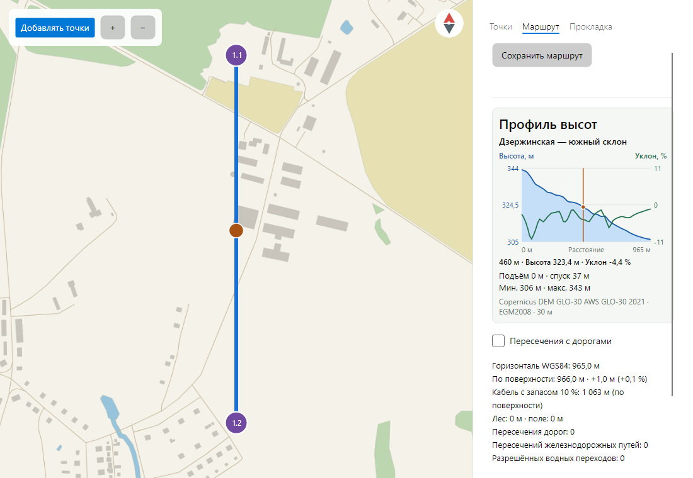
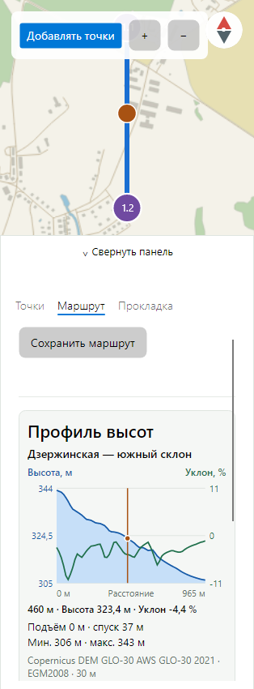

# Контрольный профиль горы Дзержинской

Источник DEM: [Copernicus GLO-30, AWS release 2021](https://copernicus-dem-30m.s3.amazonaws.com/Copernicus_DSM_COG_10_N53_00_E027_00_DEM/Copernicus_DSM_COG_10_N53_00_E027_00_DEM.tif).
SHA-256 исходника: 2e115431901b692ae14fc0ff78a7bfc92fcce46c4dfcdb7467fffa62f31e2aa5.
Нативный растр 2400×3600, EPSG:4326, EGM2008. Данные — DSM.

Линия опыта: [OSM node 1372197268](https://www.openstreetmap.org/node/1372197268), версия 23, (53.8486702, 27.0655127) → (53.8400000, 27.0655127). Это линия для проверки высот, не утверждённая кабельная трасса и не разрешение прохода через объекты. Справочная высота вершины 345 м не используется как точное ожидаемое значение пикселя.

Независимый расчёт использует GeographicLib Python 2.1 WGS84 Inverse для горизонтальных участков, Rasterio 1.4.3 для чтения родных пикселей и отдельную bilinear-формулу double precision. Производственный C# интегрирует WGS84 line element и читает подготовленные SQLite-блоки; тест сравнивает расстояния, высоты каждой выборки, набор/спуск и запас.

| Величина | Максимальный шаг 15 м |
|---|---:|
| Горизонтальная длина | 965,011466 м |
| Длина по DSM | 966,022418 м |
| Добавка рельефа | 1,010952 м (0,104761%) |
| Подъём | 0,203545 м |
| Спуск | 37,133333 м |
| Длина с запасом 10% | 1062,624660 м |

При шаге 7,5 м добавка составляет 1,033054 м: изменение интегрирования около 0,0221 м. Эти знаки нужны для воспроизводимости теста и не означают сантиметровую точность DEM или реального кабеля. Например, растительность и неизвестная геометрия прокладки могут влиять сильнее.

Полный TIFF хранится только в artifacts/dem. В Git включён ограниченный 78-КБ производный SQLite-fixture около вершины и JSON числового эталона в tests/CableRoutePlanner.Tests/Fixtures/Elevation. Native crop: 27.04,53.83,27.09,53.86. Обязательные уведомления находятся в NOTICE.txt рядом с fixture и стандартным sample.

Воспроизведение (предварительно скачайте исходник по указанному URL):

~~~powershell
uv run --locked --project tools/GeodataPreparation python tools/GeodataPreparation/prepare_elevation.py --dem artifacts/dem/copernicus-N53E027.tif --output artifacts/dem/elevation.sqlite --source-version "AWS GLO-30 2021" --bounds 27.04 53.83 27.09 53.86
uv run --locked --project tools/GeodataPreparation --with geographiclib==2.1 python docs/evidence/route-elevation/create_reference.py artifacts/dem/copernicus-N53E027.tif
dotnet test CableRoutePlanner.Desktop.slnf -c Release --filter FullyQualifiedName~RealElevationReferenceTests
~~~

Подготовка эталона нужна при осознанном обновлении данных; обычный тест работает без сети и Python. Он не перегенерирует ожидаемые значения.

## Отрисовка интерфейса

Проверены настоящие production MapView/Styles/Mapsui с Avalonia Headless и Skia: [1100×760](desktop.png), [314×850](narrow.png). Использованы контрольная линия этого опыта и реальная OSM-подложка; это проверка представления, а не подтверждение проходимости линии. Подложка загрузилась (20/4 кешированных тайлов), числовой курсор и оранжевая точка связаны с теми же выборками. Развёрнутая нижняя панель может закрывать часть карты: для осмотра закрытой точки панель можно свернуть. На физическом Android жесты не проверялись.

Самостоятельный поиск коридора от самой OSM-вершины к указанному южному концу также проверен на имеющемся полном OSM-пакете: сетки 10 и 15 м вернули NoRouteInSearchArea для всех трёх профилей, без таймаута или изменения лимита узлов. [Структурированная диагностика](planning-diagnostics.json). Поэтому приведённые числа относятся к измеряемой контрольной линии, а не к найденной пригодной трассе. Существующий A* этим PR не изменяется. Полный производственный путь с DEM дополнительно успешно проверен на существующем реальном контрольном маршруте Минска (53.9409,27.4977 → 53.9411157,27.49791875).

Подложка снимков: © OpenStreetMap contributors, [ODbL 1.0](https://www.openstreetmap.org/copyright). Профиль использует Copernicus WorldDEM-30 с уведомлениями в комплектном NOTICE.txt.

[Проверка требований и платформ](validation.md).
