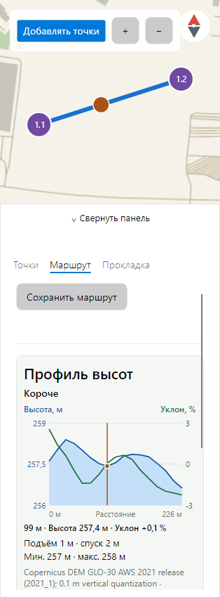

# Высоты всей Беларуси

Маршрут с телефона: (53.917148, 27.430907) → (53.917765, 27.434188). Он находился за пределами прежнего демонстрационного DEM; полная APK также собиралась без этого DEM. Полная поставка теперь включает каталог высот страны автоматически.

Проверен настоящий PlanningSession с полной OSM-базой и новым TiledElevationProvider. Найден вариант «Короче», профиль полный. Горизонталь WGS84: 226,253579 м; поверхность: 226,286836 м; подъём: 1,213900 м; спуск: 2,191234 м. Небольшая добавка длины на этом пологом маршруте составляет около 0,0333 м; экран округляет метры до одного десятичного знака. [Структурированный результат](country-user-route.json).

[Снимок Desktop](country-user-desktop.png). Это настоящие MapView/Mapsui/Skia с геометрией найденного маршрута, а не макет. Проверка физического телефона здесь не выполнялась.

Полный пакет: 60 GeoTIFF, 840 областей владения тайлами, 612 429 824 байта SQLite. Все 410 620 932 проверенных отсчёта внутри покрытия конечны; NoData — 0. Проверены четыре крайние точки прямоугольника и точные широтные стыки 54°, 55°, 56°. [Машиночитаемый аудит](country-report.json) содержит исходные пиксели, независимую интерполяцию, размеры, контрольные точки и ошибку округления.

Исходные высоты концов: 257,622894 / 256,665840 м; после округления country-пакета и интерполяции: 257,607843 / 256,630509 м. Различие меньше 0,05 м в этих точках. Общее максимальное измеренное различие отдельных пикселей с учётом float32 — 0,0500031 м; это характеристика кодирования, а не точность DSM. Родной шаг около 30 м и датум EGM2008 сохранены.

Проверки: CountryCatalogTakesPrecedenceOverLegacyDemAndPreservesPointOrderAcrossPaddedSeams; CompressedCountryShardsProduceIdenticalNativeSeamHeightsToLegacyRawBlocks; CorruptLaterShardLeavesPreviousCountryCompletelyReadableAndCleansStaging; test_ownership_covers_country_bounds_without_interior_overlap; test_integer_latitude_band_seam_keeps_both_native_rows; test_country_elevation_catalog_and_shards_survive_packaging; test_actual_archive_bytes_and_complete_coverage_are_required. Проверка поставки: tools/check_apk_elevation.py <Belarus.apk> --country.

Данные: Copernicus DEM GLO-30 AWS 2021, [закреплённые источники](../../../tools/GeodataPreparation/belarus-elevation.lock.json). Подложка: © OpenStreetMap contributors, ODbL 1.0. Уведомления Copernicus входят в elevation/NOTICE.txt APK.
