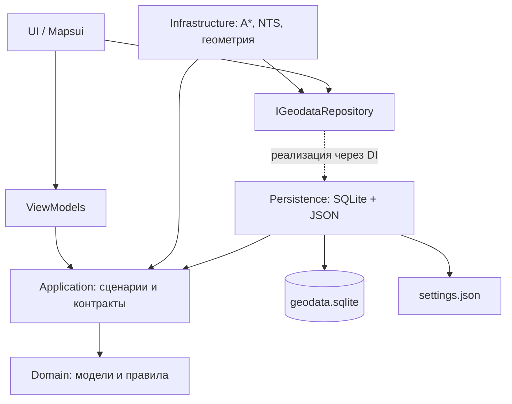

# Persistence: офлайн-геоданные SQLite, R-tree и настройки

> Для разработчика, который впервые открывает `CableRoutePlanner.Persistence`. Здесь описано текущее поведение кода, а не предполагаемая архитектура.

## Коротко: зачем существует этот слой

`Persistence` — слой доступа к постоянным данным. В проекте он выполняет **две разные задачи**:

1. Читает заранее подготовленную **офлайн-карту** из `geodata.sqlite` с пространственными R-tree индексами и проверяет сопутствующий `manifest.json`.
2. Загружает и сохраняет **настройки расчёта** в отдельный `settings.json`.

`Persistence` **не рисует карту**, **не ищет маршрут** и **не хранит рассчитанные маршруты**. В частности, пользовательские точки живут в `PlanningSession` в памяти, а найденные альтернативы — в состоянии приложения. После закрытия программы они не восстанавливаются из SQLite.

Большая карта хранится в SQLite потому, что загружать геометрии всей Беларуси в оперативную память при каждом запуске невозможно. Вместо этого приложение выбирает только объекты внутри нужной области. R-tree ускоряет выборку по координатам; отдельные уровни детализации уменьшают объём геометрии для отрисовки.

### Границы ответственности и зависимости



Это **логические зависимости**, а не цепочка вызовов одного алгоритма: `Infrastructure` и `Persistence` не ссылаются друг на друга. Оба используют контракты `Application`. Точки входа Desktop, Android и Verify собирают всё через DI.

В `Application/Contracts.cs` находятся `IGeodataRepository` (запрос геоданных, сведения о пакете) и `ISettingsStore` (чтение/запись настроек). `PersistenceServiceCollectionExtensions.AddPersistence(dataDirectory, settingsPath)` регистрирует:

| Интерфейс из Application | Реализация в Persistence | Источник |
| --- | --- | --- |
| `IGeodataRepository` | `SqliteGeodataRepository` | `manifest.json` + `geodata.sqlite` |
| `ISettingsStore` | `JsonSettingsStore` | `settings.json` |

Благодаря этому `GridRoutePlanner` и код отображения запрашивают данные через `IGeodataRepository` и не содержат SQL. Замена способа хранения не должна менять доменные правила и A* при сохранении контракта.

## Откуда появляется база и где она лежит

```text
OpenStreetMap / Geofabrik (belarus.osm.pbf)
    -> tools/GeodataPreparation/prepare_country.py (Python + osmium + Shapely)
    -> классификация OSM-тегов и подготовка WKB
    -> geodata.sqlite (геометрии, индексы, упрощённые варианты)
    -> manifest.json (версия, границы, источник, SHA-256 базы)
    -> пакет Desktop/Android -> чтение C# через SqliteGeodataRepository
```

Для небольшого района используется `tools/GeodataPreparation/prepare.py` и тестовый пакет `samples/real-geodata-fixtures/minsk/`. Импортеры выполняются **при сборке данных**, не в работающем C# приложении: готовым APK и Desktop не требуются Python, сеть или установленный отдельно SQLite-сервер.

Для полной Беларуси пример подготовки (контрольная сумма берётся из выбранного фиксированного PBF-снимка):

```sh
uv sync --project tools/GeodataPreparation --locked
uv run --project tools/GeodataPreparation --locked python tools/GeodataPreparation/prepare_country.py \
  --pbf /data/belarus.osm.pbf --expected-sha256 <SHA-256-из-belarus.lock.json> \
  --output /data/belarus-package --compress
```

**Desktop:** каталог с `manifest.json` и `geodata.sqlite` берётся из `CABLEROUTE_DATA` или из `Data` возле исполняемого приложения.

**Android:** исходный пакет включён в APK в assets; `MainActivity.PrepareDataAsync()` при необходимости распаковывает сжатую базу в `FilesDir/Data`. Настройки лежат отдельно в `FilesDir/settings.json`.

На старте `SqliteGeodataRepository` проверяет наличие обоих файлов, `schema_version` (1 или 2), `coordinate_system = EPSG:4326` и SHA-256 **всего** `geodata.sqlite` против `database_sha256` из манифеста. Затем открывает базу только на чтение (`SqliteOpenMode.ReadOnly`, `Pooling = false`). Это помогает обнаружить повреждение или несовместимый пакет; первоначальная проверка многогигабайтного файла сама требует дискового чтения.

`manifest.json` **не является таблицей SQLite**. Он также содержит `region_id`, `bounds`, `attribution`, `status`, сведения об источнике и составе. `coverage_boundary` может задавать более точную границу покрытия: прямоугольные `bounds` нужны для выборок, но прямоугольник не доказывает, что весь участок действительно покрыт данными. Для `region_id = belarus` при отсутствии границы в манифесте предусмотрен встроенный контур покрытия.

См. [источники данных](data-sources.md), [полный пакет Беларуси](full-belarus-development.md), [подготовку страны](../tools/GeodataPreparation/prepare_country.py).

## Схема SQLite: версии 1 и 2

Версия схемы указана **в манифесте**, а не в отдельной таблице БД.

| Таблица | v1: небольшой регион | v2: полная Беларусь | Назначение |
| --- | :---: | :---: | --- |
| `features` | Да | Да | Исходная геометрия для точных проверок и маршрутизации |
| `feature_index` (R-tree) | Да | Да | Поиск кандидатов в заданной области |
| `display_features` | Нет | Да | Упрощённые геометрии нескольких масштабов |
| `display_index` (R-tree) | Нет | Да | Пространственный поиск для отображения |
| `display_lod` (обычный индекс) | Нет | Да | Индекс по `display_features(lod)` |

### Исходные геометрии и индекс

SQL из подготовительных скриптов:

```sql
CREATE TABLE features (
    id INTEGER PRIMARY KEY,
    kind TEXT NOT NULL,
    wkb BLOB NOT NULL,
    name TEXT NOT NULL,
    approval_id TEXT,
    source_id TEXT NOT NULL
);
CREATE VIRTUAL TABLE feature_index
USING rtree(id, minx, maxx, miny, maxy);
```

| Поле | Значение |
| --- | --- |
| `id` | Внутренний идентификатор строки |
| `kind` | Категория по `TerrainKind`: например `Road`, `Lake`, `Building`, `Forest`, `BridgeCandidate`, `OverheadGasPipeline`, `GasPipelineCrossingCandidate` |
| `wkb` | Бинарная геометрия **WKB** (точка, линия, полигон и т. п.) в EPSG:4326 |
| `name` | Имя объекта; при импорте страны приоритет у OSM `name:ru`, затем `name` |
| `approval_id` | Идентификатор отдельно утверждённого перехода, если он передан при подготовке; для обычных объектов `NULL` |
| `source_id` | Происхождение объекта, например `way/...` или `relation/...`; API `MapFeature` сейчас не передаёт это поле потребителям |

Координаты в WKB и R-tree находятся в `EPSG:4326`: **X = долгота, Y = широта**, поэтому индекс хранит `minx/maxx` (west/east) и `miny/maxy` (south/north). Для вычислений в метрах `Infrastructure` использует локальную проекцию; для отрисовки Mapsui используется Web Mercator.

У `feature_index.id` тот же идентификатор, что у `features.id`. При импорте после вставки каждой геометрии её ограничивающий прямоугольник (bounding box) добавляется в R-tree.

### Упрощённые объекты для отображения (только v2)

```sql
CREATE TABLE display_features (
    id INTEGER PRIMARY KEY,
    kind TEXT NOT NULL,
    wkb BLOB NOT NULL,
    name TEXT NOT NULL,
    lod INTEGER NOT NULL
);
CREATE VIRTUAL TABLE display_index
USING rtree(id, minx, maxx, miny, maxy);
CREATE INDEX display_lod ON display_features(lod);
```

`lod` означает **level of detail**. Импортер `prepare_country.py` подготавливает геометрию с допусками упрощения `0.003`, `0.0005`, `0.00005` **в градусах**, соответственно уровням `0`, `1`, `2`. Не каждый исходный объект попадает на каждый уровень: `display_lod.py` отфильтровывает мелкие детали, чтобы обзор страны оставался читаемым. Это уровни **отображения**, а не качества расчёта. `display_features.id` — собственный идентификатор строки: не следует считать его равным `features.id`. Границы `display_index` при импорте берутся из исходной геометрии соответствующего объекта.

Для R-tree SQLite автоматически создаёт служебные **shadow-таблицы** с внутренними именами. Это детали реализации виртуального индекса; отдельно редактировать их не нужно.

## Что делает R-tree и почему недостаточно обычного индекса

Обычный индекс по `id` не помогает ответить на вопрос «какие геометрии пересекают прямоугольник видимой карты?». R-tree хранит пространственные прямоугольники, чтобы быстро исключать далёкие объекты **до** чтения тяжёлых WKB.

Пример логики реального запроса из `SqliteGeodataRepository`:

```sql
SELECT f.id, f.kind, f.wkb, f.name, f.approval_id
FROM features AS f
JOIN feature_index AS i ON i.id = f.id
WHERE i.minx <= $east
  AND i.maxx >= $west
  AND i.miny <= $north
  AND i.maxy >= $south
ORDER BY f.id;
```

Параметры `$west/$south/$east/$north` обозначают границы окна в географических координатах. Условие проверяет **пересечение двух bounding box**, а не точное пересечение полигонов. Например, угловая часть bounding box большого озера может попасть в окно, хотя само озеро — нет. Точную геометрию впоследствии анализирует `Infrastructure` через NetTopologySuite. Это сознательный двухэтапный подход: *быстро отфильтровать кандидатов, затем точно проверить геометрию*.

Для `display_features` используется аналогичный запрос через `display_index` и дополнительное `f.lod = $lod`. Ограничения `LIMIT` по числу объектов нет: оно приводило бы к постоянным пропускам дорог/участков внутри уже закешированного тайла. Производительность отображения обеспечивается прежде всего выбором области, LOD и кешированием тайлов.

R-tree не гарантирует точность и полноту **самих исходных OSM-данных**: отсутствие объекта в карте не означает, что препятствия в реальности нет.

## Как именно C# читает эти данные

`SqliteGeodataRepository` возвращает записи `MapFeature(Id, Kind, Wkb, Name, ApprovalId)`, не объекты SQLite и не типы Mapsui. В каждом запросе создаётся отдельное SQLite-соединение в режиме чтения; синхронное чтение вынесено в `Task.Run`, предусмотрена проверка отмены при обработке строк.

Доступны два метода:

| Метод | Для кого | Откуда берёт данные |
| --- | --- | --- |
| `QueryAsync(bounds, ct)` | Маршрутизация и проверка допустимости точки | Только **исходные** `features + feature_index` |
| `QueryMapAsync(bounds, metresPerPixel, ct)` | Подложка карты | При v2 выбирает исходные или **упрощённые** геометрии; при v1 всегда исходные |

Выбор детализации в текущем `QueryMapAsync`:

| Разрешение (метров/пиксель) | Источник |
| --- | --- |
| `<= 10` | `features` — оригинал |
| `> 10` и `<= 40` | `display_features`, `lod = 2` |
| `> 40` и `<= 250` | `display_features`, `lod = 1` |
| `> 250` | `display_features`, `lod = 0` |

### Сценарий А: перемещение карты

```text
Mapsui / OfflineRasterLayer
  -> GeodataFeatureProvider.GetFeaturesAsync()
  -> IGeodataRepository.QueryMapAsync(видимое окно, разрешение)
  -> SqliteGeodataRepository -> R-tree + подходящий LOD
  -> MapFeature / WKB -> Mapsui PrepareFeatures()
  -> RasterizingTileProvider -> кеш и вывод тайла
```

В рабочей конфигурации `MapsuiMapAdapter` создаёт тайловую подложку с `GeodataFeatureProvider`. Существует также путь `MapAreaLoader -> MapViewModel -> SetFeaturesAsync` для адаптера без тайлового репозитория, но при активной `OfflineRasterLayer` он **не является вторым обязательным параллельным чтением** тех же тайлов: обработчик viewport в этом режиме сразу возвращает управление.

### Сценарий Б: пользователь добавляет точку

```text
MapViewModel -> PlanningSession.AddAsync()
  -> GeodataPointPlacementValidator
  -> IGeodataRepository.Info.Contains() / QueryAsync(малое окно)
  -> NTS: точная проверка запрещённых объектов
```

### Сценарий В: пользователь строит маршрут

```text
MapViewModel -> RouteCalculationService
  -> PlanningSession.BuildAsync() -> GridRoutePlanner (Infrastructure)
  -> PreparedRoutingAreaCache -> IGeodataRepository.QueryAsync(область поиска)
  -> WKB -> NTS / локальная проекция / TerrainEvaluator
  -> генерация сетки и A* -> RouteAlternative -> UI
```

`PreparedRoutingAreaCache` хранит последнюю подготовленную область **в оперативной памяти**, чтобы при повторном расчёте не обрабатывать ту же геометрию. Это не запись в SQLite. A* не выполняет SQL на каждом ребре сетки.

**Критичный инвариант:** для инженерных проверок и расчёта нельзя использовать `display_features`. Упрощённая геометрия может «стереть» тонкую реку, строение или препятствие, но не должна изменять результат маршрутизации.

## Где находятся пользовательские настройки

`JsonSettingsStore` реализует `ISettingsStore` из `Application`, но **не использует SQLite**:

- Desktop: `LocalApplicationData/CableRoutePlanner/settings.json`;
- Android: `FilesDir/settings.json`.

Файл содержит сериализованный `RoutingOptions`: `CellSizeMetres` (по умолчанию 25 м), `MaxNodes` (100 000), `ReserveFraction` (0.10 = 10 %) и `PreferOverheadGasCrossings` (по умолчанию `false`). При отсутствии файла возвращаются значения по умолчанию. При загрузке и сохранении выполняется `Validate()`. Сохранение идёт через временный файл `settings.json.tmp` и замену целевого.

`SettingsViewModel` редактирует настройки через `ISettingsStore`. Перед следующим расчётом `RouteCalculationService.BuildAsync()` снова вызывает `Load()`. Настройки **не меняют уже рассчитанный маршрут задним числом**.

## Как посмотреть базу самостоятельно

Для небольшого пакета из репозитория достаточно установленного CLI `sqlite3`:

```sh
sqlite3 samples/real-geodata-fixtures/minsk/geodata.sqlite ".tables"
sqlite3 samples/real-geodata-fixtures/minsk/geodata.sqlite ".schema features"
sqlite3 samples/real-geodata-fixtures/minsk/geodata.sqlite ".schema feature_index"
sqlite3 -readonly samples/real-geodata-fixtures/minsk/geodata.sqlite \
  "SELECT kind, COUNT(*) FROM features GROUP BY kind ORDER BY COUNT(*) DESC;"
```

Для полной версии v2 дополнительно:

```sql
SELECT lod, COUNT(*) FROM display_features GROUP BY lod ORDER BY lod;
SELECT COUNT(*) FROM feature_index;
SELECT COUNT(*) FROM display_index;
```

Не изменяйте распространяемую базу вручную: при следующей проверке SHA-256 она перестанет соответствовать `manifest.json`. Для повторяемых изменений нужно править импортер, пересобирать пакет и обновлять манифест. Уточнить фактическую схему всегда можно через `.schema`, а версию пакета — через `manifest.json`.

## Что менять при развитии проекта

- **Новый вид OSM-объекта:** согласовать `feature_classification.py`, `Domain/TerrainKind.cs`, правила прохода/стили и тесты; пересобрать базу. Не добавлять вид только в UI.
- **Новый способ пространственного поиска или LOD:** сначала измерить SQL, количество WKB, подготовку геометрии, растеризацию и поведение кеша отдельно. Дополнить `SqliteGeodataRepository` и тесты `Persistence`.
- **Изменение схемы или пакета:** обновить импортер, договорённость `schema_version` и чтение соответствующей версии; пересчитать контрольные суммы. Тестировать старый маленький v1 и актуальный v2.
- **Проекты пользователя, сохранённые точки, история:** добавить новые прикладные контракты и постоянное хранилище. Лучше держать изменяемые пользовательские данные **отдельно** от большой проверяемой read-only карты. Сейчас таких таблиц нет.
- **EF Core:** сейчас не используется: SQL преимущественно пространственный, исходный OSM-пакет read-only. ORM не заменяет R-tree; его полезность нужно оценивать отдельно при появлении изменяемой модели проектов.

## Навигация по коду

| Задача | Файл |
| --- | --- |
| Контракты геоданных и настроек | [`Application/Contracts.cs`](../src/CableRoutePlanner.Application/Contracts.cs) |
| Чтение SQLite, manifest, выбор LOD | [`Persistence/SqliteGeodataRepository.cs`](../src/CableRoutePlanner.Persistence/SqliteGeodataRepository.cs) |
| Чтение/сохранение настроек JSON | [`Persistence/JsonSettingsStore.cs`](../src/CableRoutePlanner.Persistence/JsonSettingsStore.cs) |
| DI-регистрация | [`Persistence/PersistenceServiceCollectionExtensions.cs`](../src/CableRoutePlanner.Persistence/PersistenceServiceCollectionExtensions.cs) |
| Создание базы v1 | [`tools/GeodataPreparation/prepare.py`](../tools/GeodataPreparation/prepare.py) |
| Создание базы v2 | [`tools/GeodataPreparation/prepare_country.py`](../tools/GeodataPreparation/prepare_country.py) |
| Отбор объектов по масштабу | [`tools/GeodataPreparation/display_lod.py`](../tools/GeodataPreparation/display_lod.py) |
| Загрузка тайлов для карты | [`UI/MapAdapters/GeodataFeatureProvider.cs`](../src/CableRoutePlanner.UI/MapAdapters/GeodataFeatureProvider.cs) |
| Подготовка области маршрутизации | [`Infrastructure/Routing/PreparedRoutingAreaCache.cs`](../src/CableRoutePlanner.Infrastructure/Routing/PreparedRoutingAreaCache.cs) |
| Проверка точки | [`Infrastructure/GeodataPointPlacementValidator.cs`](../src/CableRoutePlanner.Infrastructure/GeodataPointPlacementValidator.cs) |
| Использование настроек при расчёте | [`Application/RouteCalculationService.cs`](../src/CableRoutePlanner.Application/RouteCalculationService.cs) |

Документ основан на исходниках, а не на структуре предполагаемой будущей БД. Все приведённые SELECT — запросы на чтение; рабочее приложение не импортирует и не редактирует OSM-объекты.
