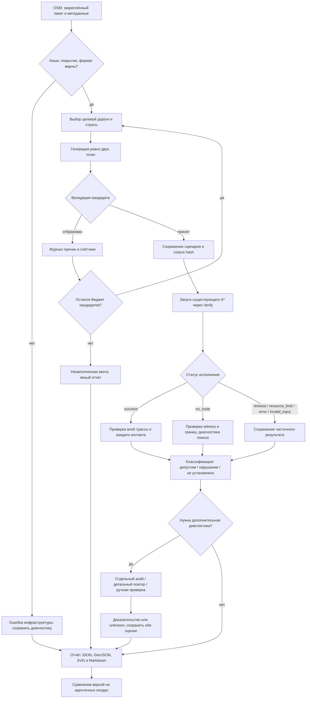

# Routing Crossing Experiment: стратегия тестирования дорожных пересечений

**Статус:** техническое задание для последующих PR, только документация.
Эксперимент, генератор, отчёты и workflow, описанные ниже, ещё не реализованы.
В этом PR не выполняются расчёты маршрутов или новые измерения на Беларуси.
Анализ реализации выполнен для `7c612260e194ee2e5c1cec4bd8826fc460121830`.
Числа с пометкой «предложение» задают будущую методику, а не ограничения приложения.

## 1. Назначение и проверяемые гипотезы

Исследовать CableRoutePlanner на реальных сельских геоданных Республики Беларусь:
находит ли он допустимый кабельный маршрут между **строго двумя пользовательскими
точками** по разные стороны конкретной дороги и не создаёт ли запрещённых
пересечений. Внутренние узлы сетки, GridPortal и вершины эталонной полилинии
не являются пользовательскими waypoint и не добавляются в запрос.

Гипотезы:

- H1: доступный в модели узкий переход может теряться при подключении точек,
  концов GridPortal, укрупнении сетки или постобработке геометрии.
- H2: поиск может не соединять несколько допустимых переходов последовательно,
  хотя независимо проверенный путь в той же области существует.
- H3: точечные контакты, повторные пересечения извилистой дороги, соседние дороги
  и смешанные геометрии могут приводить к ошибочному разрешению пересечения.
- H4: часть отказов объясняется покрытием, областью поиска, ресурсами или
  неполнотой OSM, а не ошибкой A*. Эти причины необходимо различать.
- H5: изменение версии может улучшить долю корректных маршрутов и одновременно
  ухудшить стоимость, длину или время; одного процента успеха недостаточно.

Полностью случайные пары на 10–15 км часто попадают в один лесной массив без
значимого барьера либо в невалидные точки. Они плохо проверяют нужное поведение.
Поэтому единица исследования — **целевая дорога, окружающая область и пара точек**;
случайность используется только внутри заданных географических условий.
Это целевая выборка для поиска дефектов, не оценка вероятности успеха для любого
случайного маршрута Беларуси. Распределения по стратам публикуются отдельно.

## 2. Что существует сейчас и что повторно использовать

При расхождении старых описаний с кодом источником поведения служит закреплённый
commit; версия правил входит в результат. Ниже — факты текущей реализации.

| Компонент / источник | Поведение сейчас | Применение в эксперименте |
| --- | --- | --- |
| [Verify](../tools/CableRoutePlanner.Verify/Program.cs) | Composition Root: Infrastructure + Persistence + PlanningSession; принимает `lat,lon`, добавляет точки через `session.AddAsync`, вызывает `BuildAsync(new RoutingOptions())`; GeoJSON содержит трассы и Metrics | Расширить существующий CLI отдельным машинным режимом, сохранить прежний режим |
| [benchmark_routes.py](../tools/benchmark_routes.py), [описание замеров](routing-benchmarks.md) | Холодный процесс на сценарий, timeout 120 с, managed heap 1536 MiB, промежуточная запись отчёта; статусы `completed/failed/no_routes/timeout` | Переиспользовать orchestration, не выдавать старые статусы за достаточную классификацию |
| [Контракты Application](../src/CableRoutePlanner.Application/Contracts.cs) | IRoutePlanner, IPlanningSession, IPointPlacementValidator, IGeodataRepository; PlanningException.Reason и SearchFailures | Вызывать существующий путь приложения и сериализовать типизированные ошибки без разбора сообщений |
| [GridRoutePlanner](../src/CableRoutePlanner.Infrastructure/Routing/GridRoutePlanner.cs) | Область — bbox точек плюс `clamp(0.1 × distance, 1000, 5000)` м, обрезанная bounds пакета; маска Coverage ограничивает рёбра | Сохранять requested/clipped bounds и покрытие; не обещать произвольную область поиска через CLI |
| [GridMesh / IGridGenerator](../src/CableRoutePlanner.Infrastructure/Routing/Graph/GridMesh.cs) | Запрошенный шаг может увеличиваться до 2000 м; возвращает фактический шаг, Rows, Columns, Nodes | Декоратор существующего IGridGenerator в Verify для записи сетки, без изменения генератора |
| [GridSearchGraph](../src/CableRoutePlanner.Infrastructure/Routing/Graph/GridSearchGraph.cs), [A*](../src/CableRoutePlanner.Infrastructure/Routing/Graph/AStarGridPathfinder.cs) | Восемь соседей; соединители в квадрате ±8 строк/столбцов вокруг округлённого узла, явные порталы; каждый отрезок проверяется | Проверять также соединители и выходы порталов; не создавать второй routing engine |
| [PreparedTerrainData](../src/CableRoutePlanner.Infrastructure/Routing/Terrain/PreparedTerrainData.cs), [TerrainEvaluator](../src/CableRoutePlanner.Infrastructure/Routing/Terrain/TerrainEvaluator.cs) | Полные WKB, LocalProjection, индексы, коридоры мостов и газа; проверка финальных сегментов | Проверка поиска использует их как прежде; независимый аудит отдельно строит пересечения исходной геометрии |
| [RoutingLog](../src/CableRoutePlanner.Infrastructure/Routing/RoutingLog.cs) | EventId 1: QueryMilliseconds/PreparationMilliseconds; 2: elapsed расчёта после подготовки; 3: NodeCount/EdgeEvaluations; 4: профиль/Reason | ILogger provider собирает structured state по EventId и полям; локализованный текст не парсить |
| [RouteAlternative](../src/CableRoutePlanner.Domain/RouteAlternative.cs), [RouteMetrics](../src/CableRoutePlanner.Domain/RouteMetrics.cs) | Геометрия, RoadContacts, TransitionPoints, GasPipelineCandidateIds, длина/стоимость/счётчики | Расширить экспорт Verify: сейчас он теряет контакты и ID газа |
| [Подготовка страны](../tools/GeodataPreparation/prepare_country.py), [country_data.py](../tools/GeodataPreparation/country_data.py) | Закреплённые источники/recipe, SQLite v2, R-tree, лицензии, исходный и display-слой | Использовать штатный пакет; для маршрутизации только `QueryAsync`, не display LOD |

Изученные тесты задают полезные контрольные свойства, но не заменяют эксперимент
на сельских данных: [RoadCrossingRegressionTests](../tests/CableRoutePlanner.Tests/Infrastructure/RoadCrossingRegressionTests.cs)
проверяют каждый точечный контакт и смешанные пересечения;
[GasPipelineRoutingTests](../tests/CableRoutePlanner.Tests/Infrastructure/GasPipelineRoutingTests.cs)
— узкий газовый портал и запрет открывать им воду;
[GridSearchGraphTests](../tests/CableRoutePlanner.Tests/Infrastructure/GridSearchGraphTests.cs)
— соединители, грубый шаг и недоступные порталы;
[PointPlacementTests](../tests/CableRoutePlanner.Tests/Infrastructure/PointPlacementTests.cs),
[CoverageRoutingTests](../tests/CableRoutePlanner.Tests/Infrastructure/CoverageRoutingTests.cs)
— точки и покрытие;
[PlanningDiagnosticsTests](../tests/CableRoutePlanner.Tests/Infrastructure/PlanningDiagnosticsTests.cs)
— типизированные отказы.
[SuccessfulGraphPhaseTests](../tests/CableRoutePlanner.Tests/Infrastructure/SuccessfulGraphPhaseTests.cs)
показывают отдельный fixed-area probe: его фазовые замеры нельзя считать
end-to-end временем публичного planner. Синтетические LargeScaleRoutingTests
не доказывают работу на реальной Беларуси.

### 2.1. Действующие Domain-правила переходов

Основание — [TerrainTraversalPolicy](../src/CableRoutePlanner.Domain/TerrainTraversalPolicy.cs),
[TerrainRules](../src/CableRoutePlanner.Infrastructure/Routing/Terrain/TerrainRules.cs),
[GasCrossingIndex](../src/CableRoutePlanner.Infrastructure/Routing/Terrain/GasCrossingIndex.cs).

- Лес, поле, просека изменяют стоимость. Лес сам по себе не является барьером.
  Здание, болото, река и озеро блокируют путь с оговорёнными ниже водными исключениями.
- Для каждой точечной компоненты пересечения с Road нужен подходящий мостовой
  или газовый кандидат (`AllowsRoadCrossing`). Один кандидат не разрешает
  остальные контакты с той же дорогой. Изолированное касание, включая конец
  ребра на оси дороги, также требует кандидата. Линейное совпадение с дорогой
  само по себе допустимо; смешанную коллекцию нельзя проверить только по линиям.
- Для моста: геометрия BridgeCandidate должна пересекать соответствующую дорогу,
  а её буфер **2 м** покрывать конкретную точку контакта. Это технический допуск.
  Не следует расширять разрешённый коридор до размера ячейки.
- Газ: только подготовленный GasPipelineCrossingCandidate, поперечно пересекающий
  дорогу; точка и относящаяся к ней часть сегмента внутри окна дороги ±**3 м**
  должны помещаться в коридор трубы **1 м**. Окно не является измеренной шириной
  дороги. Соседние контакты имеют отдельные окна. Подготовка создаёт span до
  **12 м** по каждой стороне из `man_made=pipeline`, `substance=gas`,
  `location=overhead`; касания, совместные линии и исключённые пешеходные пути
  не создают такой span. См. [pipeline_crossings.py](../tools/GeodataPreparation/pipeline_crossings.py).
- Газ не открывает воду, болото или здание. PreferOverheadGasCrossings влияет
  на штраф и приоритет альтернатив, а не отменяет предметные запреты.
- ApprovedCrossing с непустым ApprovalId открывает соответствующую геометрию
  воды; BridgeCandidate открывает водный коридор с допуском 2 м.
  **ApprovedCrossing не является универсальным разрешением пересекать Road.**
  В реальную выборку нельзя добавлять фиктивные approval_id ради успеха.
- Классификатор импортера выбирает один Kind: highway с bridge становится
  BridgeCandidate, а не дополнительным Road. Разрывы Road на мостовых участках,
  конечные отрезки дорог и отсутствующие соединения надо учитывать как свойства
  представления барьера; не дорисовывать непрерывную запрещённую линию.

### 2.2. Существующие пределы и предлагаемые настройки

| Параметр | Уже реализовано | Предложение для пилота |
| --- | --- | --- |
| RoutingOptions.CellSizeMetres | Default 25 м, ввод 5–200 м | 25 м, сохранять также effective step |
| RoutingOptions.MaxNodes | Default 100 000, ввод 100–1 000 000 | 100 000 для baseline |
| ReserveFraction | Default 0.10, диапазон 0–1 | 0.10; длина трассы без запаса отдельно |
| PreferOverheadGasCrossings | Default true | true; отдельные диагностические пары true/false |
| MaxRouteLengthMetres | Default 1 000 000, диапазон 1–10 000 000 | 1 000 000; не ограничивать обход длиной прямой |
| Фактический адаптивный шаг | До 2000 м; это не предел входного CellSizeMetres | Записывать, особенно при C/E |
| Тайм-аут сценария | У planner нет встроенного wall-time предела; benchmark задаёт 120 с | 120 с + до 10 с на корректную отмену, затем kill дерева процессов |
| Память | Старый benchmark ограничивает managed heap 1536 MiB, не весь RSS | Сначала тот же heap; внешний предел RSS 3 GiB при наличии supervisor |

Источник диапазонов — [RoutingOptions.cs](../src/CableRoutePlanner.Application/RoutingOptions.cs).
Новые пороги генератора и audit хранятся в одном версионированном конфиге
эксперимента с единицами, не копируются в production-константы.

## 3. Геоданные, территория и полнота

Главная выборка: сельская Беларусь. Основные страты: лес/лес, лес/поле, поле/поле,
окрестности деревень и сельхозтерриторий, несколько дорог, места потенциальных
мостовых/газовых переходов. Крупные города и плотная застройка исключаются.

Для пилота использовать проверенный пакет через
[существующий country-data action](../.github/actions/country-data/action.yml) /
`python tools/GeodataPreparation/country_data.py ensure` и
[belarus.lock.json](../tools/GeodataPreparation/belarus.lock.json).
[install_belarus.py](../tools/install_belarus.py) — существующий локальный путь
получения пакета из закреплённого APK, но он может соответствовать другой версии
снимка. Нельзя считать эти два способа идентичными без сравнения SHA-256 базы,
recipe и состава кандидатов. Первичный пилот закрепляет один пакет.

Дрозды–Новинки имеют bounds `[27.48, 53.93, 27.53, 53.96]`, подходят для проверки
формата/существующего smoke, но не для сельской выборки и дистанций 10–15 км.
Использовать полную Беларусь или подготовленные штатным pipeline региональные
фрагменты с достаточным покрытием. Новая загрузка страны в этом PR не нужна.

Фиксировать отдельно SHA-256 исходного OSM PBF, сжатого asset и распакованной
SQLite; последний брать из проверенного manifest, а не из имени каталога.
Записывать manifest/receipt, recipe key, версии импортера и зависимостей,
coverage geometry и ошибки преобразования. Кеш не источник истины.
Не подменять отсутствующий пакет синтетикой или live Overpass. Overpass допустим
для разведки следующего выпуска; такие сведения не меняют закреплённый corpus.
Сохранять © OpenStreetMap contributors, ODbL/DbCL и NOTICE в артефактах.

### 3.1. Воспроизводимая классификация сельской местности

Минимально доступна классификация по Kind и полным WKB из SQLite:
Forest (`natural=wood`/`landuse=forest`), Field (`farmland`/`meadow`/`grassland`),
Building, Road и Settlement. Использовать ту же
[feature_classification.py](../tools/GeodataPreparation/feature_classification.py),
не вводить свою предметную классификацию. Предложение для генератора v1:

1. Для якоря дороги взять локальный участок ±100 м по длине, построить окна
   по 500 м влево/вправо от его направления в метрической проекции.
   Исключить полосу 20 м вокруг оси из площадей этих окон.
2. По каждой стороне вычислить площадь union Forest и union Field, затем
   `Forest only`, `Field only`, `overlap`, `unknown`. Не складывать перекрывающиеся
   полигоны многократно. Для ярлыка forest/field требовать долю соответствующего
   неперекрывающегося класса ≥60%; иначе `mixed/unknown`.
3. Записать также классы в радиусе 100 м от каждой точки и доли всей области
   исследования. Локальный лес/поле у дороги не доказывает однородность 15 км пути.
4. Прокси плотной застройки: Building footprint union >15% площади диска 1 км
   у якоря или у любой точки — исключить из основной выборки.
   Это предлагаемый технический порог, не определение города.
5. В SQLite Settlement хранится как точка и имя, без исходного `place` и population.
   Поэтому близость к Settlement (например, ≤2 км) даёт только ярлык
   `settlement_nearby`, не «деревня». Нельзя по имени определить размер поселения.

Для надёжного исключения city/town и выбора village/hamlet нужен дополнительный
малый metadata sidecar **из того же закреплённого PBF**: source_id, place,
population при наличии, residential/industrial и административные границы при
наличии. Текущая SQLite хранит `source_id`, но MapFeature его не выдаёт; исходные
теги highway/bridge/tunnel/layer и place в базе не сохраняются. Предлагаемый sidecar
создаётся только на этапе реализации, не меняет production schema/классификатор.

Пилот без sidecar допускает ручную проверку 2–3 AOI по тому же исходнику с
сохранением review-файла и хеша. Для полностью автоматической массовой выборки
unknown rural/urban исключается с явным счётчиком, а не признаётся сельским.
Для случайно выбранных исключённых случаев тоже публикуется причина: неполнота
застройки/landuse в OSM иначе создаёт скрытое смещение.

OSM не доказывает отсутствие сооружений, коммуникаций, болот или частных участков.
Спутниковый land cover (например, WorldCover), официальные границы поселений,
реестр сооружений и инженерные согласования могли бы повысить достоверность,
но пока не являются входами текущих Domain-правил. DEM не нужен для основной
горизонтальной дистанции; неподдерживаемые высоты не заполнять нулями.

### 3.2. Три уровня сведений о переходе

| Уровень | Что установлено | Как влияет на ожидания |
| --- | --- | --- |
| `osm_present` | Физический объект представлен исходными тегами/геометрией | Только потенциальный кандидат; OSM может быть неточен |
| `model_eligible` | Объект импортирован в поддержанный Kind; его геометрия подходит конкретному контакту по текущим Domain-правилам | Можно проверять доступность перехода в модели, но ещё не существование полного пути |
| `engineering_confirmed` | Есть внешнее подтверждение допустимости реальной прокладки, источник и дата | Отдельное инженерное знание; не выводить из первых двух уровней |

Эти признаки хранить раздельно, неизвестный — `null/unknown`.
BridgeCandidate может описывать мост/надземное сооружение, но расположенный
рядом мост не разрешает любое пересечение дороги. Для газа поддерживается
только указанный overhead span; `overground` и `underground` ему не эквивалентны.
Общий `tunnel=yes`, пешеходный тоннель, подземный переход или специальное сооружение
не имеют самостоятельного разрешающего правила текущей модели. Отдельный импортёр
тоннельных переходов отсутствует. Объект с tunnel может попасть в Road по highway,
но тег tunnel сам по себе разрешения не добавляет. Такие объекты хранить как
`potential_unsupported`, изучать полноту данных и будущую поддержку; не назначать
им положительное ожидание. Объект с несколькими тегами оценивать по фактическому
Kind и текущему правилу, а не по названию сооружения.

## 4. Генерация сценария вокруг барьера

### 4.1. Детерминированный порядок

Генерация выполняется до запуска A*, по снимку данных и конфигу. Предложение:
seed `20261106`, PRNG PCG-XSH-RR 64/32 (PCG32), stream selector 54,
стандартная двухшаговая инициализация reference PCG, с опубликованными test vectors; одной
фиксации seed недостаточно. Перечень AOI, версии библиотек геометрии, порядок
объектов/компонент и параметры входят в generatorVersion/config hash.
Сортировать source_id по типу OSM и числовому ID, затем part/segment/station;
SQLite feature ID сохранять дополнительно, он не стабилен между переподготовками.
Для производных газовых spans сохранять source_id `gas-road:...` и оба родителя.

1. Выбрать AOI и страту по квоте, запросить полные Road и соседние объекты.
   Убедиться по source_id/Kind, что это реально импортированная дорога.
   При отсутствии highway-тегов нельзя называть любой Road автомобильной магистралью:
   класс дороги уточнять по sidecar; service/track учитывать отдельными стратами.
2. Разбить MultiLineString на компоненты, исключить нулевые сегменты, задать
   станции через 250 м по длине (предложение). Не заменять извилистую линию
   хордой между концами. Случайно переставить станции внутри страты фиксированным
   PRNG; выбирать по квотам, а не только пропорционально числу OSM ways.
3. В LocalProjection с центром у якоря найти ненулевой сегмент `a → b` и точку
   якоря `q` внутри сегмента. Сохранить origin, a/b, index, station и направление
   исходной линии. Ориентация OSM произвольна: метки left/right могут меняться
   при развороте way, противоположность сторон сохраняется.
4. Пусть `t=(b-a)/|b-a|`, `n=(-t.y,t.x)`.
   Предложить `p=q+u1*t+d1*n`, `r=q+u2*t-d2*n`, где `d1,d2>0`.
   Для локальной группы выбирать d в 250–1500 м и |u|≤250 м; для полной —
   d в 4–8 км и |u|≤1 км, затем принимать только фактическую дистанцию нужной группы.
   Все диапазоны — предложение; не растягивать короткий узкий тест ради 15 км.
5. Для **обеих** точек проверить метрический signed distance
   `s(x)=cross(b-a,x-a)/|b-a|`. Требовать разные знаки и |s|≥20 м.
   Это расстояние до ориентированной прямой; дополнительно проверить ближайшую
   часть исходного LineString и геометрию всей дороги, а не только знак.
6. Для простого случая требовать единственное поперечное пересечение `p–r`
   с локальной целевой компонентой в пределах 100 м station от q, без общего
   линейного участка/касания. Записать все остальные пересечения `p–r` с дорогами.
   Для извилистой линии проверить стабильность знаков на ненулевых соседних
   сегментах в окне ±100 м; изменение направления >30°, близость других ветвей
   ≤100 м, несколько равно близких проекций или пересечений дают `complex`.
7. Отдельно проверить точки через существующий IPointPlacementValidator и
   DataPackageInfo.Contains (включая Coverage), расстояние и класс местности.
   Предложение: минимум 20 м от Road и 10 м от блокирующей геометрии для
   обычных точек; эти запасы генератора не меняют валидатор приложения.
8. Рассчитать ожидаемую область planner из двух точек по действующей формуле,
   сохранить также независимую область исследования: её расширение на 5 км
   по всем сторонам (предложение для инвентаризации обходов). Обе области
   сопоставить с реальной маской покрытия; одного bbox недостаточно.
9. Инвентаризировать в обеих областях кандидатов и неподдержанные объекты.
   Переход, полностью или частично за пределами planner bounds, помечать отдельно:
   GridRoutePlanner отбрасывает портал, если хотя бы одна его вершина вне области.
   Наличие перехода в большом AOI не делает его доступным данному запуску.
10. Проверить категорию/качество, географические дубликаты, сохранить сценарий,
    исходные геометрии, проверки и журнал отбраковки. Затем запускать planner.

Дистанция группы проверяется включительно: local 500–3000 м, full 10 000–15 000 м.
Сохранять `GeoCoordinate.DistanceTo` (сферическая геодезическая модель приложения)
и её идентификатор. Это горизонтальное расстояние без рельефа; не длина в градусах,
не 3D-длина, не длина найденной трассы. Если позднее нужен эллипсоид WGS84,
добавить отдельное поле и версию методики, не менять незаметно границы корпуса.

### 4.2. Отдельная ветка генерации контролей F

Для `same_side` использовать тот же anchor, но `p=q+u1*t+d1*n`,
`r=q+u2*t+d2*n` (либо оба отрицательных d), local-дистанцию 500–3000 м.
Требовать одинаковый устойчивый знак s, отсутствие контакта прямой p–r с целевой
дорогой и прохождение остальных проверок точек/coverage/местности. Прямую можно
сохранить как witness только после независимой полной проверки препятствий;
иначе подобрать допустимую контрольную полилинию вручную и проверить её.

Для `valid_detour_without_target` исходные точки могут иметь разные локальные
знаки, но нужен независимо проверенный witness, обходящий конец/разрыв дороги
и не контактирующий с целевым барьером. Перебрать якоря около естественного конца
Road, не создавать разрыв в данных. При невозможности получить такой witness
для slot 10 использовать второй same_side F с другой географией и явным тегом
замены. Эта ветка освобождается от cross-line критерия; остальные проверки,
журнал отбора и дедупликация сохраняются. Нельзя назвать control положительным
только потому, что baseline его успешно рассчитала.

### 4.3. Сложная геометрия и предел вывода о барьере

**Противоположные стороны локального сегмента и пересечение прямой не доказывают,
что любой допустимый маршрут обязан пересечь именно эту дорогу.** Можно обойти
конец way, разрыв, всю ветку или воспользоваться другим переходом. Это верно
и для пары на 15 км. Назначать `targetCrossingRequired=true` только по отдельному
свидетельству разделения свободного пространства в ограниченной области.
Без него поле `unknown`, а обход целевой дороги не является ошибкой.

- Извилистая дорога: сохранять все точки контакта; один кандидат не покрывает
  два изгиба. Если локальная сторона неоднозначна — complex/exploratory, а не
  произвольный выбор по широте/долготе.
- Перекрёстки и разветвления: вокруг якоря учитывать все инцидентные Road и
  расходящиеся ветви; в простую A/B-страту не включать узел развилки.
  Оставить отдельную complex-страту после ручной проверки.
- Параллельные дороги и разделённые проезжие части: хранить barrierGroup из
  отдельных source_id и проверять разрешение на каждом контакте, а не один
  буфер на группу. Кандидат через одну проезжую часть не открывает соседнюю.
- Конечные/разорванные дороги: в области исследования искать концы, связность
  и стыки соседних ways; помечать `open/fragmented/unknown`. Не склеивать их
  искусственным запрещённым отрезком. Геометрически разорванный объект может
  не разделять область; допуск склейки для диагностики не даёт новых запретов.
- Дорога на мосту: изучить фактическую разбивку Road/BridgeCandidate. В текущей
  2D-модели layer/высота не дают общего правила разнесения уровней.
- Нельзя исключить все сложные случаи из исследования: пилот имеет хотя бы
  один E/complex, масштабный corpus публикует отдельную квоту, например 20%.
  Неоднозначные случаи не смешиваются с простой проверенной выборкой.

## 5. Категории и качество сценариев

Категория описывает географическую постановку, quality — доказательства,
expectation — проверяемое утверждение. Это независимые оси.

| Тип | Условия до поиска | Что проверять |
| --- | --- | --- |
| A: известный допустимый переход | По разные стороны; имеется model_eligible кандидат в области planner | Обнаружение/подключение и допустимость полного пути; обязательный success только при проверенном witness |
| B: нет известного перехода | По разные стороны; в зафиксированной локальной области нет подходящих кандидатов | Любая найденная трасса должна быть допустимой; обход/дальний переход возможны, blanket NoRoute запрещён |
| C: узкий переход | A или E с шириной коридора заметно меньше requested/effective cell size | Portal, landing connectors, изгибы span и шаг; фиксировать ширину и оба отношения к шагу |
| D: несколько переходов | ≥2 model_eligible потенциальных контактов в области | Достаточно хотя бы одного допустимого пути; длина/стоимость всех альтернатив, без требования конкретного ID |
| E: несколько дорожных барьеров | Есть несколько Road/barrierGroup на потенциальном пути | Последовательное соединение переходов и аудит каждого барьера; сама прямая ещё не доказывает обязательность всех |
| F: контроль | Та же география, точки на одной стороне или независимо проверенный путь без целевого контакта | Корректность генератора, входов и исполнения; cross-line требование для F явно отключено |

Один primaryType A–F и дополнительные теги, например `C`, `gas`, `parallel_roads`.
Не увеличивать размер корпуса за счёт повторного учёта одной пары в нескольких типах.

- `verified`: независимая проверка подтверждает условия и ровно заявленное
  expectation. `must_find_valid_route` требует сохранённого допустимого witness
  в области/покрытии и с длиной в лимите. `invariants_only` может быть verified,
  если подтверждена постановка B, но это **не** доказательство невозможности пути.
- `exploratory`: геометрия, входы и категория пригодны, но существование пути
  или часть сложных условий не установлены. По умолчанию expectation
  `invariants_only`, existence `unknown`.
- `rejected` — запись журнала кандидатов, не сценарий корпуса. Если аудит позже
  опроверг условия verified, сохранять прежний record и новую ревизию оценки.

Возможный строгий отрицательный expectation `no_valid_route_in_bounded_model`
требует доказанного разделения свободного пространства во всей указанной области
с учётом всех model-eligible переходов и текущих разрешённых shared sections.
В пилоте его не требовать; B по умолчанию проверяет запреты, а не NoRoute.
Невозможность в bounded model никогда не называется физической невозможностью.

### 5.1. Фильтрация до дорогого поиска

Принять только конечные разные координаты с валидной географией, обе внутри
coverage и вне запрещённых объектов, с целевой дорогой в зафиксированной базе,
нужной дистанцией, проверенной стороной/cross-line (кроме F), подходящей стратой
и достаточными данными для оценки кандидатов. Для неизвестной применимости
перехода снижать quality, не объявлять его разрешённым.

Предложение дедупликации: одинаковый target source_id/barrierGroup, station
ближе 1 км и пары с каждой соответствующей точкой ближе 250 м считать одним
географическим случаем (сравнить также p/r с перестановкой). Для соседних ways
дополнительно сравнить якоря ≤1 км и общий кластер дороги. C-варианты разных
настроек — запуски одного сценария, не новые географические примеры.

Лимит генерации: 200 пар на anchor и 5000 на AOI (предложение), затем явный
`quota_unfilled`; не бесконечный цикл и не молчаливое ослабление порогов.
Журнал `generation.jsonl` содержит candidateId, seed/позицию PRNG, anchor,
первую причину и все дополнительные причины отказа. Минимальные reason codes:
`point_outside_coverage`, `blocked_point`, `distance_out_of_band`, `missing_road`,
`ambiguous_side`, `no_target_intersection`, `urban_or_unknown`,
`terrain_mismatch`, `insufficient_transition_data`, `coverage_truncated`,
`duplicate`, `quota_unfilled`. Счётчики: anchors/пар рассмотрено, принято,
отклонено по первой причине; дополнительные причины считать отдельно.

**Запрещено фильтровать по успеху текущего маршрутизатора.** Корпус фиксируется
и хешируется до baseline A*. Повторный поиск используется для диагностики,
не для удаления неудобных отказов. Ручные исправления координат создают новую
ревизию сценария и новый corpus hash с сохранением исходного случая.

## 6. Минимальная архитектура будущего инструмента

Предпочтение — расширить Verify и benchmark orchestration. Альтернатива, новый
самостоятельный harness с дублированием загрузки/правил, увеличивает риск
расхождений; plugin framework, новый сервис/UI и второй engine не нужны.

1. **Подготовка/генерация offline:** Python с уже закреплёнными sqlite3,
   Shapely и при необходимости osmium из tools/GeodataPreparation. На чтение
   базы — read-only; вывод только в artifacts и малый сценарный corpus.
   Переиспользовать классификацию и derivation газа. Метаданные source_id читать
   из существующей SQLite служебным запросом, не расширяя MapFeature ради отчёта.
   Метрическая математика генератора должна совпадать с LocalProjection и
   DistanceTo, с небольшими проверочными примерами на этапе реализации.
2. **Исполнение:** новый предложенный режим Verify `--crossing-scenario` читает
   один JSON, проверяет schemaVersion/два points/options/hashes, добавляет ровно
   две координаты через IPlanningSession, вызывает BuildAsync с явными options.
   Регистрирует те же Infrastructure/Persistence. Не читает сохранённые настройки
   пользователя; использует изолированный settings path. Старый CLI сохраняется.
3. **Диагностика:** ILogger provider собирает поля событий, декоратор IGridGenerator
   фиксирует bounds/projection/effective cell/rows/columns. Только регистрация
   в Verify; алгоритмические классы не менять. На неуспехе отсутствующие события
   сохранять как null с причиной. Ошибка не должна выглядеть как ноль времени.
4. **Supervisor:** расширение существующего Python runner для timeout, kill,
   памяти, cold/warm серий, JSONL checkpoints, итоговых JSON/Markdown/CSV и
   сравнения версий. Модули выделять только по реальной сложности, без нового
   интерфейсного слоя вокруг IRoutePlanner.
5. **Независимый audit:** отдельный проход по экспортированной финальной
   геометрии и сырым WKB; NTS либо Shapely для overlays, Domain для решений
   допустимости. Минимальный adapter в Verify вызывает публичные Domain policies,
   вместо копирования бизнес-таблиц в Python. Аудит не вызывает A* и не считает
   ответ TerrainEvaluator независимым доказательством. Он не является вторым
   маршрутизатором. Конкретные predicate/tolerance источники закреплять SHA.
6. **Изображение:** offline SVG из тех же координатных слоёв, с локальной
   метрической системой, легендой, масштабом, north arrow, ID и attribution.
   Это минимальная 2D-карта без внешнего tile/API и нового UI. Если требуется PNG,
   добавить только закреплённый converter; SVG уже является изображением пилота.

Недоступно сейчас в готовом отчёте: typed Reason/SearchFailures (Verify печатает
только ex.Message), использованные bridge ID по контактам, инвентарь кандидатов,
результат независимого аудита, grid bounds/effective step и полный RSS peak.
Имеются только доступные лог-события и поля RouteAlternative. На неуспешном поиске
EventId 2/3 могут не появиться. Отдельные длительности mesh/graph/A*/postprocess
публичный API не возвращает: в пилоте `null/not_instrumented`, а не вычитание
несопоставимых секунд. Не превращать fixed-area probe в end-to-end API.
В дальнейшем дополнительная инструментализация production допустима только
отдельным обоснованным PR, если существующих событий/декоратора недостаточно.

Полный процесс (все новые стадии пока являются проектом):



## 7. Модель входного сценария

Предлагаемая schema `maps.routing-crossing.scenario.v1`:

- id/revision, primaryType/tags, quality, expectation и независимое existence;
- points — массив **ровно из двух** `{latitude, longitude}`, порядок значим;
- targetBarrier — тип, feature ID в SQLite, OSM source_id, component/segment,
  station/anchor/orientation, barrierGroup, geometry reference и hash;
- sideEvidence — projection origin/version, signed distances, contact geometry,
  ambiguity reasons, targetCrossingRequired и evidence reference;
- terrain — classifier version, доли/окна, признаки поселения, источники;
- distanceMetres/model, requestedSearchBounds, clippedSearchBounds,
  researchBounds, coverageStatus и список порталов вне search bounds;
- transitions — source_id/Kind/родители/геометрия, osm_present,
  model_eligible/условия, engineering_confirmed и provenance;
- reproducibility — seed/PRNG/generator/config hashes, corpus hash,
  OSM/db/manifest/sidecar hashes, commit правил; RoutingOptions целиком;
- review — reviewer/tool version, дата, witness/доказательство или причина unknown.

Пример ниже — **шаблон структуры, не реальный выбранный сценарий и не результат
пилота**. Координаты служат только иллюстрацией формата; принадлежность дороге,
стороны и расстояние для них не проверялись. `null` вместо обязательных ID,
хешей и измерений означает, что файл не готов к исполнению. Будущий validator
обязан отклонить такой шаблон, а не подставлять значения по умолчанию.

```json
{
  "schema": "maps.routing-crossing.scenario.v1",
  "id": "pilot-forest-A-local-01",
  "revision": 1,
  "primaryType": "A",
  "tags": ["forest_forest", "bridge"],
  "quality": "exploratory",
  "expectation": "invariants_only",
  "existence": "unknown",
  "points": [
    {"latitude": 53.90, "longitude": 26.50},
    {"latitude": 53.91, "longitude": 26.52}
  ],
  "distanceMetres": null,
  "distanceModel": "GeoCoordinate.DistanceTo/mean-earth-radius",
  "targetBarrier": {
    "kind": "Road",
    "featureId": null,
    "sourceId": null,
    "componentIndex": 0,
    "segmentIndex": null,
    "stationMetres": null,
    "geometryRef": "input.geojson#target-road",
    "geometrySha256": null,
    "barrierGroup": []
  },
  "sideEvidence": {
    "projection": "LocalProjection",
    "origin": null,
    "signedDistancesMetres": null,
    "targetCrossingRequired": "unknown",
    "ambiguityReasons": []
  },
  "terrain": {"class": "forest_forest", "evidenceRef": "terrain.json"},
  "area": {
    "requestedSearchBounds": null,
    "clippedSearchBounds": null,
    "researchBounds": null,
    "coverageStatus": "unknown"
  },
  "transitions": [],
  "routingOptions": {
    "CellSizeMetres": 25,
    "MaxNodes": 100000,
    "ReserveFraction": 0.10,
    "PreferOverheadGasCrossings": true,
    "MaxRouteLengthMetres": 1000000
  },
  "reproducibility": {
    "seed": 20261106,
    "prng": "PCG32-v1",
    "generatorVersion": "crossing-generator-v1",
    "generatorConfigSha256": null,
    "corpusSha256": null,
    "osmPbfSha256": null,
    "databaseSha256": null,
    "manifestSha256": null,
    "metadataSha256": null,
    "rulesCommit": "7c612260e194ee2e5c1cec4bd8826fc460121830"
  },
  "review": {"evidenceRef": null, "witnessRef": null, "reviewer": null}
}
```

Реальный сценарий A обязательно содержит хотя бы один подтверждённый в модели
кандидат; пустой transitions из шаблона не проходит schema/semantic validation.
GeoJSON хранит координаты **[longitude, latitude]**, JSON points — именованные
поля, старый CLI Verify — **latitude,longitude**. Проверять конверсию явно.
Прямую, полный Road и выбранную компоненту сохранять разными feature IDs.

## 8. Модель результата и метрики

Разделить `executionStatus` и `assessment`: успешный вызов API может вернуть
недопустимую трассу; timeout не равен NoRoute. Результат содержит runId,
scenarioId/revision/hash, commit приложения и hash бинарников, полную конфигурацию,
данные/среду/тип прогрева и массив всех альтернатив.

| Поле | Измерение и интерпретация |
| --- | --- |
| executionStatus | `success`, `no_route`, `timeout`, `error`, `invalid_input`, `resource_limit` |
| error | PlanningException.Reason, TerrainKind, actual/max length, все SearchFailures по профилям; exception type отдельно |
| alternatives | Геометрия, профиль/имя, RouteMetrics, контакты, ID газа; сохранять все, не только первую |
| timing | Wall процесса, загрузка/валидация при наличии собственных stopwatch, BuildAsync total, Query/Preparation из событий, audit/render отдельно |
| route distance | LengthMetres и `LengthMetres / directDistanceMetres`; длина кабеля с запасом отдельна |
| cost | WeightedCost в условных метрических единицах профиля, не денежная смета; сравнивать одинаковые профили |
| transitions | Количество объектов-кандидатов в research/search bounds, model-eligible контактов и фактически использованных переходов раздельно |
| graph | Requested/effective cell, rows/columns/grid node count; EdgeEvaluations — уникальные оценённые рёбра сеточного кеша, не все expansions A* |
| memory | OS whole-process peak RSS / working set, единицы и способ; managed heap limit отдельно, delta из старого Verify не полный пик |
| validation | valid / violation / unknown, coverage check, список контактов и rule evidence, witness status |

`RouteMetrics.RoadCrossings` считает уникальные Road ID, не число всех геометрических
пересечений; bridge/gas counters также объектные. Поэтому audit отдельно считает
контакты и сопоставления `(roadId, contactIndex, candidateId)`. ID использованных
мостов в RouteAlternative прямо не предоставляются: их устанавливает audit с
уровнем уверенности; TransitionPoints — подсказка, не доказательство разрешения.
Невозможное измерение — `null` + availability reason, не `0`.

Предлагаемый mapping: PointOutsidePackage/BlockedTerrain и неверный формат/options
→ invalid_input; GridConnectionUnavailable/NoRouteInSearchArea → no_route;
RouteLengthLimitExceeded → no_route с отдельной причиной (был допустимый путь
сверх лимита, не доказано отсутствие более короткого); ResourceLimit → resource_limit.
Ожидаемая отмена supervisor → timeout; внешняя отмена имеет отдельный termination
reason. Неожиданное исключение → error. OOM/kill классифицировать resource_limit
только при подтверждении supervisor/OS; неизвестный crash остаётся error.
`PlanningErrorReason.Unknown` не переименовывать в NoRoute по тексту сообщения.

Пример результата — **пустой шаблон до исполнения**, без вымышленных числовых
измерений. В финальном отчёте `executionStatus=null` недопустим; в checkpoint
разрешён только с `recordState=pending/running`.

```json
{
  "schema": "maps.routing-crossing.result.v1",
  "recordState": "pending",
  "runId": null,
  "scenarioId": "pilot-forest-A-local-01",
  "scenarioRevision": 1,
  "scenarioSha256": null,
  "appCommit": null,
  "databaseSha256": null,
  "configurationRef": "run.json",
  "warmupMode": "cold_process_os_cache_unspecified",
  "attempt": 1,
  "executionStatus": null,
  "terminationReason": null,
  "error": null,
  "alternativeCount": null,
  "alternatives": [],
  "timingMs": {
    "processWall": null,
    "buildTotal": null,
    "query": null,
    "preparation": null,
    "aStar": null,
    "audit": null
  },
  "availability": {"timingMs.aStar": "not_instrumented"},
  "graph": {"nodeCount": null, "edgeEvaluations": null, "effectiveCellMetres": null},
  "memory": {"peakRssBytes": null, "method": null, "managedHeapLimitMiB": 1536},
  "transitionInventoryRef": "transitions.json",
  "assessment": {
    "classification": "correctness_unknown",
    "routeCompliance": "unknown",
    "witnessStatus": "not_checked",
    "targetRoadCrossed": null,
    "suspicionReasons": []
  },
  "artifacts": {
    "inputGeojson": "input.geojson",
    "routesGeojson": null,
    "mapImage": null,
    "audit": null,
    "stdout": "stdout.log",
    "stderr": "stderr.log"
  }
}
```

Для каждой альтернативы обязательны geometryRef, profile, lengthMetres,
weightedCost, detourRatio, исходные RouteMetrics, roadContacts,
usedTransitionMatches и compliance. При отказе маршрута routesGeojson=null,
но input.geojson, transitions.json и изображение исходной карты всё равно нужны.

### 8.1. Классификация выводов

1. `valid_route_found`: есть хотя бы одна независимо проверенная допустимая
   альтернатива. Каждую другую тоже проверить; наличие плохой альтернативы — дефект.
2. `not_found_in_current_graph`: нет результата, имеется typed graph/search
   failure; существование непрерывного допустимого пути не установлено.
3. `time_or_resource_limit`: поиск не завершён в бюджете, топологических выводов нет.
4. `domain_violation`: хотя бы одна выданная альтернатива нарушает жёсткое правило.
5. `confirmed_missed_valid_path`: проверенный witness доступен в тех же search
   bounds/coverage, укладывается в длину и правила, но завершённый поиск его
   не находит. Отличать graph discretization от подозрения на дефект A*.
6. `correctness_unknown`: данных/аудита недостаточно либо инфраструктурный crash.

Хранить также независимые flags, чтобы нарушение одной альтернативы не терялось
за хорошей. Для основного classification приоритет: domain_violation, затем
ресурсный статус, confirmed_missed_valid_path, valid_route_found,
not_found_in_current_graph, correctness_unknown. Не называть любой
NoRouteInSearchArea ложным отказом. Рост success при росте domain_violation
не является улучшением.

Cold: отдельный Release-процесс на сценарий; явно указать, что файловый кеш ОС
не гарантированно холодный. Warm: тот же процесс, ServiceProvider и planner,
один немеряемый прогрев идентичного сценария и три измеряемых повтора
(предложение); фиксировать порядок и попадание prepared-area cache.
Query/Preparation=0 при cache reuse не выдавать за отсутствие работы вообще.
Медианы cold и warm публиковать отдельно; ошибки/тайм-ауты не исключать из долей
и не заменять лимитом в расчёте медианы успешных результатов.

## 9. Независимая проверка и выделение подозрительных случаев

### 9.1. Аудит найденной геометрии

Для **каждой** альтернативы из финального результата:

1. Проверить начало/конец на исходных двух точках (предложение допуска 1 м),
   конечность координат, связность, самопересечения, покрытие каждого сегмента
   и длину ≤MaxRouteLengthMetres. Отдельно сохранить фактическое отклонение.
2. По исходным routing WKB построить пересечения всей трассы со всеми Road,
   Building, Marsh, River, Lake. Обрабатывать Point/MultiPoint, LineString,
   MultiLineString и смешанные GeometryCollection, включая вершины трассы.
   Совпадающие точки соседних рёбер дедуплицировать для счёта, но не терять
   локальную проверку каждого сегмента на разрешение.
3. Для каждой точечной компоненты Road независимо получить bridge/gas matches
   по правилам §2.1 и вызвать Domain AllowsRoadCrossing. Сохранить road/candidate
   source IDs, контакт, тип, расстояния/коридор и результат каждого predicate.
   Не считать линейное совпадение запрещённым только из-за близости к дороге.
4. Газовое окно проверять на оригинальном финальном сегменте и соответствующих
   соседних контактах, как требует модель. Нельзя раздробить неподходящий
   диагональный сегмент так, чтобы короткие кусочки искусственно получили
   разрешение. Дополнительно проверять общую полилинию вокруг вершины на оси,
   чтобы splitting не скрывал поперечный контакт.
5. Для воды заново построить только действующие openings: ApprovedCrossing с
   непустым ApprovalId и мостовой коридор. Не открывать болото/здание и не
   применять газ к воде. Допуски модели закрепить; дополнительные tolerance
   аудита показывать как uncertainty, не расширять молча разрешения.
6. Сверить длину/контакты/стоимость с Metrics, учитывая различие уникальных IDs
   и количества контактов. Стоимость пересчитывать Domain RouteCostCalculator
   по исходным фактам/профилю. Не ожидать равенства стоимостей разных профилей.

Аудит имеет независимое извлечение геометрических фактов, но общую предметную
политику; полная независимость не обещается. В будущих тестах самого audit нужны
известные допустимые и запрещённые геометрии, смешанные контакты и изменённая
плохая трасса; синтетические unit-тесты допустимы для проверяющего инструмента,
но не заменяют реальные сценарии пилота. Совпадение с TerrainEvaluator само по
себе не доказывает отсутствие общей ошибки геометрических библиотек.
Для 8–12 случаев человек сверяет SVG, исходные OSM IDs и числовой audit.

### 9.2. Свидетельство пропущенного пути

Допустимый witness — сохранённая полилиния между теми же точками, независимо
проверенная по всем сегментам/контактам в **той же** модели, области и coverage.
Её можно подготовить вручную по известному коридору или получить более детальным
повтором. Это доказательство существования пути в модели, не согласование работ.
Вершины witness никогда не передаются planner как промежуточные пользовательские точки.

Диагностический повтор: те же точки/данные, CellSizeMetres=5 и MaxNodes=1 000 000
(в действующих диапазонах), с отдельным лимитом, например 300 с. Сохранять actual
step: увеличение бюджета не гарантирует мелкую сетку. Проверить полученный путь
независимым audit; только после этого использовать как witness для baseline.
Если witness выходит за baseline bounds, классифицировать `search_area_limited`,
а не доказанный пропуск внутри графа. Расширение области не доступно в публичных
RoutingOptions; не добавлять waypoint ради её расширения. Fixed-area probe,
если понадобится, обозначать отдельным исследованием с иными условиями.

Для локализации A* допустим ограниченный Dijkstra по **тому же IRoutingGraph**
в диагностическом режиме: это не второй продуктовый engine. Найденный путь
проверяется отдельно; одинаковый неуспех двух алгоритмов на одном неполном графе
не доказывает невозможность непрерывного пути. Для пилота реализация Dijkstra
не обязательна: проверенный ручной witness достаточен и дешевле.

Повторные неудачи, отсутствие ближайших кандидатов или субъективное «на карте
очевидно» не являются доказательством физической невозможности. Независимый
negative proof требует полного bounded анализа и может остаться недоступным.

### 9.3. Очередь дополнительной диагностики

Автоматически создавать `suspects.jsonl` с evidence refs и приоритетом:

- P0: любой запрещённый контакт, выход из coverage, неправильные endpoints,
  пропуск аудита выданной альтернативы или нарушенный контракт отчёта.
- P1: no_route при verified witness; success → failure на одинаковых входах;
  известный кандидат внутри bounds, но недоступные grid connections;
  effective cell намного шире коридора; портал/обход обрезан границей.
- P2: unknown audit, disagreement независимых проверок, необычный detourRatio,
  отсутствие target crossing при неподтверждённой обязательности — для осмотра,
  не автоматическая ошибка; резкое изменение длины/стоимости/времени.

Предложение review-порогов: detourRatio>3, изменение длины/стоимости >20%, времени
>30% при одинаковом прогреве. Это сигналы исследования, не предметные запреты
и не автоматические performance gates. Диагностические повторы не переписывают
первый результат; у них parentAttemptId и отдельный configuration hash.

## 10. Малый пилот: 3 области, 10 сценариев

Следующий PR сначала выбирает и фиксирует участки, затем запускает корпус.
Предложенные **окна разведки** (W,S,E,N, EPSG:4326) — реальные районы Беларуси,
но наличие нужных условий в закреплённом пакете здесь ещё не проверено:

| AOI | Окно разведки | Приоритет |
| --- | --- | --- |
| F: Налибокская пуща и сельские дороги | `[26.35, 53.75, 26.75, 54.00]` | Лес/лес, мостовой или узкий переход |
| A: сельхозтерритории Пуховичского района | `[27.35, 52.70, 27.75, 53.00]` | Поле/поле, лес/поле, overhead gas при наличии |
| M: сельские окрестности Смолевичей | `[28.02, 53.85, 28.42, 54.10]` | Несколько дорог и развязки, вне городской застройки |

Это окна поиска, не доказанные площадки и не координаты стартов.
В A известны исторические OSM-кандидаты около `27.57,52.86` из
[обзора газа](overhead-gas-crossings.md); совпадение с текущим пакетом обязательно
проверить заново, исторический Overpass не задаёт положительное ожидание.
Для каждого AOI выбрать один компактный study window, покрывающий сценарии и
их researchBounds. Ориентир — до 30×30 км; full-сценарии не требуют загрузки
всей страны в память. Study window фиксируется по фактическим кандидатам.

| Slot | AOI | Primary / tags | Дистанция | Ожидание до независимой проверки |
| --- | --- | --- | --- | --- |
| 01 | F | A, forest_forest, bridge | local | invariants_only; повысить до must_find при witness |
| 02 | F | C, forest_forest, narrow | local | То же, желательно verified witness |
| 03 | F | B, forest_forest | full | invariants_only, existence unknown |
| 04 | F | F, same_side | local | must_find только после независимого witness без дороги |
| 05 | A | A, field_field или forest_field, gas если есть | local | invariants_only / verified witness |
| 06 | A | B, field_field | full | invariants_only, existence unknown |
| 07 | A | D, несколько кандидатов | full | invariants_only, любой корректный переход |
| 08 | M | E, несколько дорог, complex | local | invariants_only / verified chain witness |
| 09 | M | E, parallel_roads или branching | full | invariants_only, несколько отдельных Road |
| 10 | M | F, valid_detour_without_target | local | must_find только после независимого witness |

Итого 6 local и 4 full, два контроля. Каждая строка — одна пара, без дополнительных
точек. Пересечение основной прямой требуется для 01–03,05–09; для F достаточно
условий контроля. Разные слоты не должны быть географическими дублями.

Порядок выбора: фиксированный snapshot/config/seed; stations по §4, первый
кандидат, прошедший условия соответствующего slot и дедупликацию. Подготовить
witness хотя бы для двух положительных случаев (A/C) и одного F. Если найден
неуспех baseline, проверенный witness сохраняется и сценарий остаётся в корпусе.
Не выбирать «положительный» случай по успешному ответу baseline.

Если квота не заполняется в окне, пройти соседние окна той же величины с шагом
исходной ширины/высоты: восток, север, запад, юг, не более одного кольца,
с учётом границы Беларуси/городского фильтра. Сохранить порядок и отказы.
Если всё ещё нет кандидата, не придумывать переход: возможны 8–12 сценариев,
но минимум 2 AOI, ≥2 full, ≥2 local, ≥1 B, ≥1 E/complex и ≥1 F.
Предпочтительны A,C,D; неподдержанный/отсутствующий gas не заменяется подземной
трубой. Если A/C/D не представлены, явно отметить незакрытую страту и подобрать
новое AOI по тем же правилам до масштабирования. Если нельзя получить минимум
пилота или независимые положительные свидетельства — отчёт о blocker,
а не заявление об успешном пилоте. Это не повод менять Domain или исходные данные.

### 10.1. Порядок работы и артефакты пилота

1. Получить/проверить данные штатным инструментом, проверить наличие кандидатов
   и свободное место. Для регионального fragment закрепить исходник, рецепт,
   геометрию coverage; не обрезать researchBounds и концы порталов.
2. Сгенерировать кандидатов, выполнить дешёвые проверки, ручной review постановок
   и witness; заморозить `pilot-v1` с hashes **до** запуска baseline.
3. Выполнить один cold запуск каждой пары; короткую warm-серию сделать отдельно
   минимум для одного local и одного full. Запускать последовательно.
4. Сохранить результаты и audit всех альтернатив, включая отказ/timeout;
   сформировать изображения и вручную проверить все выбранные сценарии.
5. Повторить исполнение того же frozen корпуса для проверки воспроизводимости
   классификации. Если бюджет не позволяет весь повтор сразу — отдельный run,
   не заменять его обещанием. Время и случайный RouteAlternative.Id не обязаны
   побитово совпадать; координаты, входы и смысловая оценка должны совпадать.

Предлагаемая структура результатов:

```text
artifacts/routing-crossing/<run-id>/
  run.json, corpus.json, generation.jsonl, suspects.jsonl
  report.json, report.csv, report.md, comparison.json
  scenarios/<scenario-id>/
    scenario.json, input.geojson, transitions.json, terrain.json
    review.json, witness.geojson (если есть)
    attempts/<attempt-id>/
      result.json, routes.geojson (если есть), audit.json
      map.svg, stdout.log, stderr.log
```

`input.geojson`: две Point features, целевая дорога и её локальный участок,
остальные барьеры, coverage/search/research границы и потенциальные переходы;
для каждого слоя source_id/Kind и provenance. Изображение использует те же
features: точки 1/2, дорога выделена, blocked terrain различим, кандидаты
различаются по поддержке, трассы по альтернативам. Общий вид для full и inset
перехода; масштаб/легенда/атрибуция обязательны. Не рисовать незагруженные области
как проверенную свободную территорию. Изображение помогает review, координаты
и audit остаются источником проверки. При отсутствии трассы показать статус.

**Успешный пилот**: минимум указанной выборки, все записи валидны и повторяемы,
полный журнал отбора, hashes/typed failures/частичные результаты сохранены,
каждая выданная трасса проверена, все карты читаемы и соотносятся с WKB/OSM,
неустановленные случаи явно обозначены. Успех всех маршрутов не требуется.
Обнаруженные domain violations регистрируются как отдельные дефекты; наличие
результатов эксперимента не оправдывает нарушение и не разрешает масштабирование
без разбора причин. Пилот проверяет пригодность метода, а не обещает отсутствие ошибок.

## 11. Воспроизводимость и сравнение версий

Два независимых набора:

- **Regression corpus:** после пилота 100–200 фиксированных пар, изменения
  добавляются только явной ревизией; хранить также выявленные дефекты и controls.
- **Exploration corpus:** после подтверждения ресурсов до 500–1000 сценариев,
  новые seed и география для открытия ошибок. Отложенная часть не используется
  при подборе параметров; при переносе случая в regression сохранять происхождение.

Для каждого сценария фиксируются точные double-координаты (с round-trip
сериализацией), Road/source IDs/тип, геометрия, seed+версия PRNG/генератора,
terrain class, config, SHA-256 corpus/OSM/SQLite/sidecar, RoutingOptions и commit.
Run manifest добавляет SHA приложения/бинарников, ОС, .NET/библиотеки геометрии,
CPU/RAM/runner image, пределы, параллелизм, прогрев/порядок и версии audit.

Определить хеширование v1: UTF-8 canonical JSON с отсортированными ключами,
фиксированным числовым round-trip форматом, без whitespace; SHA-256 каждого
сценария **без собственного hash/corpusSha256** и без результатов запуска.
Corpus hash — hash manifest со схемой/config/data hashes и отсортированными
`(id, revision, scenarioSha256)`, без поля corpusSha256. Ссылочные геометрии и
metadata включать по хешам канонических файлов; избежать циклического хеширования.
Изменение координат/геометрии/классификатора или условий — новый hash/revision.

Старую и новую версии запускать только на одинаковых points, данных и конфигурации.
При изменении Domain либо importer это отдельная ось эксперимента: сначала
зафиксировать общую модель сравнения или честно отметить несопоставимость.
Не регенерировать точки для каждой версии. Порядок AB/BA чередовать по seed;
повторы performance делать минимум по три на версию при доступном бюджете,
указать разброс и нагрузку. Warm и cold не смешивать.

| Переход по executionStatus | Проверка смысла |
| --- | --- |
| failure → success | Улучшение только при valid audit; нарушение — ухудшение |
| success → failure | Возможная регрессия, либо прежний success был запрещённым; нужен audit обеих версий |
| success → success | Сравнить допустимость всех альтернатив, профили, длину, стоимость, время и память |
| failure → failure | Сравнить typed reasons, ресурсы и известность существования пути; это не «ничего не изменилось» |

В таблице failure означает любой non-success executionStatus, но рядом обязательна
развёрнутая матрица no_route/timeout/error/invalid_input/resource_limit и
assessment; данные, отсутствующие из-за инфраструктуры, — `not_comparable`.
Сравнивать альтернативы по профилю/набору использованных переходов и геометрии,
а не по случайному Guid или позиции: газовое предпочтение может менять порядок.
Не выбирать по новым версиям только самую выгодную альтернативу задним числом.
Доли: valid/violation/unknown на всю выборку, подтверждённые пропуски — отдельно
на verified-positive подмножестве; confidence/знаменатели и страты публикуются.

Переход к 100–200: пилот повторён, schema/audit проверены, AOI/данные доступны,
понятны unknown/нарушения, p95 времени и peak RSS измерены, стоимость одной пары
и общий бюджет приемлемы. Переход к 1000: regression стабилен по инструменту,
отработаны timeout/resume/sharding, проверена полнота отчётов и дисковый бюджет,
есть отложенная география/seed и согласованный вычислительный бюджет.
Порогов приемлемого процента успеха без подтверждённых ожиданий не вводить.

## 12. Будущий отдельный GitHub Actions workflow

Предлагаемый файл — `.github/workflows/routing-experiment.yml`.
**В этом PR он не создаётся.** Сначала только `workflow_dispatch`, inputs:
mode, corpus ref/hash, app/base SHA, seed, timeout, shard count, warmup mode,
resume artifact/run. Значения проверять до загрузки данных/сборки.

| Режим | Масштаб | Назначение |
| --- | --- | --- |
| Pilot | 8–12 | Методика и воспроизводимость на реальных участках |
| Regression | 100–200 | Сравнение выбранных версий на frozen corpus |
| Exploration | До 1000 | Новые ошибки после проверки ресурсов |

Порядок: checkout точного SHA → SDK/locked dependencies → штатный country-data
restore/verify → Release Verify → validate corpus hashes → bounded shard runners
→ audit/render → merge report → upload artifacts с `if: always()`.
Права минимально `contents: read`; отчёты публикуются в artifacts и step summary,
не автоматически комментируются во внешних обсуждениях. Длинный experiment
не входит в required PR CI и не запускается через `pull_request_target`.

Текущие [ci.yml](../.github/workflows/ci.yml),
[pull-request-apks.yml](../.github/workflows/pull-request-apks.yml) и
[offline-packages.yml](../.github/workflows/offline-packages.yml) уже умеют
подготовку страны и отдельные измерения по метке `ci:routing-benchmark`.
Новый workflow не должен подменять эти checks или привязываться к сборке APK.
Для будущего nightly/weekly добавить schedule только после успешного пилота,
подтверждения доступности пакета и стоимости; cron/UTC и owner бюджета определить
в PR включения расписания. Сейчас расписание и результаты отсутствуют.

### 12.1. Ресурсы и частичные результаты

- GitHub-hosted job ограничен максимумом 6 часов; проверять актуальные лимиты
  перед включением. Предложение: Pilot job timeout 45 минут, до 20 минут
  непосредственно на 10 cold сценариев плюс setup/audit; warm/repeat — отдельные
  bounded серии при необходимости. Прогнозировать бюджет, не обещать укладывание
  до измерений. Не переносить default 20 минут старого benchmark вслепую.
- 1000×120 с — около 33 часов последовательного worst-case поиска без setup,
  поэтому один job не подходит. Предложение: shard ≤25 сценариев (≤50 минут
  только на поиск при таком timeout), общий job до 90 минут, matrix max-parallel=2
  после пилота; внутри shard один процесс. Shard assignment стабилен по
  scenario hash, не по порядку завершения. Измерения baseline/new на одинаковом
  runner class; разную конкуренцию не смешивать в performance.
- Полный prepared gzip около 1.2 GB, SQLite около 2.6 GB согласно текущей
  документации. До загрузки оценить место под обе версии binaries, пакет,
  распаковку и artifacts; минимум 8 GiB свободного места — предложение пилота,
  не гарантия для всех 1000. Получать пакет один раз на job, не на каждую пару.
  Каждая shard-загрузка умножает сетевой трафик; сравнить с длительным self-hosted
  runner с локальным проверенным пакетом или проверенными региональными extracts.
- Использовать точные ключи country_data (recipe/source/dependencies) и checksum
  после cache hit. Cache может исчезнуть; Release — закреплённый источник.
  Не повторять upload полной карты в отчёт каждого shard. Не коммитить PBF/SQLite.
- На сценарий atomic result.json и append-only supervisor journal; flush после
  каждой попытки. Внешний watchdog сначала отменяет, затем убивает дерево процессов;
  сохраняет stdout/stderr и подтверждённую причину завершения. C# cancellation
  не гарантирует мгновенное прерывание всех native операций.
- RSS peak измерять OS supervisor, например Linux wait4/rusage дочернего процесса,
  либо подтверждённым cgroup peak. Sampling с интервалом 100 мс — только sampled
  peak и нижняя оценка, не истинный максимум. На платформах без измерителя null.
- При остановке job оставить запас на merge/upload. Hard termination runner
  может не выполнить `always()`: для долгих runs нужны небольшие shards и
  завершённые checkpoints/artifacts предыдущих shards, гарантировать сохранение
  последней незавершённой попытки нельзя.
- Resume принимает проверенный artifact/journal с тем же corpus/data/app/options/
  audit/warmup hashes. Пропускать только завершённые валидные records;
  running/pending переисполнять с новым attempt ID. Сохранить связь и обе попытки.
  Не смешивать автоматически результаты разных версий и warm-process сессий.
- Retention предложение: 30 дней для полных отчётов; regression manifests и
  отобранные минимальные evidence сохранять долговременно в малом corpus или
  версионированном Release. Учесть квоты artifacts/трафика; source лицензии
  сохранять, секреты/временные settings не публиковать.

Ожидаемый no_route, timeout, resource_limit и ошибка отдельного расчёта сохраняются
как результаты и сами по себе не роняют весь job. Упавший child не останавливает
остальные сценарии. Ошибка самого harness, повреждённые/недоступные данные,
неверная schema, потерянные результаты/дубли, непроверенная выданная трасса и
подтверждённое нарушение жёстких требований получают отдельный infrastructure/
integrity/correctness gate после сохранения отчётов. Для verified-positive
подтверждённый пропуск отмечается correctness regression; exploratory no_route
такого gate не создаёт. Не применять `continue-on-error` ко всему workflow,
скрывая поломку инструмента.

## 13. Риски, ограничения и критерии приёмки реализации

| Риск | Мера и предел вывода |
| --- | --- |
| Нет объекта/тегов OSM, неполный импорт | Provenance, errors/unknown, проверка исходного PBF; absence не равно physical absence |
| Общая ошибка evaluator и audit | Независимые overlays, Domain policy reuse, ручные controls, проверки плохих трасс |
| Локальная сторона принята за глобальный барьер | targetCrossingRequired unknown до доказательства; open/fragmented/complex |
| Узкий проход исчезает из графа | Effective cell, portal bounds, independent witness, finer diagnostic run |
| Неполное покрытие/область | Проверять всю geometry coverage и planner bounds, отдельный research extent |
| Выбор только успешных случаев | Freeze до baseline, rejection log, quotas/holdout, не удалять отказы |
| Нереалистичный engineering вывод | Раздельные osm/model/engineering признаки; ни один OSM-тег не разрешение работ |
| Произвольное изменение правил в тесте | Закреплённые Domain SHA/options; unsupported типы только исследовательские |
| Непостоянная скорость runner | Cold/warm, повторы, условия ОС/нагрузки и сопоставимость, без обещаний времени |
| Разрастание инструмента | Verify/существующий runner, offline SVG, без UI/нового engine/платформы абстракций |

Следующий pilot PR принимается, когда:

- Сценарии следуют barrier-oriented отбору; schema запрещает число points ≠2,
  координаты/стороны/дистанции/покрытие и input validation проверены до поиска.
- Реальные геоданные и все hashes воспроизводимы; есть 2–3 области и 8–12
  разных случаев по минимумам §10; отсутствующие страты явно отражены.
- Verified/exploratory/control и ожидания подтверждены сохранёнными evidence,
  witness не подменяется промежуточными пользовательскими точками.
- NoRoute не объявляется физической невозможностью; audit всех выданных
  альтернатив выявляет запрещённые контакты и сохраняет unknown.
- Все результаты, отказы, ресурсные остановки и журнал отбора сохраняются;
  изображения согласованы с координатами и исходными объектами, пройден ручной review.
- Повтор frozen корпуса, checkpoint/resume и ограничения исполнения проверены
  в малом объёме; эксперимент можно повторить без нового проектирования методики.
- Production-правила пересечений не меняются ради тестов. Если найдены дефекты,
  исправления идут отдельными PR с точными минимальными регрессиями.

Приёмка **нынешнего документационного PR**: есть техническая привязка к исходникам,
полный процесс с reject/unknown, модели данных/метрики, исполнимый план малого
пилота, независимая проверка и поэтапное масштабирование. Diff ограничен этим
Markdown, навигационной ссылкой и собственным changelog-фрагментом. Маршрутизатор,
тестовые классы, геоданные, production/UI и CI не изменены. Это готовность ТЗ
к реализации, а не доказательство работоспособности ещё не созданного эксперимента.

## 14. Последовательность будущих PR

1. **Малый offline pilot:** semantic schema validation, выбранные 2–3 AOI,
   генерация/сохранение 8–12 реальных пар по §10; расширение машинного режима
   Verify и существующего runner, typed failures/options/logs/grid capture,
   минимальный независимый audit/witness, GeoJSON/SVG/отчёт и повторяемость;
   supervisor timeout/kill, атомарные checkpoints и простой resume последовательной
   cold-серии обязательны уже здесь, чтобы §13 был проверяемым.
   Workflow не нужен для первого локального результата; production алгоритм
   не менять. Не добавлять неподдержанные тоннели ради выполнения квоты.
2. **Надёжность инструмента и ручной Actions Pilot:** полный RSS и проверки
   принудительных прерываний/повреждённых checkpoints/несовпадающих resume hashes,
   проверки schema/reject accounting/audit, отдельный workflow_dispatch,
   штатное получение данных и artifacts. Переиспользовать timeout/checkpoint/resume
   из PR 1; здесь расширить проверки
   отказоустойчивости и работу с artifacts, не создавать второй механизм.
3. **Regression 100–200 и сравнение версий:** frozen corpus, достаточное покрытие
   страт, AB/BA, transition matrix, holdout и evidence-based correctness gates.
   Найденные routing bugs исправлять отдельными PR без смешивания с harness.
4. **Exploration до 500–1000:** новые seed/AOI, sharding, budgets/retention,
   проверка self-hosted против hosted, перенос подтверждённых дефектов в regression.
5. **Расписание nightly/weekly:** только после предыдущих критериев и явного
   выбора допустимой стоимости. Поддержка новых типов подземных/надземных
   переходов — отдельные Domain/data/algorithm задачи, не часть experiment harness.

Связанные материалы: [алгоритм](routing-algorithm.md),
[внутреннее устройство](routing-internals.md), [замеры](routing-benchmarks.md),
[геоданные CI](ci-geodata.md), [полная Беларусь](full-belarus-development.md),
[данные газа](overhead-gas-crossings.md), [правила разработки](development.md).
