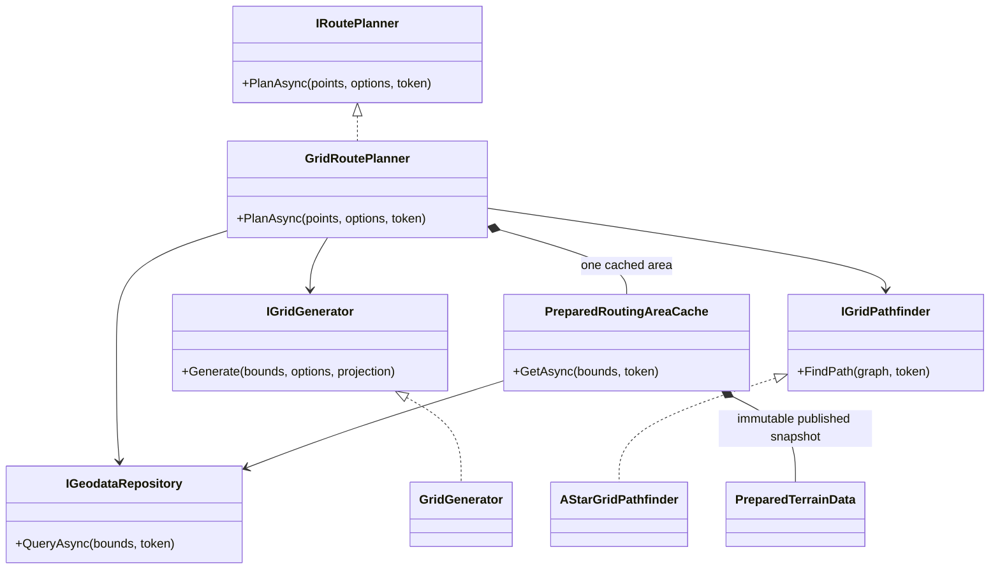
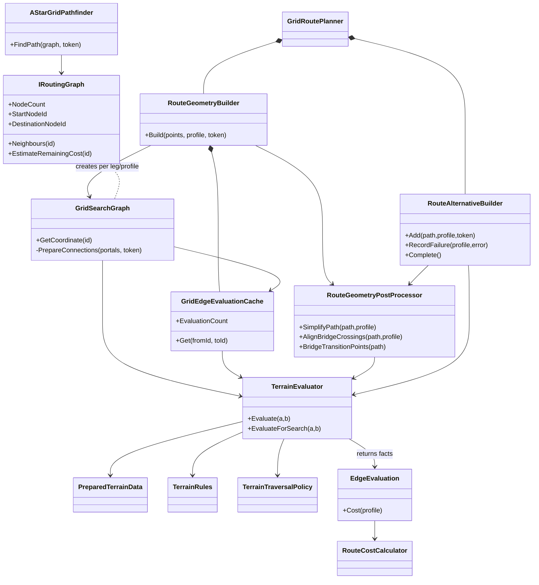
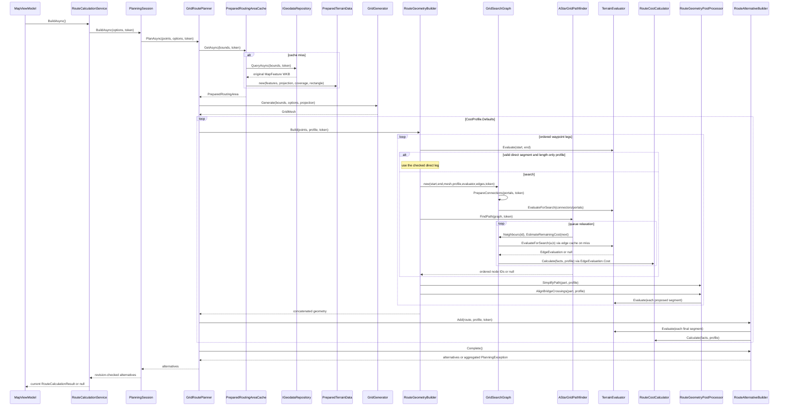

# Внутреннее устройство маршрутизации

Это руководство объясняет реализацию после структурного рефакторинга. Начните с
`GridRoutePlanner`, затем прочитайте `RouteGeometryBuilder`, `GridSearchGraph`,
`AStarGridPathfinder`, `TerrainEvaluator` и `RouteAlternativeBuilder`.
[Предметное поведение](routing-algorithm.md), [аудит и baseline](routing-refactoring-audit.md)
и [измерения](routing-benchmarks.md) дополняют описание кода.

## Структура каталогов

Файлы маршрутизации сгруппированы по уже существующим обязанностям:

- `Routing/` — координация расчёта и структурированное логирование;
- `Routing/Graph/` — представление графа, ленивые оценки рёбер и алгоритмы поиска;
- `Routing/Terrain/` — подготовленные пространственные данные и инженерные правила;
- `Routing/Routes/` — построение, постобработка и формирование альтернатив.

Физическое перемещение не меняет namespace `CableRoutePlanner.Infrastructure.Routing`,
публичные контракты или зависимости между классами.

## Назначение и границы

Маршрутизатор соединяет упорядоченные пользовательские точки кабельной трассой
внутри офлайн-пакета. Исходные несокращённые WKB объектов приходят через
`IGeodataRepository`; SQLite и его R-tree принадлежат Persistence. Расчёт не
обращается к сети и не использует упрощённый слой отрисовки карты.

Domain определяет запреты и стоимость. Infrastructure измеряет геометрические
факты, строит граф и ищет пути. Application владеет сессией, ревизией и отменой;
ViewModels и UI показывают результаты. OSM-кандидат моста позволяет исследовать
геометрический переход, но **не удостоверяет инженерную пригодность**.

## Полная последовательность расчёта

| Шаг и владелец | Вход → операция → выход | Отказ или отмена |
| --- | --- | --- |
| `MapViewModel.BuildRoutes` | Команда пользователя → `IRouteCalculationService.BuildAsync` → состояние занятости и результат для представления | Старый результат не публикуется после изменения сессии |
| `RouteCalculationService.BuildAsync` | Загружает `ISettingsStore.Load`, фиксирует request/revision, отменяет предыдущий запрос → `IPlanningSession.BuildAsync` | Отмена даёт Cancelled; ошибки становятся Failed на границе представления; устаревший запрос возвращает null |
| `PlanningSession.BuildAsync` | Проверяет настройки/состояние точек, копирует координаты → `IRoutePlanner.PlanAsync` | Изменившаяся ревизия и cancellation не позволяют сохранить устаревшие альтернативы |
| `GridRoutePlanner.PlanAsync` | Проверяет options, минимум две точки, покрытие; строит и обрезает область поиска | `PointOutsidePackage`, ошибки параметров |
| `PreparedRoutingAreaCache.GetAsync` | Ключ точные bounds одного repository/planner → повторно использует один снимок либо делает `QueryAsync` и подготовку в фоне | Ошибка репозитория/геометрии, неизвестный тип местности, cancellation; отменённая подготовка не публикуется |
| `PreparedTerrainData` | WKB → один проход проекции, коридоры воды, prepared geometry, STRtree, мостовые/газовые порталы и дорожные контакты | Некорректные исходные геометрии и неподдерживаемая конфигурация не скрываются |
| `GridGenerator.Generate` | Область/options/projection → регулярный `GridMesh` с адаптивным шагом | `ResourceLimit`, если бюджет не соблюдается даже с допустимым укрупнением |
| `GridRoutePlanner.Calculate` | Создаёт evaluator, postprocessor и builders одного расчёта; исключает порталы вне загруженной области; перебирает профили | Cancellation проверяется между профилями; неожиданные исключения распространяются |
| `RouteGeometryBuilder.Build` | Упорядоченные точки + профиль → объединённые legs; прямой допустимый путь для чистого профиля длины либо граф/A* | Совпадающие точки пропускаются; `GridConnectionUnavailable` и `NoRouteInSearchArea` остаются разными отказами |
| `GridSearchGraph` / `AStarGridPathfinder.FindPath` | Узлы, допустимые переходы/стоимости/эвристика → node IDs пути либо null | Cancellation; отсутствие пути в представленном графе не доказывает физическую непроходимость |
| `RouteGeometryPostProcessor` | `SimplifyPath`, затем `AlignBridgeCrossings` → проверенная геометрия leg | Каждый shortcut/splice проверяется тем же evaluator; недопустимая замена не применяется |
| `RouteAlternativeBuilder.Add` | Финальная геометрия → повторная проверка сегментов, метрики/ID/маркеры/контакты, проверка максимальной длины и сходства | `RouteLengthLimitExceeded` с actual/max, совпадение всех точек, непрошедшая проверку геометрия |
| `RouteAlternativeBuilder.Complete` | Успехи и ожидаемые отказы профилей → стабильные уникальные альтернативы либо структурированная совокупная ошибка | Все исходные `ProfileSearchFailure` сохраняются; успех другого профиля остаётся доступным |
| Возврат через Application в ViewModel | Проверяется актуальность request/revision → список альтернатив и выбранная трасса | Поздние ответы не заменяют новые данные; presentation-проекция вершин не меняет расчётную геометрию |

## Классы и владение

Общая схема зависимостей (Composition Root создаёт реализации через регистрацию):

Внутренние объекты одного расчёта и одного leg/profile:

Нет ссылки Infrastructure на Persistence, ссылок Domain на NTS и циклической
зависимости evaluator/postprocessor. `RoutingLog` — static-определения событий,
а не DI-сервис. Подробности исходной схемы и обоснование выделений находятся в
[аудите](routing-refactoring-audit.md).

## Последовательность вызовов

## Граф и A*

`GridMesh` нумерует регулярные узлы по строкам (`row * Columns + column`).
`GridSearchGraph` дописывает вершины порталов и две произвольные конечные точки.
Соседи сетки — восемь клеток. Соединители точки исследуют квадрат радиусом
**8 ячеек**, с округлением ближайшей строки/колонки и обрезкой границ. Это
квадрат поиска кандидатов, а не гарантия соединения: каждый отрезок проверяется.
Конструктор вызывает private `PrepareConnections`: сначала соединения start,
затем destination, затем порталы и прямой сегмент. Граф владеет этими готовыми
связями одного leg/profile; отдельный builder или DI-сервис не нужен.
К концам порталов также строятся проверенные соединители; последовательные
вершины портала соединяются явно в обоих направлениях. Короткое прямое ребро
графа рассматривается при расстоянии не более двух ячеек.

`IRoutingGraph` предоставляет плотные целые ID, соседей с неотрицательными
конечными стоимостями и допустимую нижнюю оценку остатка. A* использует массивы
лучших расстояний и родителей, priority queue и восстановление ID от цели к
истоку. Устаревшие записи очереди игнорируются. Отмена проверяется при извлечении
очередного узла. Ядро знает только BCL и контракт графа; отсутствие пути даёт
null, а предметную ошибку оформляет владелец leg.

Эвристика `distanceToGoal * profile.MinimumCostPerMetre` использует минимум
обычной цены метра и множителя просеки. Штрафы неотрицательны, поэтому она не
завышает стоимость. Нулевая оценка превращает поиск в Dijkstra; переоценка
нарушила бы гарантию оптимальности в заданном графе. Порядок соседей и
очередность профилей сохранены, включая выбор среди равных стоимостей.

## Стоимость и предметные правила

`TerrainTraversalPolicy.For` явно классифицирует каждый `TerrainKind`:
blocked, costed, conditional transition, approved transition или neutral.
`TerrainRules` проверяет полноту реализации всех значений и соответствие
`Blocks` Domain. Пропущенное правило или неизвестный тип отклоняются явно;
новый enum не становится автоматически проходимым. Settlement и исходная
OverheadGasPipeline остаются нейтральными. Отдельный GasPipelineCrossingCandidate
обрабатывается индексом допустимых переходов, а не становится препятствием.

`TerrainEvaluator` сначала проверяет покрытие и полное пересечение препятствий,
потом собирает длины участков и идентификаторы. Результат `EdgeEvaluation`
передаёт `SegmentTerrainFacts` в Domain `RouteCostCalculator`. Жёсткий запрет
возвращает null до расчёта цены. Стоимость состоит из длины, весов леса/поля,
скидки просеки и штрафов переходов согласно профилю. Предпочтение газа влияет
только на фактически применимые газовые переходы; мост сам по себе не является
газовым переходом.

При поиске длины плоские; итоговая длина — геодезическая между концами каждого
отрезка. Измеренные плоские доли леса/поля/просеки масштабируются к этой длине
и ограничиваются длиной сегмента. Одни и те же Domain правила применяются в
поиске, сглаживании и итоговой оценке; различие метрической аппроксимации явно
сохранено. Цена суммируется по рёбрам, а отображаемые количества объектов и ID
уникальны для всей трассы. Одно ребро не считает один мост дважды.

## Препятствия, мосты, газ и постобработка

`PreparedTerrainData` читает и проецирует каждый WKB один раз. Объекты для
основного индекса сортируются по ID; газовые кандидаты сохраняют исходный
порядок репозитория, чтобы не менять tie choices. Prepared geometry ускоряет
intersects/covers, STRtree отбирает потенциальные пересечения по envelope.
Полный сегмент проверяется и у диагоналей, и у произвольных соединителей.

Вода получает вырезанные коридоры подтверждённых переходов с непустым
`ApprovalId` и OSM-кандидатов мостов с фиксированным допуском 2 м. Это не
разрешает здание или болото. Мостовые порталы содержат полную исходную линию;
порталы за пределами загруженной области не включаются в граф. Газовый индекс
проверяет локальную геометрию кандидат/дорога и применимость к каждому контакту.

Для дороги рекурсивно выделяются все точки, включая MultiPoint и смешанные
GeometryCollection с линейными компонентами. Каждый контакт требует кандидата
моста либо газа по Domain. Совпадение вдоль дороги сохраняет прежнюю семантику;
изолированное касание требует кандидата и не позволяет обойти запрет разбиением
отрезка вершиной на оси дороги.

`SimplifyPath` выбирает самый дальний допустимый shortcut в окне 64 вершин,
если его стоимость не выше заменённого участка с допуском 0.001 cost units.
Затем `AlignBridgeCrossings` рассматривает мосты не дальше 15 м, заменяет
близкие вершины полной линией моста и выбирает допустимый простой splice по
стоимости, затем длине. Самопересечение или запрещённый сегмент отклоняет splice.
`BridgeTransitionPoints` формирует уникальные точки входа/выхода из воды;
`RoadContactAnalyzer` добавляет дорожные контакты. Presentation-проекция не
переупрощает инженерный путь.

## Альтернативы и диагностика

`RouteAlternativeBuilder` повторно проверяет финальные сегменты, суммирует
длины и цены, объединяет ID объектов, создаёт read-only геометрию и метаданные.
Равенство максимальной длине допускается. Два пути считаются почти одинаковыми,
если совпадает набор газовых кандидатов и не менее 90% длины предлагаемого пути
попадает в коридор существующего шириной 0.75 исходного шага. Сравнение
направленное, поэтому порядок профилей сохраняется. При предпочтении газа
стабильная сортировка показывает найденные газовые альтернативы первыми.

Ожидаемые GridConnectionUnavailable/NoRouteInSearchArea не мешают другому
профилю. Если успехов нет, приоритет ошибки: наиболее короткий доказанный
RouteLengthLimitExceeded, затем GridConnectionUnavailable, затем первый
NoRouteInSearchArea. `SearchFailures` сохраняет все отказы, `InnerException`
— выбранный исходный отказ. Причина не определяется по русскому тексту.
Неожиданные исключения и ошибки конфигурации не маскируются объяснением о дороге.

`RoutingLog` сохраняет Information-события 1 PreparationLog, 2
RoutesCompletedLog, 3 SearchCompletedLog и 4 ProfileUnavailableLog. Поля времени,
профиля/reason, числа узлов/уникальных рёбер и исходное исключение остаются
структурированными; координаты не добавляются. Категория логгера остаётся
`GridRoutePlanner`.

## Кеши, жизненный цикл и параллельность

DI регистрирует высокоуровневый `IRoutePlanner`, подменяемые `IGridGenerator` и
`IGridPathfinder`, репозиторий и Application-сервисы. Полезные подмены генератора
и поиска сохраняются в композиционных тестах. Обычные внутренние классы
создаются владельцем расчёта: регистрировать их в контейнере не требуется.

`PreparedRoutingAreaCache` хранит только последнюю область в течение жизни
planner. Ключ включает только точные Bounds: ни размер ячейки, ни историческое
предпочтение газа не участвуют в подготовке WKB/проекций/индексов. Размер ячейки
применяется заново в каждом расчёте, а газовое предпочтение в приложении всегда
включено и нормализуется при чтении legacy-настроек. Lock защищает чтение/публикацию снимка; дорогая подготовка выполняется
вне lock. Два параллельных miss могут независимо подготовить данные — это
сознательно сохранённое поведение без блокировки длительной работы. Ни один
читатель не мутирует опубликованные NTS-геометрии/индексы.

`RouteGeometryBuilder` владеет `GridEdgeEvaluationCache`: ключ `(minId,maxId)`
симметричен, значение — факты либо null для заблокированного ребра. Цена
профиля не кешируется. `EvaluationCount` равен числу уникальных ключей,
включая заблокированные. Один расчёт переиспользует факты между legs и
профилями; другой имеет собственный словарь. Один словарь не используется
параллельными профилями: они выполняются последовательно. Подготовленный снимок
можно разделять между запросами, поисковые словари/очереди — нельзя.

Чистые вычисления и лог-определения static; временные кеши, индексы и builders
обычные экземпляры; интерфейс введён только там, где отделяет A* от графа.
Нет Service Locator, глобального изменяемого состояния и универсального context.

## Точность и производительность

Область расширяется на 10% максимального последовательного leg с границами
1–5 км. Долготный запас учитывает cos средней широты и ограничивается 180°.
Это ограниченный поиск обхода, а не бесконечное расширение.

Локальная проекция использует фиксированный масштаб долготы в центре области.
В коде нет прежнего заявленного ограничения 20 км; на больших широтных
диапазонах и около полюсов аппроксимация хуже. Смена проекции/перенос через
антимеридиан этим рефакторингом не реализуются.

Генератор начинает с sqrt(area / MaxNodes), уточняет фактическое число строк и
столбцов 48 шагами бинарного поиска и ограничивает шаг 2000 м. При бюджете
меньше 1000 узлов сохраняется ранний отказ, если исходная сетка не помещается.
Грубая сетка может потерять узкий проход; ResourceLimit и отсутствие пути не
доказывают невозможность строительства.

Память зависит от числа загруженных геометрий, узлов/порталов и вычисленных
рёбер. Один кеш области не ограничивает размер самой области; бюджет узлов
не является отдельным строгим бюджетом NTS-памяти. Точные сравнения до/после,
границы применимости замеров и команды находятся в
[аудите](routing-refactoring-audit.md). Контрольные JSON проверяют геометрию,
все метрики, ID, контакты, порядок альтернатив и типизированные ошибки без Guid.

## Как добавить инженерное правило

Пример: новая запрещённая территория `ProtectedArea`, поступающая из источника.
Это будущий пример, он не добавляет тип и не меняет SQLite в текущем PR.

1. В Domain `TerrainKind.cs` добавьте значение и **явный** case в
   `TerrainTraversalPolicy.For`. Для запрета верните Blocked. Не меняйте A*.
2. В Infrastructure `Routing/TerrainRules.cs` зарегистрируйте
   `TraversalOnlyRule(TerrainKind.ProtectedArea)` в Defaults. Конструктор
   проверяет полноту и согласованность Blocks с Domain. DI для одного правила
   не нужен: это внутренний реестр геометрических вкладов.
3. Если источник ещё не поставляет такой объект, отдельно определите его
   преобразование в инструменте подготовки Persistence/данных и совместимость
   пакета. Изменение формата не является частью подключения A*.
4. Добавьте Domain-тест политики, тест отсутствия регистрации, segment-тест
   пересечения и обхода, тест запрета пользовательской точки и интеграционный
   маршрут. Для известной ошибки сначала воспроизведите RED, затем GREEN.
5. Прогоните контрольные RoutingBaselineTests и существующие команды
   `tools/check.py lint` / `desktop`, обновите routing-algorithm.md.

Для стоимостного правила добавляются измеряемые факты в профильный evaluator/
contribution и формула в Domain `SegmentTerrainFacts`/`RouteCostCalculator`;
при изменении цены проверьте нижнюю оценку `MinimumCostPerMetre`. Для условного
перехода Infrastructure обнаруживает геометрические кандидаты, Domain решает
допустимость, затем профильные индексы добавляют порталы и факты результата.
Нейтральному объекту требуется явная пассивная регистрация. Факты, которые
нужны пользователю, проходят через assembler/метрики; они не должны скрыто
влиять на цену или становиться разрешением перехода.

Адаптивный/иерархический граф в будущем может реализовать `IRoutingGraph`,
сохранив допустимую эвристику и ID-контракт. Построение порталов и перевод ID в
геометрию останутся ответственностью соответствующего графа/builder, а ядро
A* не должно узнавать о WKB, SQLite или конкретном инженерном объекте.

## Проверка соединений и успешных маршрутов после PR #44

[Точечный аудит и сравнение вариантов](routing-graph-cache-audit.md) объясняет
отказ от builder, дополнительных интерфейсов и UI-конфигурации подключения.
`GridSearchGraphTests` проверяет ties-to-even, квадрат 17×17, края, заблокированные
кандидаты, включительную границу двух ячеек, лень регулярных рёбер, нумерацию/порядок
порталов, препятствия и сравнение с Dijkstra. При изменении подключения сначала
закрепите эти контракты тестами; не материализуйте все регулярные рёбра.

`SuccessfulRouteRegressionTests` усиливает исходные положительные контролы и
три реальных маршрута Минска. `SuccessfulGraphPhaseTests` измеряет отдельный
fixed-area probe с проверкой найденных путей всех профилей; это не внутренние
тайминги полного planner. Обычные тесты не имеют wall-clock порогов.
