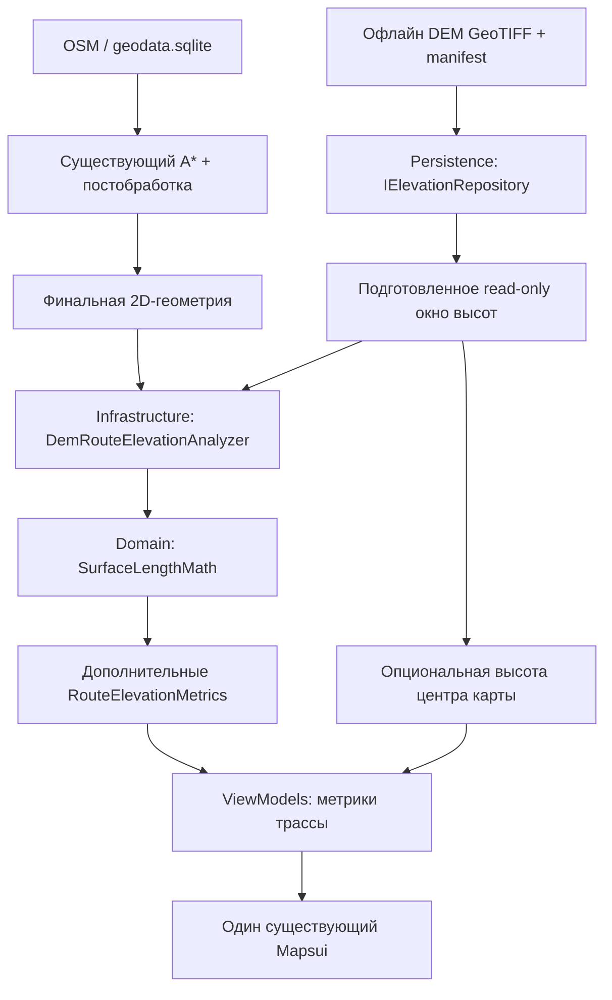

# Исследование: учёт рельефа при расчёте длины наземного кабеля

> **Статус: ИДЕЯ / ТЕХНИЧЕСКОЕ ИССЛЕДОВАНИЕ. НЕ РЕАЛИЗОВАНО. НЕ УТВЕРЖДЕНО К РАЗРАБОТКЕ.**
>
> Этот документ фиксирует рассматриваемый вариант развития CableRoutePlanner и математические формулы, чтобы не потерять их. Описанные интерфейсы, классы, сценарии UI, источники DEM и алгоритмы **предлагаются**, но **не существуют в рабочем приложении**. Документ сам по себе не меняет требования, текущие расчёты и ограничения. Актуально на 2026-11-06.

## 1. Краткое решение

Рассмотреть отдельный, опциональный **анализ готовой 2D-трассы по цифровой модели высот (DEM)** без создания 3D-карты и без изменения поиска A*.

**Рекомендуемый порядок:**

1. Проверить фактическую точность нынешней горизонтальной длины.
2. Скачать настоящий DEM **для Беларуси**, начать с существующего тестового района Дрозды — Новинки.
3. Сравнить 2D-длину, длину вдоль цифровой поверхности и независимые контрольные данные.
4. Только при доказанной полезности добавить модуль анализа, не включённый в стоимость рёбер A*.
5. Опционально показывать высоту **центра существующей 2D-карты**, используя тот же DEM.
6. Только отдельным будущим решением обсуждать учёт уклона при **выборе** маршрута.

**Не планируется в рамках этой идеи:** второй картографический движок, синхронизация двух карт, встроенный 3D, перестройка графа поиска, автоматическое отклонение крутых склонов или замена запаса кабеля геометрической поправкой.

Это оценка для **наземного кабеля, следующего грунту**. Если технология прокладки на отдельных участках предполагает подвес, специальные крепления, петли или переходы, DEM не воспроизводит фактическую геометрию кабеля.

## 2. Что есть в коде сейчас

| Факт | Текущее место |
|---|---|
| A* работает на 2D-сетке и оценивает рёбра без высот | [`Graph/GridSearchGraph.cs`](../src/CableRoutePlanner.Infrastructure/Routing/Graph/GridSearchGraph.cs), [`Graph/GridEdgeEvaluationCache.cs`](../src/CableRoutePlanner.Infrastructure/Routing/Graph/GridEdgeEvaluationCache.cs) |
| Координация поиска и нескольких профилей | [`GridRoutePlanner.cs`](../src/CableRoutePlanner.Infrastructure/Routing/GridRoutePlanner.cs) |
| Проверка препятствий и длины участка | [`Terrain/TerrainEvaluator.cs`](../src/CableRoutePlanner.Infrastructure/Routing/Terrain/TerrainEvaluator.cs) |
| Упрощение пути / проходы по мостам | [`Routes/RouteGeometryPostProcessor.cs`](../src/CableRoutePlanner.Infrastructure/Routing/Routes/RouteGeometryPostProcessor.cs) |
| Окончательная геометрия и итоговые метрики | [`Routes/RouteAlternativeBuilder.cs`](../src/CableRoutePlanner.Infrastructure/Routing/Routes/RouteAlternativeBuilder.cs) |
| Длина `LengthMetres`, запас `CableLengthMetres(reserveFraction)` и пока nullable `AscentMetres` | [`Domain/RouteMetrics.cs`](../src/CableRoutePlanner.Domain/RouteMetrics.cs) |
| Математика цены профилей независимо от GIS | [`Domain/SegmentTerrainFacts.cs`](../src/CableRoutePlanner.Domain/SegmentTerrainFacts.cs) |
| Границы инфраструктурных зависимостей | [`Application/Contracts.cs`](../src/CableRoutePlanner.Application/Contracts.cs) |
| Единственная 2D-карта Mapsui и viewport-события | [`UI/MapAdapters/IMapAdapter.cs`](../src/CableRoutePlanner.UI/MapAdapters/IMapAdapter.cs) |

Важное уточнение о точности: [`Domain/GeoCoordinate.cs`](../src/CableRoutePlanner.Domain/GeoCoordinate.cs) считает `DistanceTo` по гаверсинусу на **сфере** со средним радиусом 6 371 008,8 м. Это не точная геодезическая линия на эллипсоиде WGS 84. В общем случае сферическое приближение может ошибаться примерно до 0,5% относительно эллипсоидальной геодезики. На пологих склонах такая ошибка потенциально больше поправки от высоты. **Нельзя заявлять о повышении точности, не проверив сначала эту базу.** Изменять `DistanceTo` глобально без регрессионных проверок также нельзя: он используется не только в итоговой длине.

По состоянию на данный документ основной пакет содержит OSM, **не DEM**; `DataPackageInfo.HasTerrain` не следует считать доказательством наличия растровых высот для расчёта.

## 3. Математическая постановка

Пусть `s` — горизонтальная длина вдоль фиксированной 2D-трассы, а `h(s)` — высота поверхности в метрах в том же вертикальном датуме.

### 3.1. Длина дуги, а не площадь под графиком

$$
L_{3D}=\int_0^{L_{2D}}\sqrt{1+\left(\frac{dh}{ds}\right)^2}\,ds.
$$

Здесь `dh/ds` — **продольный уклон в направлении кабеля**, безразмерная величина (м/м). Интеграл $\int h(s)\,ds$ описывает площадь под профилем и **не является длиной кабеля**.

Дискретная реализация для последовательных измерений:

$$
\boxed{L_{3D}\approx \sum_{i=0}^{n-1}
\mathrm{hypot}\left(d_i,\,h_{i+1}-h_i\right)}
$$

где `d_i` — горизонтальная длина между соседними измерениями, а `hypot` — устойчивая численная форма $\sqrt{d_i^2+\Delta h_i^2}$.

Приближённый продольный уклон:

$$
g_i=\frac{h_{i+1}-h_i}{d_i},\qquad
p_i=100\,g_i\ \%, \qquad
\alpha_i=\arctan(g_i).
$$

Подъём и спуск по **соседним** выборкам (не просто разница концов):

$$
H_{\uparrow}=\sum_i\max(0,h_{i+1}-h_i),\qquad
H_{\downarrow}=\sum_i\max(0,h_i-h_{i+1}).
$$

На любом корректном наборе выборок $L_{3D}\geq L_{2D}$, если обе длины основаны на одних горизонтальных сегментах. Поправка $\Delta L=L_{3D}-L_{2D}$. Величина $\Delta L$ не равна ни $H_\uparrow$, ни $H_\uparrow+H_\downarrow$.

При постоянном уклоне `g`:

$$
L_{3D}=L_{2D}\sqrt{1+g^2},
\qquad
\frac{\Delta L}{L_{2D}}=\sqrt{1+g^2}-1
\approx \frac{g^2}{2}\quad (|g|\ll 1).
$$

| Постоянный уклон | Добавка на 1 км горизонтали |
|---:|---:|
| 1% | ≈0,05 м |
| 5% | ≈1,25 м |
| 10% | ≈4,99 м |
| 20% | ≈19,80 м |

Это **идеальные** прямые склоны, не эмпирические цифры для Беларуси. При переменных уклонах интегрируется вся трасса.

### 3.2. Градиент **по направлению** движения

Если поверхность задана полем высот `h(x,y)` в локальных метрических координатах, а направление текущего участка — единичный вектор $\mathbf{t}=(t_x,t_y)$:

$$
\nabla h=
\left(\frac{\partial h}{\partial x},\,\frac{\partial h}{\partial y}\right),
\qquad
\boxed{\frac{dh}{ds}=\nabla h\cdot\mathbf t}.
$$

Большой **общий** градиент местности не обязательно означает большой продольный уклон кабеля: трасса может идти **поперёк** склона.

### 3.3. Почему частота измерений зависит от изменения уклона

**Не нужно делать более частые измерения только потому, что склон крутой.** На линейном склоне двух значений высоты достаточно для вычисления длины его прямого сегмента (если сама модель действительно линейна).

Уточнение необходимо прежде всего там, где меняется `dh/ds`, то есть изгибается профиль. В идеализированном гладком поле это связано с $d^2h/ds^2$, а на прямом отрезке также с направленной кривизной $\mathbf{t}^{\mathsf{T}}\,\mathrm{Hess}(h)\,\mathbf{t}$.

Практически не следует пытаться рассчитывать шумную вторую производную DEM на каждом шаге. Предпочтительнее **геометрический критерий уточнения по длине**.

## 4. Рассматриваемый алгоритм: ограниченное адаптивное интегрирование

Для отрезка трассы $A \rightarrow B$, с серединой `M` по **горизонтальному** расстоянию:

$$
L_{AB}=\mathrm{hypot}(d_{AB},h_B-h_A),
$$

$$
L_{\mathrm{split}}=
\mathrm{hypot}(d_{AM},h_M-h_A)+
\mathrm{hypot}(d_{MB},h_B-h_M),
$$

$$
\boxed{E=L_{\mathrm{split}}-L_{AB}\geq0}.
$$

`E` — локальная оценка недоучтённой длины в рамках **проверенных точек**, а **не доказанная верхняя граница** ошибки истинной поверхности.

**Предлагаемая стратегия:**

1. Работать по **финальной геометрии** после `SimplifyPath` и `AlignBridgeCrossings`, а не по исходным рёбрам A*.
2. Получить географические координаты выборок и высоту из **локально загруженного** растра. Проверять NoData/покрытие.
3. Разбить длинные отрезки до базового максимального шага, согласованного с сеткой DEM (пилот: ориентировочно 15–30 м, уточнить по реальному pixel size и тестам); по возможности выбирать точки пересечений трассы с границами ячеек DEM. Шаг *не* увеличивает физическое разрешение исходных данных.
4. Сравнить $L_{AB}$ и $L_{\mathrm{split}}$, делить участок при $E > \varepsilon_{\mathrm{local}}$; дополнительно соблюдать максимальную глубину и общий бюджет выборок.
5. Если тест пройден — учитывать две поддлины $L_{\mathrm{split}}$, а не одну грубую хорду $L_{AB}$. Если не пройден — уточнять рекурсивно обе части.
6. Суммировать физические длины и набор/спуск; фиксировать источник, разрешение, покрытие, погрешность **численного** уточнения.
7. При любой обязательной выборке NoData/невалидной высоты **не выдавать якобы точную полную 3D-длину**. Можно показать статус «нет данных высот» и сохранённую 2D-длину.

**Критический нюанс:** по началу, середине и концу можно не увидеть несколько симметричных волн. Поэтому критерий `E` **никогда не используется без верхней границы шага**, привязанной к исходному DEM. Для билинейной модели внутри ячейки можно тестировать выборки на границах ячеек плюс адаптивное уточнение. Чрезмерное уточнение внутри одного пикселя лишь интегрирует интерполированную модель, не создаёт новые измерения рельефа.

Псевдокод без привязки к C# или выбранной библиотеке:

```text
Analyze(finalPolyline, preparedElevationWindow):
    samples = IntersectPolylineWithDemGrid(finalPolyline)
    samples = EnsureMaximumSpacing(samples, demResolutionBound)
    require EverySampleHasHeight(samples)
    totals = empty

    for each consecutive sample pair (A, B):
        Integrate(A, B, depth=0)

    return totals

Integrate(A, B, depth):
    M = HorizontalMidpoint(A, B)
    hM = preparedElevationWindow.TrySample(M)
    require hM exists
    coarse = hypot(horizontalDistance(A, B), hB - hA)
    refined = hypot(horizontalDistance(A, M), hM - hA)
            + hypot(horizontalDistance(M, B), hB - hM)

    if (refined - coarse <= toleranceForThisSegment
        or depth == maximumDepth
        or sampleBudgetExhausted):
        accept refined, flag whether tolerance was achieved
    else:
        Integrate(A, M, depth + 1)
        Integrate(M, B, depth + 1)
```

**Не выбирать численные допуски без исследования.** $\varepsilon$, максимальную глубину, бюджет и шаг подобрать по convergence-тестам на настоящем DEM. При достижении лимита хранить флаг `ResolutionLimited`, а не заявлять, что точность достигнута.

### 4.1. Интерполяция растра

Для четырёх ближайших валидных пикселей `h_{00}, h_{10}, h_{01}, h_{11}` и относительных координат $u,v\in[0,1]$:

$$
h(u,v)=(1-u)(1-v)h_{00}+u(1-v)h_{10}
       +(1-u)vh_{01}+uvh_{11}.
$$

Это билинейная интерполяция **в координатной системе и пиксельной геометрии растра**. Учитывать NoData, края тайлов, `PixelIsPoint/PixelIsArea` и реальные геотрансформации: не предполагать, что 1 пиксель всегда равен 30 м. Уплощение/сглаживание может давать систематическую недооценку мелкого рельефа.

## 5. Какой DEM брать **для Беларуси**

### 5.1. Основной кандидат для первого теста: Copernicus GLO-30 Public

- **Официальный каталог:** https://dataspace.copernicus.eu/explore-data/data-collections/copernicus-contributing-missions/collections-description/COP-DEM
- **Публичный источник файлов:** https://registry.opendata.aws/copernicus-dem/
- **Структура S3/GeoTIFF:** https://copernicus-dem-30m.s3.amazonaws.com/readme.html
- **Условия использования/атрибуция:** https://developers.google.com/earth-engine/datasets/catalog/COPERNICUS_DEM_GLO30_2024_1
- **Горизонтальная система:** WGS84, широта/долгота (EPSG:4326); **вертикальная:** высота относительно геоида **EGM2008**, в метрах. Это не автоматически `GPS ellipsoidal height` и не «высота над уровнем моря» в строгом бытовом смысле.
- **Размер ячейки:** примерно 30 м; фактический шаг по долготе на широтах Беларуси зависит от сетки продукта; посмотреть `gdalinfo`.
- **Тип:** DSM, отражающая поверхность **с деревьями, зданиями и инфраструктурой**, а не DTM чистого грунта. В лесу «профиль кабеля по земле» может быть искажён.
- **Спецификации точности:** абсолютная вертикальная ошибка менее 4 м для 90% случаев, относительная менее 2 м на уклонах ≤20% для 90% случаев. Это **не** гарантии точности длины кабеля.
- Публичная AWS-копия и сервис просмотра Copernicus — **разные способы доступа**. В августе 2026 доступ к 30-метровому **View Service** ограничили регистрацией CCM; нельзя из этого автоматически делать вывод о запрете бесплатных **публичных файлов AWS**. Проверять актуальную доступность и условия перед релизом.

### 5.2. Конкретный файл для настоящего теста в Минске

Тестовые OSM-данные уже находятся в `samples/real-geodata-fixtures/minsk`: **долгота 27.48–27.53°, широта 53.93–53.96°** (район Дрозды — Новинки). Он целиком внутри градусного тайла **N53E027**.

По опубликованной схеме именования ожидается объект:

```text
s3://copernicus-dem-30m/
  Copernicus_DSM_COG_10_N53_00_E027_00_DEM/
  Copernicus_DSM_COG_10_N53_00_E027_00_DEM.tif
```

Это **вычисленный по официальной схеме путь**, а не подтверждение успешного скачивания конкретного объекта в рамках этого исследования. Сначала проверить наличие:

```bash
aws s3 ls --no-sign-request \
  s3://copernicus-dem-30m/Copernicus_DSM_COG_10_N53_00_E027_00_DEM/
```

Если объект присутствует, скачать **на машине разработки** (AWS CLI без аккаунта):

```bash
mkdir -p artifacts/dem
aws s3 cp --no-sign-request \
  s3://copernicus-dem-30m/Copernicus_DSM_COG_10_N53_00_E027_00_DEM/Copernicus_DSM_COG_10_N53_00_E027_00_DEM.tif \
  artifacts/dem/N53E027-copernicus-glo30.tif

gdalinfo artifacts/dem/N53E027-copernicus-glo30.tif
```

Получить небольшой, немного расширенный GeoTIFF **только для этого района** (GDAL; `-projwin` в градусах EPSG:4326: слева, сверху, справа, снизу):

```bash
gdal_translate \
  -projwin 27.475 53.965 27.535 53.925 \
  -of GTiff -co TILED=YES -co COMPRESS=DEFLATE \
  artifacts/dem/N53E027-copernicus-glo30.tif \
  artifacts/dem/minsk-drozdy-novinki-dem.tif
```

Открыть `artifacts/dem/minsk-drozdy-novinki-dem.tif` в **QGIS** вместе с текущими OSM-данными и проверить фактические отметки высоты / NoData / смещение. Не хранить многомегабайтные исходники в Git.

Для всей Беларуси потребуется **мозаика множества соседних тайлов** 1°×1°, обрезка по реальному охвату страны, индекс покрытия и контрольные суммы. **Не** загружать весь национальный DEM в оперативную память и **не** добавлять автоматически весь объём в APK: сначала маленький пилот, затем отдельные региональные офлайн-пакеты.

Если конкретный тайл отсутствует: проверить `tileList.txt` из AWS, каталог Copernicus или использовать GLO-90/SRTM как **явно помеченный** резервный источник, не выдавая его за GLO-30.

### 5.3. Другие проверяемые источники

| Источник | За | Ограничения / роль |
|---|---|---|
| **Copernicus GLO-30 Public** | Настоящий GeoTIFF, публичный S3, ~30 м, Беларусь | **DSM**, растительность/здания; основной кандидат для пилота |
| **NASA SRTM 1 arc-second** | ~30 м, широко доступный baseline | Более старый рельеф, тоже не гарантирует грунт под лесом; сравнение |
| **ALOS AW3D30** | ~30 м, независимый продукт | Проверка условий и доступности; сравнительный baseline |
| **FABDEM** | Попытка удалить здания и деревья из Copernicus | ~30 м, модельная коррекция; публичные данные имеют **некоммерческую** лицензию, для коммерческого распространения отдельные условия |
| **Copernicus GLO-90** | ~90 м, глобальный запасной вариант | Более грубый, не смешивать разрешения бесследно |

- OpenTopography, выбор участка / API (для ряда способов требуется регистрация или API key): https://portal.opentopography.org/datasetMetadata.jsp?otCollectionID=OT.032021.4326.1 ; https://www.opentopography.org/developers
- Простой API **только для ручного исследования**, не для офлайн-приложения: https://www.opentopodata.org/api/ и `https://api.opentopodata.org/v1/srtm30m?locations=53.95,27.51`
- FABDEM / ограничения лицензии: https://research-information.bris.ac.uk/en/datasets/fabdem-2/ ; https://www.fathom.global/insight/fabdem-download/
- Контроль геодезической точности (сфера против эллипсоида): https://geopy.readthedocs.io/en/stable/#calculating-distance
- Официальная справка GDAL `gdal_translate`: https://gdal.org/en/stable/programs/gdal_translate.html

**Выбор конкретного набора для рабочего APK должен зависеть от результатов пилота**, а не от того, какой источник красиво выглядит на 3D-карте.

## 6. Нет «второй карты» и синхронизации двух карт

OSM и DEM — **два слоя данных с общей географической привязкой**, а не два картографических окна.

- OSM продолжает снабжать Mapsui объектами и препятствиями.
- DEM — отдельная высотная сетка, выбираемая по тем же `GeoCoordinate(latitude, longitude)`.
- Координаты по умолчанию — EPSG:4326; геометрия трассы в локальной метрической проекции переводится обратно при запросе высоты.
- На экране остаётся **один** `MapsuiMapAdapter`. Не нужно вводить MapLibre, вторую камеру, синхронизацию зума или отображение объёмного рельефа.
- Для корректной интерполяции нужны фактическая геопривязка и vertical datum DEM; пересчёт координат и проверка покрытия находятся вне Domain.
- На стыках тайлов не допускать ложных скачков высоты из-за округления / NoData / разных вертикальных систем.

**Один OSM-пакет + опциональный DEM-пакет**. Манифест DEM: `source`, `version`, `resolution`, `horizontalCrs`, `verticalDatum`, `coverage`, `hashes`, `license`, `attribution`. Не подменять флаг `HasTerrain` сведениями о просто существующем OSM.

## 7. Распределение ответственности: SOLID / KISS / DRY

Обязательное условие: **не раздувать существующие классы** и **не заставлять A* знать о DEM**.

| Слой | Рассматриваемые обязанности | Чего в нём не должно быть |
|---|---|---|
| **Domain** | Immutable `RouteElevationMetrics`, `DistanceElevationSample`, чистая функция `SurfaceLengthMath`: `hypot`, подъём/спуск, инварианты и валидация | SQLite, GDAL, GeoTIFF, Mapsui, async/IO, преобразование CRS, кэш файлов |
| **Application** | Малые контракты `IElevationRepository` / `IReadOnlyElevationWindow` и `IRouteElevationAnalyzer` (если реально нужен для подмены), опциональная оркестрация сессии, `CancellationToken`, статусы unavailable | Чтение пикселей, платформенный UI, GIS-форматы |
| **Infrastructure** | `DemRouteElevationAnalyzer`, геометрическая адаптивная выборка вдоль готовой трассы, выбор шага, математическая связь с Domain | SQL, файловая упаковка, ViewModel, изменение поискового графа |
| **Persistence** | `GeoTiffElevationRepository`: загрузка/валидация тайлов и манифеста, локальный кэш блоков, NoData, интерполяция в координатах растра; офлайн | Предметная стоимость, поиск A*, визуализация |
| **ViewModels** | Опциональное представление статуса метрик, лёгкий координирующий поток запроса высоты центра карты | Геодезические вычисления, чтение TIFF |
| **UI / Mapsui adapter** | Координаты центра viewport, событие при смене камеры; отображение подписей | Собственная копия DEM / маршрутов, второй картографический движок |

Названия предварительные; **не создавать абстракции ради абстракций**. Если для Domain достаточно `static` чистой функции и одного record — не вводить лишний интерфейс. Если чтение конкретного формата проще держать в одном адаптере Persistence — не создавать фабрику/иерархию ради единственного источника.

Поток данных:



Точки интеграции:

1. **Не менять** `AStarGridPathfinder`, `IRoutingGraph`, `GridSearchGraph`, `GridEdgeEvaluationCache` и `TerrainEvaluator` ради первой версии.
2. Проводить анализ **после** того, как `RouteAlternativeBuilder` отобрал уникальную окончательную геометрию. Не запускать тяжёлую выборку для отсеянных дубликатов; не помещать всю логику интегрирования внутрь `RouteAlternativeBuilder`.
3. Рассмотреть отдельный `RouteElevationEnricher`/application orchestrator, который получает `RouteAlternative` и возвращает новый immutable результат/`Metrics`, сохраняя идентификаторы и порядок. Изменение DTO — минимально, с обратной совместимостью.
4. `RouteMetrics.AscentMetres` уже есть и nullable: при проектировании решить, использовать существующее поле или структурированный nullable `Elevation` record. **Не хранить два конфликтующих источника подъёма.**
5. `RouteMetrics.LengthMetres`, `WeightedCost`, `MaxRouteLengthMetres` и существующий `CableLengthMetres(reserveFraction)` **сохраняют старую семантику** до отдельного согласованного решения.
6. При отмене/смене ревизии сессии отбрасывать запоздавшее обогащение точно так же, как уже отбрасывается старый поиск.
7. Не переводить GIS-зависимости в Domain. Ни один из будущих классов не должен превращаться в универсальный «сервис всего о рельефе».

## 8. UX: что показывать пользователю

**Рекомендация: оставить главный результат понятным и не заменять его молча.**

До валидации DEM:

- Основная строка: **«Длина трассы (по карте): 1 250 м»**; текущая оценка запаса не меняется.
- Если локальные высоты существуют и расчёт прошёл: во вторичных характеристиках **«Оценка длины по рельефу: 1 253 м»**, **«Разница: +3 м»**, необязательные `подъём/спуск` и статус «По цифровой модели высот».
- Если нет данных: **не показывать вымышленное «1 250 м по рельефу»**; отображать только 2D-длину.
- Не писать «точная длина кабеля» и не печатать сантиметры, если точность DEM не подтверждена.

**После** независимой валидации можно рассмотреть основную строку «Расчётная длина кабеля с запасом», где основание (2D или поверхность) **явно названо** в деталях. Запас 10% применяется **один раз**, не складываясь с придуманной «поправкой на рельеф». Важно не сломать текущие значения при загрузке старых настроек.

### 8.1. Опционально: высота точки в центре существующей карты

**Да, технически возможно без дополнительной карты**, но это отдельная необязательная UI-функция:

- внизу небольшой индикатор: **«Высота поверхности в центре: ~214 м (DEM)»**;
- центр **карты**, не местоположение GPS пользователя;
- новый/существующий viewport stream отдаёт **географический центр**, а не тип Mapsui в ViewModel;
- debounce примерно 200–300 мс при перемещении, отмена предыдущего запроса, проверка последней ревизии viewport;
- чтение из кэша высот, **никаких HTTP-запросов** и повторного запуска A* при каждом движении карты;
- при отсутствии DEM / NoData: «Высота: нет данных», опционально скрывать индикатор в настройках;
- указывать, что это **высота поверхности из DEM относительно EGM2008**, не измерение высоты телефона или точная отметка грунта;
- округление для UX до целых метров, без ложной прецизионности;
- проверить доступность и производительность на Android/Windows. На первом пилоте возможно вовсе не добавлять индикатор.

`IMapAdapter` уже содержит `ViewportStateChangedStream`; оценить его достаточность, прежде чем добавлять новое событие. Координатную проекцию выполнять в UI-адаптере, не пробрасывая Mapsui в Domain/ViewModels.

## 9. Производительность, память и отсутствие влияния на A*

**Главная оптимизация — интегрировать высоты после поиска**, по финальной линии, а не на каждом ребре сетки.

- Поиск A* и `GridEdgeEvaluationCache` не получают обращения к DEM.
- Сложность анализа ≈ `O(N)` по фактическому числу выборок высот плюс стоимость декомпрессии нужных блоков.
- Пример для оценки масштаба: 20 км при среднем шаге 20 м → ~1 000 базовых интервалов на трассу, ~3 000 на три альтернативы; **не гарантия числа** при адаптивном уточнении.
- Чтение GeoTIFF/SQLite **по одной ячейке из диска на каждую выборку запрещено**: подготовить доступный регион / ограниченный LRU-кэш блоков, batch sampling и повторное использование соседних значений.
- Не загружать DEM Беларуси целиком в RAM. Проанализировать тёплый/холодный кэш, лимит памяти Android, размер APK/распаковку отдельно.
- Настройка выбора источника не должна требовать INTERNET в Android manifest. Подключаемые DEM-пакеты готовить инструментами разработки, а не онлайн при построении трассы.
- Профили A* не должны пересчитывать одну и ту же готовую геометрию по высоте; устранение дублей — до анализа.
- Сравнить `A* before/after`: одинаковые рёбра, узлы, стоимость, сортировка альтернатив и геометрия.
- Установить конкретные бюджеты задержки **после** измерений на слабом Android и Desktop. Отдельно учитывать загрузку блоков DEM и непосредственно интегрирование.

### Если когда-нибудь потребуется 3D-стоимость **внутри A***

Это **не часть предлагаемой первой реализации**. Потребуется согласованно менять: стоимость рёбер, кэш, `RouteGeometryBuilder` (быстрый прямой путь для профиля «Короче» больше не доказан оптимальным в 3D), `SimplifyPath`/мостовые splice, предельную длину, цену и регрессии.

2D-прямая по-прежнему даёт нижнюю границу физической 3D-длины, а 2D-евклидова эвристика может оставаться допустимой **при корректных нижних коэффициентах профиля**. Но это не основание внедрять 3D-поиск без инженерных требований к уклонам.

## 10. Проверка точности и тестируемость

Разделять **численную сходимость**, **географическую точность** и **инженерную длину кабеля**.

### 10.1. Модульные тесты Domain

- Плоскость: `L3D = L2D` в пределах округления.
- Постоянный уклон: аналитический $L=\sqrt{d^2+\Delta h^2}$.
- Участок туда-обратно: сумма подъёма/спуска, независимая от одинаковых высот концов.
- Переменный уклон: адаптивное уточнение увеличивает длину относительно грубой хорды.
- Диагональный путь поперёк склона: $\nabla h\cdot\mathbf{t}$, а не $|\nabla h|$.
- Нулевые `d_i` и повторяющиеся точки; конечность чисел; отрицательные высоты допустимы, NoData — нет.
- Детерминированность, ограничения глубины и отсутствие систематического двойного счёта.
- Доказуемые простые случаи с известной формулой + намеренно «коварный» профиль, который прячется от проверки одной серединой.

### 10.2. Infrastructure / Persistence integration

- Небольшие искусственные растры с известными высотами, разные размеры пикселей, NoData/край/шов двух тайлов.
- Настоящий **N53E027** для Дрозды — Новинки: минимум несколько контрольных точек; сравнить с QGIS/GDAL и, где доступны, независимыми измерениями/другой DEM.
- Повороты маршрута, упрощённые длинные сегменты, многоточечные трассы, мостовые переходы.
- Проверка datum: недопустимо смешивать высоты EGM2008 и WGS84 ellipsoidal без явного преобразования.
- Сохранение валидных результатов без DEM; отмена и устаревшие расчёты; повреждённый пакет; частичное покрытие.
- Для `MapViewport`: при быстром pan/zoom последняя высота относится к **последнему центру**, не к старому запросу.

### 10.3. Сравнение методов и критерий полезности

На ≥10–20 маршрутах в Беларуси из разных условий (поле, холмистый район, лес, городской район) сравнить:

1. Текущую длину по сферической формуле.
2. Горизонтальную длину на эллипсоиде WGS84 (контроль; например алгоритм Карни).
3. Пространственную длину по Copernicus GLO-30.
4. Пространственную длину по доступной альтернативе/DTM при правомерной лицензии.
5. Реальную измеренную трассу, если есть независимые геодезические данные.

Подбирать шаг/$\varepsilon$ по **сходимости вычисления на одном и том же DEM**, но считать это лишь численной, а не реальной метрологической точностью. Результат пилота: средняя/максимальная поправка, разброс между источниками, прирост времени и памяти, покрытие, частота NoData, ценность UI.

**Условие принятия функциональности:** подтверждённое практическое улучшение итоговой оценки длины по сравнению с текущей формулой, соразмерное стоимости разработки и хранения данных. Если разница меньше неопределённости высот или меньше эффекта исправления сферического расчёта, допустимое решение — **не внедрять DEM в production**.

## 11. Последовательность будущих PR (не исполнять сейчас)

| Этап | Результат | Граница |
|---|---|---|
| Исследование A | Проверка горизонтального `DistanceTo` против WGS84-геодезики, измерения для Беларуси | Не менять весь Domain вслепую |
| Исследование B | Реальный тайл N53E027, тестовые высоты и карта QGIS, лицензия/пакет | Без Android APK и UI |
| Реализация 1 | Чистая математика Domain и тесты на синтетических профилях | Нет GIS/IO в Domain |
| Реализация 2 | Контракт Application и офлайн DEM-repository в Persistence | Кэш блоков, NoData, покрытие, тесты |
| Реализация 3 | Сервис адаптивного анализа финальной трассы в Infrastructure, интеграция после отбора альтернатив | A* неизменен |
| Реализация 4 | Nullable метрики и **опциональный** UI «по рельефу» / высота центра, UX-тесты | Одна Mapsui-карта |
| Решение | Бенчмарки, независимая валидация, выбор: выпускать / доработать / отказаться | Без ложных обещаний точности |

### Критерии для каждого будущего PR

- SOLID/KISS/DRY соблюдены; не создавать «толстые» `GridRoutePlanner`, `TerrainEvaluator`, `RouteAlternativeBuilder` или `MapViewModel`.
- Тестировать через чистую математику и небольшие тестовые растры; не делать интеграционные тесты зависимыми от скачивания гигабайтов или внешнего сервиса.
- Офлайн-режим и совместимость платформ сохраняются; каждый тест/бенчмарк воспроизводим.
- Никаких молчаливых изменений старой длины, стоимости, порядка альтернатив, максимума маршрута и 10% запаса.
- Источник, лицензия, vertical datum, покрытие, NoData и дата набора явно фиксируются.
- Отсутствие DEM не ломает текущие маршруты.

---

**Итоговая исследовательская гипотеза:** точнее измерять наземный кабель можно, интегрируя $\sqrt{1+(dh/ds)^2}$ по **готовой 2D-линии** и адаптивно уточняя её там, где меняется продольный уклон, с обязательным ограничением максимального шага по исходному DEM. Но прежде следует проверить сферическую ошибку текущей горизонтальной длины и влияние DSM/деревьев. **Ничего из этого документа пока не реализовано.**
